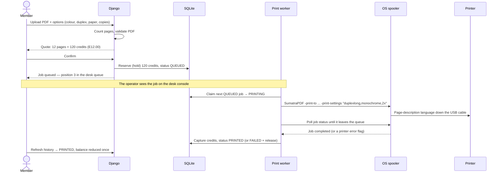
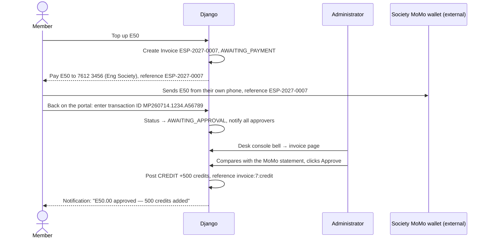
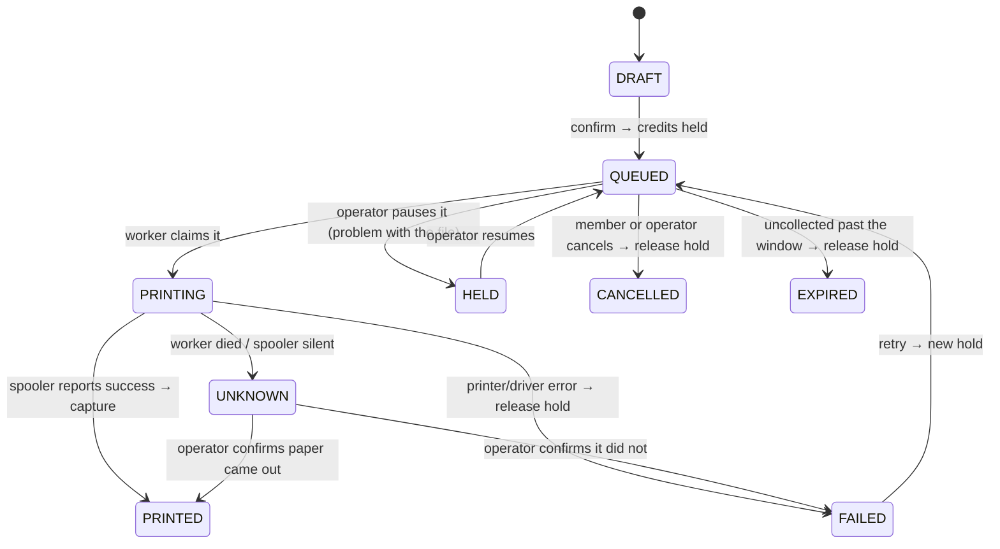
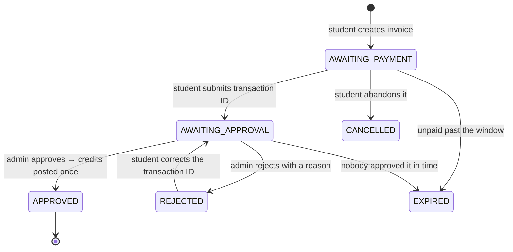
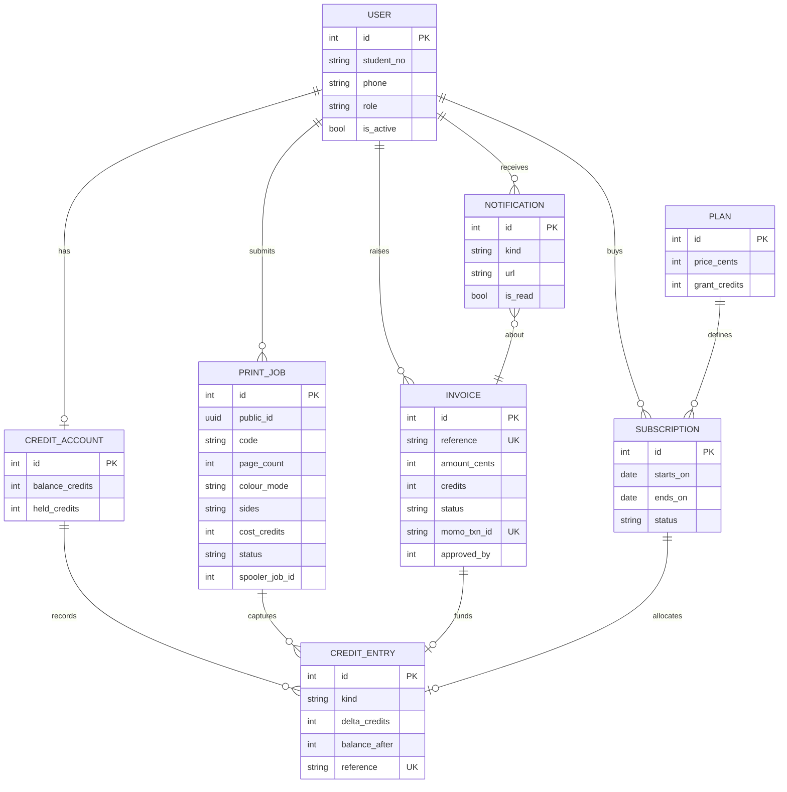

# ESprints — Engineering Society E-Printing Service Management System

**Implementation guide — revision 2: single-machine, post-stable production**
University of Eswatini · BEng (Electrical & Electronic) · Final Year Project 2026/2027
Student: Welile Maphosa · Supervisor: Dr T. Dlamini

---

## How to use this document

This is the build manual for the system described in `docs/Project_Template (1).pdf`,
rewritten for the deployment you are actually going to run: **one desktop computer in
the department building that serves the website, owns the print queue, and is plugged
into the printer by cable.** Students reach it over the department network.

- **Part A (§0–§6)** explains *what* you are building and *why* — read this first.
- **Part B (§7–§16)** is the step-by-step build with code.
- **Part C (§17–§23)** turns the build into report chapters, tests and a demo.

Anything marked **✅ Verify** is a checkpoint. Do not move to the next phase until it
passes — that is how you avoid a broken demo two weeks before submission.

### What changed from revision 1

| Area | Revision 1 | **Revision 2 (this document)** | Why |
|---|---|---|---|
| Payment | MTN MoMo REST API (sandbox + production) | **Manual mobile-money invoice, admin-approved.** No payment API at all | Production MoMo keys are not obtainable for a student project; the money still moves over mobile money, just outside the software |
| Top-up | Polling `requesttopay` | Invoice → pay → enter transaction ID → admin approves → credits land | Same economics, zero external dependency |
| Deployment | Cloud host + agent pulling over HTTPS | **Everything on one department desktop** | You control both ends of the cable, so the network problem disappears |
| Printing | Print agent on a separate host polling the server | **Print worker on the same machine, calling the OS print spooler** | See §0.3 and §12 — this is the real answer to "how does Python print?" |
| Unit of account | Money (integer cents) | **Print credits** (1 credit = 10c) | The report promises "fixed tokens"; credits make the ledger exact and the UI honest |
| Release | 6-digit code typed at the cubicle | **Desk queue** the operator works through (`PRINT_MODE` switch keeps auto-print as an option) | Somebody is standing next to the printer; the operator is the release step |
| Notifications | none | In-app notifications + desk console alert + optional email | Admin must learn that an invoice is waiting |
| Apps | `wallet`, `payments`, `agent_api` | `credits`, `billing`, `notifications` | Names now match what they do |

Everything that was good in revision 1 survives: the ledger invariant, holds instead of
immediate deduction, the pull-free job state machine, the pricing function, the
report mapping and the evaluation chapter.

---

# Part A — What you are building

## 0. Is the idea feasible? — yes, and this version is *easier*

**Verdict: feasible.** Removing the cloud and the payment API removes the two things
that could have sunk the project. What is left is ordinary web engineering on a machine
you can touch, plus one genuinely tricky integration — the printer — which has a
well-trodden answer.

| Objective (from report §1.3) | Difficulty | Verdict | What makes it work |
|---|---|---|---|
| Membership access control | Low | Straightforward | Django auth + roles + subscription check |
| Subscription-credit engine | Medium | Straightforward | Integer-credit ledger with holds |
| Online upload platform | Low | Straightforward | Django forms + PDF page counting |
| Automatic billing | Medium | Straightforward | Deterministic tariff function + tests |
| **Cable-connected printing** | **Medium** | **Solved** | **Hand the PDF + options to the OS print spooler (§12)** |
| Manual top-up + approval | Low | Straightforward | Invoice model + staff approval + idempotent credit |
| Administrative management | Low | Straightforward | Django admin + one dashboard + one desk console |
| Evaluation (accuracy + UAT) | Medium | Straightforward | Tariff matrix + ledger invariant + 50-job run |

### The four caveats (read these before you start)

1. **Python does not "send the file down the cable". The operating system does.**
   This is the single most important sentence in this document, and §0.3 explains it.
   Your code hands a PDF plus options to the *print queue* that Windows (or CUPS) created
   when the printer was installed; the spooler and the driver own the USB port. Trying to
   write bytes to the cable yourself is the one approach that will burn a fortnight.

2. **"The spooler accepted the job" is not "paper came out".** Every printing API on
   Windows and Linux tells you about the hand-off, not the outcome. A jam, an empty tray
   or a powered-off printer happens *after* your call succeeds. Your system must therefore
   separate "submitted" from "printed" and be honest about which one it can prove. §12.3
   gives you the spooler-monitoring routine; §12.7 gives you the policy for the residual
   uncertainty.

3. **There is no payment API, so reconciliation is a human process.** The student pays the
   society's mobile-money number from their own phone, types the transaction ID into the
   portal, and a treasurer compares it with the mobile-money statement before approving.
   That is *not* a hack — it is how most small societies actually operate — but it means
   your design must include the controls that stop one payment being claimed twice
   (§13.6), and your report must say plainly that approval is manual.

4. **"Colour" and "duplex" are requests to a printer driver, not guarantees.** You pass the
   right options and you bill correctly; a printer can ignore them. Say so in your
   limitations and prove what your printer does with a test page (§17.5).

**Time:** roughly 190–250 hours of focused work (10–12 weeks at 20 h/week). It is less
than revision 1 because you are not building an agent, an OAuth client, a webhook and a
cloud deployment.

**Cost:** a UPS and the printer consumables are the real costs. Software is free.

### 0.1 Who does what, in one picture

```
   Student's phone / laptop                Department desktop (the server)
   ───────────────────────                 ──────────────────────────────
   uploads a PDF            ── Wi-Fi ──►   Django, SQLite, private_media/
   sees the price                          print worker (Windows service)
   confirms the job                        print spooler  ── USB cable ──►  printer
   tops up by invoice      ◄─ Wi-Fi ──     desk console for the operator
   reads job history                       Django admin for the treasurer
```

### 0.2 The three questions everyone asks first

| Question | Answer |
|---|---|
| "Do students need internet?" | No. The website is on the department LAN. Only the *student's own phone* needs to be on the same Wi-Fi/LAN to reach it (or the campus network, if you expose it). |
| "Can a student print from anywhere?" | They can *submit* from anywhere on the network. Printing happens at the machine, in queue order, released by the operator. |
| "What if the admin is not there to approve a top-up?" | The student cannot print until approval. Say this in the UI ("top-ups are approved during office hours") and provide an admin override in §13.5 for cash at the desk. |

### 0.3 The printer question, answered properly

You asked: *how do we get Python/Django to send the file and parameters to the printer
via the connected cable?* Here is the whole answer in four paragraphs.

**You do not touch the cable.** When you installed the printer on that desktop, Windows
created a *print queue* (in Windows Settings → Printers & scanners) and bound it to a
*port* (usually `USB001`) and a *driver*. From that moment the operating system owns the
USB conversation: it converts whatever you hand it into the page-description language the
printer understands, then pushes it down the cable. Any program that prints — Word,
Chrome, your Django app — is only ever talking to that queue. So your job is two calls,
not a device driver:

1. **Hand the queue a PDF and the options.** On Windows, one `subprocess.run` of
   SumatraPDF. On Linux/Raspberry Pi, one `subprocess.run` of `lp` (CUPS).
2. **Ask the queue what happened.** Poll the spooler for the job you just submitted.

```python
# Windows — the whole "send to the printer" step
subprocess.run([
    r"C:\Program Files\SumatraPDF\SumatraPDF.exe",
    "-print-to", "HP LaserJet M404",           # exact queue name
    "-print-settings", "duplexlong,monochrome,paper=A4,2x,docname=ESP-000123",
    "-silent", pdf_path,
], check=False, timeout=180)                   # exit code tells you why it failed
```

```python
# Linux / Raspberry Pi (CUPS) — the same step, different tool
subprocess.run([
    "lp", "-d", "HP_LaserJet_M404",
    "-n", "2",                                  # copies
    "-o", "sides=two-sided-long-edge",          # duplex
    "-o", "print-color-mode=monochrome",        # colour off
    "-o", "media=A4",
    "-t", "ESP-000123",                         # spooler job title
    pdf_path,
], check=False, timeout=180)
```

**Why not write to the port directly?** Because a modern printer speaks PCL, PostScript
or a vendor raster language, and a PDF is none of those. Writing PDF bytes to `USB001`
or `LPT1` produces nothing, or a page of garbage. The only devices you can legitimately
drive with raw bytes are ESC/POS receipt printers, which accept text and control codes —
a completely different product. Table 0.1 lists the approaches and their verdicts so you
can put it in Chapter 3 as a design decision.

**Table 0.1 — ways people try to print from Python**

| Approach | Works? | Why |
|---|---|---|
| Write PDF bytes to `USB001` / `LPT1` / a `libusb` endpoint | ❌ | A PDF is not the printer's page-description language; you would be writing a rasteriser |
| `win32print` + `WritePrinter(..., "RAW")` with the PDF | ❌ | Same reason. RAW means "the printer understands these bytes" — PDF is not PCL |
| `win32print` + `WritePrinter(..., "RAW")` with ESC/POS bytes | ✅ | Only for receipt printers (`python-escpos`), not for A4 documents |
| `os.startfile(pdf, "print")` / ShellExecute `print` verb | ⚠️ | Prints, but you cannot set duplex, colour, paper or copies; it is asynchronous and shows dialogs |
| **Hand the PDF to the OS queue with options (SumatraPDF / `lp`)** | ✅ | **Correct. Supported, tested, and gets colour/duplex/paper handling for free** |
| Speak IPP to the printer over the network (`pyipp`, CUPS) | ✅ | Valid if the printer is networked — but from the same machine the local queue is simpler and identical in effect |
| Google Cloud Print | ❌ | Discontinued in 2021 |

So: **the cable is the OS's problem, the options are yours, and the outcome is the
spooler's.** §12 is the full build — installation, exact option mapping, the worker
process, spooler monitoring, the desk console and the failure table.

---

## 1. What the PDF actually requires

### 1.1 The idea in one paragraph

The Engineering Society runs a staffed printing desk inside the department building. A
desktop computer on that desk serves the society's web portal, and is connected by cable
to the printer beside it. Students subscribe to the society for a term; each subscription
converts into a fixed number of **print credits**. A student logs into the portal from
their phone, uploads a PDF, chooses colour/mono, simplex/duplex, paper size and copies,
sees the exact credit cost, and confirms the job — at which point the credits are
*reserved* so they cannot be spent twice. The job appears on the desk queue. The operator
releases it, the system prints it on the attached printer, and only after a successful
print are the reserved credits actually deducted. Students can top up by generating an
invoice, paying the society's mobile-money number from their own phone, entering the
transaction ID, and having an administrator approve it. Everything — pages, credits,
invoices, failures — is recorded in one auditable ledger.

### 1.2 Functional requirements

Use these IDs in your report (Chapter 3, SRS table). They map 1:1 to the pages you build.

| ID | Requirement | Report objective | Phase |
|---|---|---|---|
| FR-01 | Students register with student number + phone; an admin approves the account | Membership | §9 |
| FR-02 | Only a member with an **active subscription** may submit a print job | Membership | §9, §11 |
| FR-03 | Two roles: Member and Administrator (RBAC); approval is a staff permission | Membership | §9 |
| FR-04 | Admin creates plans (price, duration, fixed credits granted) | Subscription-credit | §10 |
| FR-05 | Activating a subscription grants the plan's credits **exactly once** | Subscription-credit | §10 |
| FR-06 | Wallet shows balance, reserved credits and full movement history | Subscription-credit | §10 |
| FR-07 | Member uploads a PDF and sees page count + exact credit cost before confirming | Upload / billing | §11 |
| FR-08 | Confirming a job reserves credits; a depleted wallet blocks printing | Billing | §11 |
| FR-09 | Queued jobs appear in the desk queue in order; the operator can release, hold, cancel or retry | Queue management | §12 |
| FR-10 | The system prints the job on the attached printer with the chosen options | Printing | §12 |
| FR-11 | Credits are captured only after a successful print; failures are released automatically | Billing | §11, §12 |
| FR-12 | Member raises a top-up **invoice** for a chosen amount and receives a payment reference | Credit top-up | §13 |
| FR-13 | Member records the mobile-money **transaction ID** on the invoice and submits it for approval | Credit top-up | §13 |
| FR-14 | Administrators are notified of submitted invoices and can approve or reject them | Credit top-up | §13, §14 |
| FR-15 | Approval credits the wallet exactly once, atomically, and is attributable to the approver | Credit top-up | §13 |
| FR-16 | Member sees job history: queued, printing, printed, failed, cancelled, expired, with reasons | History | §11, §15 |
| FR-17 | Admin sees usage statistics: pages, colour share, credits consumed, revenue, per member | Reporting | §15 |
| FR-18 | The operator can see printer status and print a test page from the console | Operability | §12 |
| FR-19 | Every credit movement, invoice decision and print attempt is logged with who/when/why | Auditability | §10–§13 |
| FR-20 | Jobs, invoices and usage statistics export to CSV | Reporting | §15 |

### 1.3 Non-functional requirements

| ID | Requirement | How it is met |
|---|---|---|
| NFR-01 | Passwords hashed; the portal is not exposed to the internet | Django auth (PBKDF2); bind to LAN, firewall rule |
| NFR-02 | Documents are private — no public URLs, deleted after retention | Files outside `MEDIA_ROOT` web path, served by an authorised view, `purge_jobs` command |
| NFR-03 | No double charge under retries, double clicks or worker restarts | Idempotency references + DB transactions |
| NFR-04 | The credit ledger always reconciles | `sum(entries) == balance` invariant + `check_credits` command |
| NFR-05 | Works on a phone browser | Tailwind responsive templates |
| NFR-06 | A crash or power cut cannot corrupt money or mark a job printed | Atomic transactions + WAL + explicit job states + startup recovery (§12.7) |
| NFR-07 | Response time < 1 s for normal pages | Indexed queries, no N+1 |
| NFR-08 | Printing survives a reboot without human intervention | print worker installed as a Windows service (§18.3) |
| NFR-09 | The system prints with **no internet connection at all** | Everything required is on the machine |
| NFR-10 | Audit trail retained for a full academic year | Append-only ledger + invoice history + nightly backup |

### 1.4 Actors

| Actor | Description | Interface |
|---|---|---|
| Member | Student with an active subscription | Web portal (phone/laptop) |
| Administrator | Society executive; owns plans, members, totals | Web dashboard + Django admin |
| Treasurer | An administrator with the approve-invoices permission | Invoice approval page |
| Desk operator | The admin physically at the department desk | Desk console (queue + printer) |
| Print worker | Windows service on the same machine, running `manage.py run_print_queue` | Local database + OS spooler |
| Society mobile-money wallet | The society's own MoMo number, held by the treasurer | Human: the phone and its statement |
| Printer | Device attached by USB | Owned by the OS print spooler |

### 1.5 What you physically need

**Hardware**

| Item | Minimum | Recommended | Why |
|---|---|---|---|
| Department desktop | Any Windows 10 PC, 8 GB RAM, 256 GB SSD | Small-form-factor i5 with SSD | It runs the site, the database and the print worker |
| Printer | Mono laser, single-sided | **Duplex mono laser** (or a colour inkjet if you want to *prove* colour pricing) | Duplex is the option most likely to be ignored — a duplex-capable printer lets you prove it works |
| Cable | USB 2.0 A–B, ≤ 3 m | Short, powered (no hub) | Long or unpowered USB cables are the usual cause of "it printed nothing" |
| UPS | not optional in Eswatini | 650 VA | A power cut mid-`CREATE TABLE` or mid-print is the one failure that loses money |
| Network | Any Wi-Fi AP in the building | Wired Ethernet + Wi-Fi AP | Students must reach the machine; the desk must stay up |
| Paper / toner | a ream + spare cartridge | + a spare drum | Demos die on supplies |
| Optional | — | A small tablet on the desk showing the console | Looks excellent in the demo video |

**Accounts and pieces of information**

| What | Where | Needed for |
|---|---|---|
| The society's **mobile-money number** and account name | From the society treasurer | Printing on every invoice (§13) |
| Access to that number's **statement / mini-statement** | The treasurer's phone (`*151#`-style menu) | The human side of approval — the treasurer matches transaction IDs |
| A Windows administrator account on the desktop | The department's IT officer | Installing the printer, the service and the firewall rule |
| SumatraPDF | <https://www.sumatrapdfreader.org/download-free-pdf-viewer> | The PDF printing command (§12) |

**No MTN developer account, no API keys, no hosting, no domain, no TLS certificate.**
That is the point of this revision. Write that sentence in your report — the absence of
an external dependency is a result, not a gap.

**Skills you will practise:** Django models/views/templates, transactions and row
locking, PDF page counting and merging, `subprocess` control of an OS print system,
Windows service deployment, Tailwind CSS.

---

## 2. Architecture

### 2.1 The single machine

```
                        Department Wi-Fi / LAN
   ┌──────────────────────────────────────────────────────────────┐
   │                                                              │
   │   Student phone ──HTTP──┐                                    │
   │   Student laptop ──HTTP─┤                                    │
   │   Treasurer's PC ───────┤                                    │
   │                         ▼                                    │
   │   ┌──────────────────────────────────────────────────────┐   │
   │   │        DEPARTMENT DESKTOP  (the whole system)        │   │
   │   │                                                      │   │
   │   │  Waitress  ──►  Django  ──►  SQLite (WAL)            │   │
   │   │                   │            ▲                     │   │
   │   │                   │            │ same DB, same files  │   │
   │   │  private_media/   │            │                     │   │
   │   │                   ▼            │                     │   │
   │   │  Print worker (Windows service) ── manage.py         │   │
   │   │        │                                    run_print_queue
   │   │        ▼                                             │   │
   │   │  Windows print spooler  (USB001)                      │   │
   │   └────────┬─────────────────────────────────────────────┘   │
   │            │ USB cable  (the OS owns this)                   │
   │       ┌────▼─────┐                                           │
   │       │ Printer  │                                           │
   │       └──────────┘                                           │
   └──────────────────────────────────────────────────────────────┘
```

**Why this shape is right for "post-stable production"**

- **One failure domain.** If the site is up, the printer is reachable — they are the same
  machine. Half of revision 1's error handling (agent tokens, NAT, retries over a flaky
  link, `last_seen_at` heartbeats, signed download URLs) simply disappears.
- **The two processes are separate.** The web server must never block on a printer. The
  print worker is its own process, talking to the same database and the same
  `private_media/` folder. No HTTP, no tokens, no serialisation — a genuine simplification.
- **Everything is recoverable.** SQLite + a folder + a nightly copy is a backup strategy a
  student can actually operate. See §18.5.

### 2.2 Why a single machine instead of the cloud + agent design

| Approach | Works? | Why |
|---|---|---|
| Cloud Django, printer driven by a remote agent that polls | ✅ | Revision 1. Correct, but needs hosting, a public HTTPS endpoint, agent tokens, retry logic and two network paths |
| Cloud Django, server pushes to the printer over IPP | ❌ | The server has no route to a USB printer in a cubicle |
| **Departure desktop runs the server *and* the print worker *and* owns the cable** | ✅ | **One machine, one network hop for students, no internet required, no credentials to leak** |
| Raspberry Pi as the machine | ✅ | Same code on Linux/CUPS; see §12.4. Nice option if the department cannot spare a PC |

Present table 2.2 in Chapter 3. The engineering judgement it demonstrates is *narrowing
the system boundary so the hard external dependency disappears*.

### 2.3 The print pipeline in detail

This is the figure that answers the printer question. Each layer has an owner and a
contract; your code only appears in the first row.

| # | Layer | Owns | What your code does |
|---|---|---|---|
| 1 | **Django + print worker** | The decision: *which* file, *what* options, *when* | Writes `PrintJob` rows, calls the backend |
| 2 | **Print backend** (`printing/backends.py`) | Turning a `PrintJob` into a command line | `subprocess.run([...])` — nothing more |
| 3 | **OS print spooler** (`spoolsv.exe` / CUPS) | The queue, ordering, the USB port, retries | Polls it to learn the outcome |
| 4 | **Printer driver** | Translating PDF pages into the printer's page-description language | Nothing — but you must pass options it supports |
| 5 | **Printer firmware** | Toner, paper, duplex mechanism | Nothing. It can ignore you |

**The contract at layer 2/3 is a process exit code.** `0` means "the spooler accepted the
document". It does not mean the page was printed. Everything else in §12.3 and §12.7 exists
to narrow that gap.

### 2.4 Flow 1 — upload, queue, print, charge



### 2.5 Flow 2 — top-up by invoice



### 2.6 Flow 3 — job state machine



`UNKNOWN` is the state that makes this design honest. It exists because the spooler
cannot prove paper. Only `PRINTED` moves credits permanently; every other terminal state
releases the hold.

### 2.7 Flow 4 — invoice state machine



`APPROVED` is terminal and idempotent. Double-clicking Approve, two admins approving at
once, or a page refresh after approval all produce exactly one ledger entry — because the
credit reference is `invoice:<id>:credit` and it is unique.

---

## 3. Stack and versions

| Layer | Choice | Version | Why |
|---|---|---|---|
| Language | Python | 3.12+ | You have 3.14.2 installed |
| Framework | Django | **6.1.x** (5.2 LTS also fine) | Batteries included: auth, admin, ORM, CSRF |
| Database | **SQLite in WAL mode** | built in | Single machine, no network filesystem, trivially backed up. §10.5 covers the honest limitations |
| WSGI server | **Waitress** | 3.x | Pure Python, **works on Windows** (gunicorn does not) |
| Styling | Tailwind CSS CLI | 4.3.5 | Latest v4; no Node at runtime |
| Templates | Django templates | built in | No React/Vue build chain |
| PDF | `pypdf` | 6.x | Page count, encryption check, cover-slip merge |
| Cover slip / test page | `reportlab` | 4.x | Generating the job ticket PDF (§12.8) |
| Printing (Windows) | **SumatraPDF CLI** | 3.5+ | Prints PDFs with every option, documented exit codes |
| Printing (Linux) | **CUPS `lp`** | system | The standard spooler interface |
| Spooler monitoring (Windows) | `pywin32` (`win32print`) | 306+ | `EnumJobs`, `GetPrinter` status flags |
| Config | `python-dotenv` | 1.x | `.env` outside git |
| Static files | WhiteNoise | 6.8+ | Serve CSS/JS without IIS |
| Service wrapper | NSSM | 2.24 | Run Waitress + the worker as Windows services |
| CSV/reporting | Python standard library | — | No extra dependency |

> **Django version note.** `Django==6.1.3` is current and requires Python ≥ 3.12.
> Everything here also works on 5.2 LTS (supported to April 2028) if the department PC
> runs an older Python. Pin one and do not upgrade mid-project.

**Deliberately not used:** Celery/Redis (the print worker *is* your queue), DRF (no public
JSON API is needed — the worker uses the ORM directly), django-allauth, any JS framework,
any payment SDK. Fewer moving parts = a demo that works.

**requirements.txt**

```
Django>=6.1,<6.2
pypdf>=6,<7
reportlab>=4,<5
requests>=2.32
python-dotenv>=1.0
whitenoise>=6.8
waitress>=3.0
pywin32>=306; sys_platform == "win32"
```

`requests` survives only for the optional email notification and nothing else; if you skip
that, drop it.

---

## 4. Project layout

```
printer/
├─ manage.py
├─ requirements.txt
├─ package.json                  # Tailwind only
├─ .env                          # never committed
├─ .env.example
├─ config/
│  ├─ settings.py
│  ├─ urls.py
│  └─ wsgi.py / asgi.py
├─ apps/
│  ├─ core/                      # shared base model, formatting, health
│  ├─ accounts/                  # User, roles, approval, permissions
│  ├─ subscriptions/             # plans, membership periods, credit grant
│  ├─ credits/                   # CreditAccount, CreditEntry, holds  ← the only money code
│  ├─ printing/                  # jobs, tariff, backends, worker, desk console
│  ├─ billing/                   # invoices, payment proof, approval
│  ├─ notifications/             # in-app notifications + email hook
│  └─ reports/                   # dashboard, usage stats, CSV exports
├─ templates/
│  ├─ base.html
│  ├─ partials/                  # nav, notification bell, job status badge
│  └─ <app>/*.html
├─ static/
│  ├─ src/input.css
│  ├─ css/app.css                # built, committed
│  └─ img/
├─ private_media/
│  ├─ jobs/                      # uploaded PDFs
│  └─ invoices/                  # payment proof screenshots
├─ tools/
│  ├─ install_service.ps1        # NSSM: web + worker
│  └─ printer_probe.py           # one-off diagnostics (§22)
└─ docs/
   └─ Project_Template (1).pdf
```

| App | Responsibility | Must not do |
|---|---|---|
| `core` | `TimeStampedModel`, credit formatting, health check | Know about printing |
| `accounts` | Identity, roles, approval, permissions | Touch credits |
| `subscriptions` | Plans and periods | Change balances directly |
| `credits` | **The only place credits change** | Know about printing or invoices |
| `printing` | Jobs, tariff, queue, printer backends, worker | Write ledger rows itself — it calls `credits` |
| `billing` | Invoices and approval workflow | Credit wallets directly — it calls `credits` |
| `notifications` | Notify and read notifications | Contain business rules |
| `reports` | Read-only aggregates and exports | Mutate anything |

That table is a good figure for Chapter 3 ("module decomposition"). The rule that makes it
work: **`credits/services.py` is the only module that writes `balance_credits`.** Every
other app imports a function from it.

---

## 5. Data model

### 5.1 The unit of account — decide this first

You are billing in **print credits**, not money.

- `1 credit = E0.10`. So a mono A4 single side costs **10 credits** (E1.00).
- A student who tops up E50.00 gets **500 credits**.
- Money (Lilangeni, stored as integer cents) appears in exactly two places: **plan prices**
  and **invoices**. After an invoice is approved, it becomes credits and disappears from
  the print side of the system.

Why this is better than billing in cents:

| Reason | Detail |
|---|---|
| The report asks for "fixed tokens" | A plan grants a *number of pages*, which is what students understand |
| Rounding | Tariffs are whole numbers, so duplex discounts never create fractions (§6.1) |
| Two separate questions | "How much money did we take?" is invoicing. "How many pages did we sell?" is credits. Mixing them makes both harder |
| Fraud surface | A credit has no exchange value outside the system, so a compromised account cannot be drained for cash |

`config/settings.py` holds `CREDITS_PER_RAND = 10`. Formatting helpers live in
`apps/core/credits_fmt.py` (§8.4). Never store a credit as a float.

### 5.2 ERD



### 5.3 Rules that must not be broken

1. **Credits are integers.** `PositiveIntegerField` for balances, `IntegerField` for signed
   deltas. No floats anywhere in the money/credit path.
2. **One balance, one ledger.** `balance_credits` is a cache; `CreditEntry` is the truth.
   Invariant: `sum(entry.delta_credits) == account.balance_credits`.
3. **Holds are not entries.** `held_credits` is a reservation counter, not a movement. That
   keeps the invariant simple and provable in one command.
4. **Every mutation has an idempotency key** — a unique `reference` such as
   `job:42:capture`, `invoice:7:credit`, `sub:3:allocation`. Re-running it does nothing.
5. **All mutations run inside `transaction.atomic()`.**
6. **Money and credits never share a field.** `Invoice.amount_cents` and
   `Invoice.credits` are both stored, and the conversion rate is snapshotted on the invoice.

### 5.4 Field reference

**accounts.User** (extends `AbstractUser`)

| Field | Type | Notes |
|---|---|---|
| `student_no` | CharField(20) unique | Login identifier, e.g. `202202881` |
| `phone` | CharField(16) | E.164, `+26876123456` — the number they will pay *from* |
| `role` | CharField choices | `MEMBER`, `ADMIN` |
| `is_active` | bool | `False` until an admin approves |
| `approved_at`, `approved_by` | DateTime / FK | Audit |

**subscriptions.Plan**

| Field | Type | Notes |
|---|---|---|
| `name` | CharField(60) | "Standard semester" |
| `price_cents` | PositiveInt | E150.00 = 15000 |
| `duration_days` | PositiveSmallInt | 120 |
| `grant_credits` | PositiveInt | **Fixed** credits granted on activation. 1000 credits = E100 of printing |
| `is_active` | bool | Hide retired plans |

> Revision 1 computed credits as a *percentage* of the price. You asked for **fixed
> tokens**, and fixed is better: you decide the grant in whole pages, and you can change
> the plan price without changing how many pages students get.

**subscriptions.Subscription**

| Field | Type | Notes |
|---|---|---|
| `member` | FK User | |
| `plan` | FK Plan | `PROTECT` — never delete a plan with history |
| `starts_on`, `ends_on` | Date | Active if `starts_on <= today <= ends_on` |
| `status` | choices | `ACTIVE`, `EXPIRED`, `CANCELLED` |
| `grants_credits` | PositiveInt | Snapshot of `plan.grant_credits` at activation |

**credits.CreditAccount**

| Field | Type | Notes |
|---|---|---|
| `member` | OneToOne User | |
| `balance_credits` | PositiveInt | Settled credits |
| `held_credits` | PositiveInt | Reserved by queued jobs |

**credits.CreditEntry**

| Field | Type | Notes |
|---|---|---|
| `account` | FK | |
| `kind` | choices | `ALLOCATION`, `TOPUP`, `CAPTURE`, `REFUND`, `ADJUSTMENT`, `REVERSAL` |
| `delta_credits` | Integer (signed) | Positive credit, negative debit |
| `balance_after` | PositiveInt | Snapshot for statements |
| `reference` | CharField(80) unique | **The idempotency key** |
| `memo` | CharField(200) | Human-readable |
| `job`, `invoice`, `subscription` | FK null | Traceability |
| `created_by` | FK null | Who caused it (admin actions) |

**printing.PrintJob**

| Field | Type | Notes |
|---|---|---|
| `public_id` | UUID | Used in URLs, never the PK |
| `code` | CharField(12) unique | Human code, e.g. `ESP-000123`; also the spooler `docname` |
| `member` | FK User | |
| `document` | FileField | `private_media/jobs/<member>/<uuid>.pdf` |
| `original_name` | CharField(200) | Display only |
| `page_count` | PositiveInt | Counted server-side |
| `colour_mode` | choices | `MONO`, `COLOUR` |
| `sides` | choices | `SIMPLEX`, `DUPLEX` |
| `paper` | choices | `A4`, `A3` |
| `copies` | PositiveSmallInt | 1–20 |
| `cost_credits` | PositiveInt | Snapshot of the quote |
| `tariff_snapshot` | JSON | Rates used, so old bills never change |
| `status` | choices | §2.6 |
| `hold_credits` | PositiveInt | Amount currently reserved |
| `spooler_job_id` | Integer null | Windows job id, for monitoring |
| `spooler_name` | CharField(80) | Queue used, so a printer swap is traceable |
| `attempts` | PositiveSmallInt | Auto-retry budget |
| `claimed_at`, `printed_at`, `failed_at` | DateTime null | Timing metrics |
| `printed_pages` | PositiveInt null | What the spooler reported |
| `failure_reason` | Text | Support + report |

**billing.Invoice**

| Field | Type | Notes |
|---|---|---|
| `reference` | CharField(20) unique | `ESP-2027-0007`. **The student puts this in the MoMo reference box** |
| `member` | FK | |
| `amount_cents` | PositiveInt | Immutable after creation |
| `credits` | PositiveInt | `amount_cents × CREDITS_PER_RAND // 100`, snapshotted |
| `rate_credits_per_rand` | PositiveSmallInt | Snapshot of the conversion rate |
| `status` | choices | §2.7 |
| `momo_txn_id` | CharField(40) null, **unique** | Normalised, uppercase, no spaces — the anti-duplicate control |
| `payer_phone` | CharField(16) | The number that paid; may differ from the profile |
| `proof_file` | FileField null | Optional screenshot / PDF of the confirmation SMS |
| `submitted_at` | DateTime null | |
| `decided_at`, `decided_by` | DateTime / FK null | |
| `rejection_reason` | CharField(200) | Shown to the student |
| `attempts` | PositiveSmallInt | How many times the student submitted |
| `expires_at` | DateTime | `INVOICE_TTL_HOURS` after creation |

**notifications.Notification**

| Field | Type | Notes |
|---|---|---|
| `recipient` | FK User | |
| `kind` | choices | `INVOICE_SUBMITTED`, `INVOICE_DECIDED`, `JOB_FAILED`, `PRINTER_ERROR`, `LOW_CREDITS` |
| `title`, `body` | CharField / Text | |
| `url` | CharField(300) | Where clicking takes them — this is the "redirect to admin portal" |
| `is_read`, `read_at` | bool / DateTime | |
| `invoice`, `job` | FK null | Traceability |

### 5.5 Worked ledger example

A student activates a 500-credit plan, then submits a 12-page mono job (120 credits),
which jams, is retried, and prints.

| Step | Action | `balance_credits` | `held_credits` | Ledger row |
|---|---|---|---|---|
| 1 | Subscription activated | 500 | 0 | `ALLOCATION +500` |
| 2 | Confirm job (hold) | 500 | 120 | — (hold only) |
| 3 | Print fails (jam) → release | 500 | 0 | — (hold released, no row) |
| 4 | Retry (new hold) | 500 | 120 | — |
| 5 | Print succeeds (capture) | 380 | 0 | `CAPTURE −120` |
| 6 | Top-up invoice E20 approved | 580 | 0 | `TOPUP +200` |

Available credit is always `balance_credits − held_credits`. At step 2 the student sees
"380 credits available" and cannot queue another 400-credit job.

---

## 6. Business rules

### 6.1 The tariff

Configuration is a singleton `Tariff` (editable in Django admin, versioned by
`effective_from`) so prices change without code:

| Setting | Default | Meaning |
|---|---|---|
| `mono_a4_credits` | 10 | One A4 mono **side** (E1.00) |
| `colour_a4_credits` | 40 | One A4 colour **side** (E4.00) |
| `a3_multiplier_percent` | 200 | A3 side costs double |
| `duplex_discount_percent` | 10 | Paper saving passed on, applied **per side** |
| `minimum_charge_credits` | 10 | Never bill less than one mono page |

```
sides  = page_count × copies
rate   = (colour ? colour_a4 : mono_a4) × (paper == A3 ? a3_percent : 100) // 100
if duplex:
    rate = rate × (100 − duplex_discount) // 100      # per side, so it stays an integer
total  = max(sides × rate, minimum_charge)
```

Two deliberate decisions:

- **The discount is applied to the per-side rate, not to the total.** `10 × 90 // 100 = 9`,
  exactly. Applying 10% to the total would produce fractions (5.4 credits) that you would
  then have to round — and rounding is where billing accuracy claims go to die.
- **The quote is stored on the job** (`cost_credits` + `tariff_snapshot`) *before* the hold
  is placed. If the admin changes the tariff tomorrow, yesterday's jobs still reconcile.

**Worked examples** (these are also the rows of the billing matrix in §17.6)

| Job | Calculation | Credits | In E |
|---|---|---|---|
| 1 page, mono, simplex, A4 | 1 × 10 | 10 | E1.00 |
| 12 pages, mono, simplex, A4 | 12 × 10 | 120 | E12.00 |
| 12 pages, colour, duplex, A4 | 12 × (40×0.9 = 36) | 432 | E43.20 |
| 3 pages, mono, simplex, A3, 2 copies | 6 × 20 | 120 | E12.00 |
| 50 pages, colour, simplex, A4 | 50 × 40 | 2000 | E200.00 |
| 2 pages, mono, duplex, A4, 3 copies | 6 × 9 | 54 | E5.40 |
| 200 pages, mono, duplex, A4 | 200 × 9 | 1800 | E180.00 |
| 9 pages, colour, duplex, A3 | 9 × (80×0.9 = 72) | 648 | E64.80 |

Every number is exact. That is the whole reason for the per-side discount.

### 6.2 Subscription → credits

```
credits_granted = plan.grant_credits        # fixed, not a percentage
```

Activation runs once per subscription with reference `sub:<id>:allocation`, so an admin
double-clicking "Activate" cannot double-credit.

Default plan: **E150.00 per semester, granting 1000 credits** (E100 of printing, i.e. 100
mono pages). The remaining E50 is the society's operating margin — state that in your
report; it is the honest economics of the service.

### 6.3 Invoice rules

| Rule | Enforcement |
|---|---|
| Minimum top-up E5.00, maximum E500.00 | Form validation + settings |
| The amount cannot change after the invoice is created | Model raises on update of `amount_cents` |
| One transaction ID can only be used once, ever | `momo_txn_id` `unique=True` (nullable, so unpaid invoices do not collide) |
| Approval is idempotent | `credit` reference `invoice:<id>:credit` + `select_for_update` |
| The approver is recorded | `decided_by`, and `CreditEntry.created_by` |
| A rejected invoice can be corrected and resubmitted | `attempts` counter; the old transaction ID is released so a *correct* one can be entered |
| Unpaid invoices expire | `expires_at` + `expire_invoices` command |
| Credits granted = `amount_cents × 10 // 100` | Snapshotted on the invoice at creation |

### 6.4 Guarantees your report can claim

| ID | Guarantee | How it is enforced |
|---|---|---|
| G1 | A balance never goes negative | Service check + `PositiveIntegerField` |
| G2 | Nothing prints without sufficient available credit | Hold placed before `QUEUED` |
| G3 | No double charge | Unique `reference` per ledger row |
| G4 | No charge for failed, cancelled or expired jobs | Only `PRINTED` triggers capture |
| G5 | The ledger reconciles | `manage.py check_credits` |
| G6 | One mobile-money payment cannot be claimed twice | `momo_txn_id` unique across all invoices |
| G7 | Credits are only granted by an identified administrator | `decided_by` + `created_by` |
| G8 | Every job is traceable to a member, a price, a printer queue and a time | FKs + `spooler_name` + timestamps |
| G9 | A leaked document URL is useless | Files under `private_media/`, served only by an authorised view |
| G10 | A power cut cannot silently lose money | Atomic transactions, WAL, explicit job states, startup recovery |

---

# Part B — Step-by-step build

## 7. Phase 0 — machine setup (≈3 hours)

### 7.1 Install the printer first (before any code)

Do this on the department desktop while you still have the packaging. Half of the
"Python can't print" problem is a printer that was never installed properly.

1. Connect the printer by USB and switch it on.
2. **Windows Settings → Bluetooth & devices → Printers & scanners → Add device.** Let
   Windows find it, or choose "Add manually → Add a printer using an IP address" if it is
   networked.
3. Install the **manufacturer's driver** if Windows only installed a generic one. Generic
   drivers often refuse duplex or colour options.
4. Note the **exact queue name** — it is case-sensitive in the commands you are about to
   write. `HP LaserJet M404` is not `HP LaserJet M404 (Copy 1)`.
5. Print the Windows test page (Printer properties → Print Test Page) and confirm paper
   actually comes out. Do not build software against an unproven printer.
6. **Install it for all users**, so the service account can see it:

```powershell
# Confirm what Windows thinks is installed
Get-Printer | Format-Table Name, DriverName, PortName, PrinterStatus -AutoSize

# Install for every user on the machine (needed when a service prints)
rundll32 printui.dll,PrintUIEntry /ga /n "HP LaserJet M404"
Restart-Service Spooler
```

7. **Disable USB power saving**, which is the number one cause of "it printed nothing":

```powershell
# Tell Windows never to power down any USB hub / root port
Get-WmiObject -Class MSPower_DeviceEnable -Namespace root\wmi |
  Where-Object { $_.InstanceName -match 'USB' } |
  ForEach-Object { $_.Enable = $false; $_.Put() | Out-Null }
```

Also turn off *Device Manager → USB Root Hub → Properties → Power Management → "Allow the
computer to turn off this device to save power"*, and set the printer's own sleep timer to
never (or 60 minutes).

### 7.2 Find the exact printer name and its supported paper/tray names

SumatraPDF ships a listing command that tells you precisely which strings the driver
accepts. Run it and keep the output — you will paste values from it into `.env`:

```powershell
& "C:\Program Files\SumatraPDF\SumatraPDF.exe" -list-printers -console
```

You will see each queue, its default settings, and the paper sizes and trays it reports.
If `paper=A4` has no effect later, this is where the correct string (`A4 210 x 297 mm`,
`paperkind=9`) comes from.

### 7.3 Create the project folder and virtual environment

```powershell
# from C:\Users\BlueDreams\Documents\Final Years 2026\printer
py -m venv .venv
.\.venv\Scripts\Activate.ps1
```

If PowerShell blocks activation:

```powershell
Set-ExecutionPolicy -Scope CurrentUser RemoteSigned
# or, for this shell only:
cmd /c ".venv\Scripts\activate.bat"
```

> **Windows note (you will hit this):** `npm` is blocked by execution policy on this
> machine. Always call `npm.cmd` or run `cmd /c "npm ..."`.

### 7.4 Install dependencies

```powershell
py -m pip install --upgrade pip
py -m pip install "Django>=6.1,<6.2" "pypdf>=6,<7" "reportlab>=4,<5" "requests>=2.32" "python-dotenv>=1.0" "whitenoise>=6.8" "waitress>=3.0"
py -m pip install pywin32          # Windows only: spooler monitoring
py -m pip freeze > requirements.txt
```

Also install **SumatraPDF** (free) from <https://www.sumatrapdfreader.org/download-free-pdf-viewer>.
The portable `.exe` is fine — put it somewhere permanent such as
`C:\Tools\SumatraPDF\SumatraPDF.exe` and record that path in `.env`.

> **Why SumatraPDF and not Adobe Reader?** Adobe's `/t` switch prints, but it cannot set
> duplex, colour, paper or copies, it needs a licence, and it pops dialogs. SumatraPDF is
> a single 10 MB executable with a documented, complete command line and documented exit
> codes. Its own documentation is the reference you cite in Chapter 2.

### 7.5 Node + Tailwind CLI

Node 24 is already installed. Install the local toolchain:

```powershell
npm.cmd init -y
npm.cmd install -D tailwindcss@4.3.5 @tailwindcss/cli@4.3.5
```

### 7.6 Create the Django project

```powershell
py -m django startproject config .
mkdir apps
"# apps package" | Out-File apps\__init__.py -Encoding utf8
```

### 7.7 Create the apps inside `apps/`

`startapp` requires the destination folder to exist, so create all folders first:

```powershell
foreach ($a in "core","accounts","subscriptions","credits","printing","billing","notifications","reports") {
    New-Item -ItemType Directory -Force "apps\$a" | Out-Null
    py manage.py startapp $a "apps\$a"
}
```

Then in each `apps\<name>\apps.py`, change `name = "<name>"` to `name = "apps.<name>"`.

### 7.8 `.env` and `.gitignore`

`.env` — this is the production shape, not the dev shape:

```ini
# --- core ---
DJANGO_SECRET_KEY=change-me-to-50-random-characters
DJANGO_DEBUG=0
DJANGO_ALLOWED_HOSTS=127.0.0.1,localhost,192.168.1.50,esprints.local
SITE_URL=http://192.168.1.50:8000
USE_HTTPS=0

# --- printing ---
PRINT_BACKEND=windows              # windows | cups | fake
PRINTER_NAME=HP LaserJet M404
SUMATRA_PATH=C:\Tools\SumatraPDF\SumatraPDF.exe
PRINT_MODE=DESK                    # DESK (operator releases) | AUTO (print on confirm)
PRINT_POLL_SECONDS=2
PRINT_TIMEOUT_SECONDS=300

# --- money / credits ---
CREDITS_PER_RAND=10
TOPUP_MIN_CENTS=500
TOPUP_MAX_CENTS=50000
INVOICE_TTL_HOURS=48
JOB_EXPIRY_HOURS=24

# --- the society's mobile-money details shown on every invoice ---
SOCIETY_MOMO_NUMBER=+268 7612 3456
SOCIETY_MOMO_NAME=Engineering Society (UNESWA)
SOCIETY_EMAIL=engineering.society@uneswa.ac.sia

# --- optional: email notifications (leave EMAIL_BACKEND as console to skip) ---
EMAIL_BACKEND=django.core.mail.backends.console.EmailBackend
EMAIL_HOST=
EMAIL_HOST_USER=
EMAIL_HOST_PASSWORD=
EMAIL_PORT=587
ADMIN_EMAILS=
```

`.gitignore`:

```
.venv/
__pycache__/
*.pyc
.env
db.sqlite3
db.sqlite3-wal
db.sqlite3-shm
private_media/
logs/
node_modules/
```

Commit `static/css/app.css` (the built stylesheet) so the site works even if a marker
clones without Node. Commit a `.env.example` with the keys and empty values: it doubles as
your deployment checklist.

**✅ Verify**

```powershell
py manage.py runserver
```

Open <http://127.0.0.1:8000> — the Django rocket page must appear. If not, stop and fix
this before anything else.

---

## 8. Phase 1 — settings, URLs and the base shell (≈3 hours)

### 8.1 `config/settings.py`

The important differences from a tutorial project are marked **← production**.

```python
from pathlib import Path
import os
from django.core.exceptions import ImproperlyConfigured
from dotenv import load_dotenv

BASE_DIR = Path(__file__).resolve().parent.parent
load_dotenv(BASE_DIR / ".env")

DEBUG = os.environ.get("DJANGO_DEBUG", "1") == "1"

SECRET_KEY = os.environ.get("DJANGO_SECRET_KEY", "")
if not SECRET_KEY:
    if DEBUG:
        SECRET_KEY = "dev-only-insecure-key"
    else:                                   # ← production: refuse to boot with a default
        raise ImproperlyConfigured("DJANGO_SECRET_KEY must be set when DJANGO_DEBUG=0")

ALLOWED_HOSTS = [h.strip() for h in os.environ.get(
    "DJANGO_ALLOWED_HOSTS", "127.0.0.1,localhost").split(",") if h.strip()]

SITE_URL = os.environ.get("SITE_URL", "http://127.0.0.1:8000")
USE_HTTPS = os.environ.get("USE_HTTPS", "0") == "1"     # ← LAN installs run plain HTTP
CSRF_TRUSTED_ORIGINS = [SITE_URL]

INSTALLED_APPS = [
    "django.contrib.admin",
    "django.contrib.auth",
    "django.contrib.contenttypes",
    "django.contrib.sessions",
    "django.contrib.messages",
    "django.contrib.staticfiles",
    "django.contrib.humanize",
    "apps.core",
    "apps.accounts",
    "apps.subscriptions",
    "apps.credits",
    "apps.printing",
    "apps.billing",
    "apps.notifications",
    "apps.reports",
]

MIDDLEWARE = [
    "django.middleware.security.SecurityMiddleware",
    "whitenoise.middleware.WhiteNoiseMiddleware",
    "django.contrib.sessions.middleware.SessionMiddleware",
    "django.middleware.common.CommonMiddleware",
    "django.middleware.csrf.CsrfViewMiddleware",
    "django.contrib.auth.middleware.AuthenticationMiddleware",
    "django.contrib.auth.middleware.LoginRequiredMiddleware",   # members-only by default
    "django.contrib.messages.middleware.MessageMiddleware",
    "django.middleware.clickjacking.XFrameOptionsMiddleware",
]

ROOT_URLCONF = "config.urls"

TEMPLATES = [{
    "BACKEND": "django.template.backends.django.DjangoTemplates",
    "DIRS": [BASE_DIR / "templates"],
    "APP_DIRS": True,
    "OPTIONS": {"context_processors": [
        "django.template.context_processors.request",
        "django.contrib.auth.context_processors.auth",
        "django.contrib.messages.context_processors.messages",
        "apps.notifications.context.notification_counts",        # bell badge on every page
    ]},
}]

WSGI_APPLICATION = "config.wsgi.application"

DATABASES = {"default": {
    "ENGINE": "django.db.backends.sqlite3",
    "NAME": BASE_DIR / "db.sqlite3",
    "OPTIONS": {
        # ← production: WAL lets the web server read while the print worker writes.
        #   Without it, a long print transaction blocks every page load.
        "init_command": "PRAGMA journal_mode=WAL; PRAGMA synchronous=FULL;"
                        "PRAGMA busy_timeout=20000;",
        "transaction_mode": "IMMEDIATE",     # ← take the write lock up front
    },
}}

AUTH_USER_MODEL = "accounts.User"

LOGIN_URL = "accounts:login"
LOGIN_REDIRECT_URL = "printing:job_list"
LOGOUT_REDIRECT_URL = "accounts:login"

STATIC_URL = "static/"
STATICFILES_DIRS = [BASE_DIR / "static"]
STATIC_ROOT = BASE_DIR / "staticfiles"

STORAGES = {
    "default": {"BACKEND": "django.core.files.storage.FileSystemStorage"},
    "staticfiles": {"BACKEND": "django.contrib.staticfiles.storage.StaticFilesStorage"},
}
if not DEBUG:
    STORAGES["staticfiles"]["BACKEND"] = "whitenoise.storage.CompressedManifestStaticFilesStorage"

# Uploaded documents must NEVER be publicly served:
# MEDIA_ROOT is outside the web root and MEDIA_URL is deliberately not routed in urls.py.
MEDIA_ROOT = BASE_DIR / "private_media"
MEDIA_URL = "/media/"

TIME_ZONE = "Africa/Mbabane"
USE_TZ = True
LANGUAGE_CODE = "en"
DEFAULT_AUTO_FIELD = "django.db.models.BigAutoField"

# --- credits / business config ------------------------------------------------
CREDITS_PER_RAND = int(os.environ.get("CREDITS_PER_RAND", "10"))
TOPUP_MIN_CENTS = int(os.environ.get("TOPUP_MIN_CENTS", "500"))
TOPUP_MAX_CENTS = int(os.environ.get("TOPUP_MAX_CENTS", "50000"))
INVOICE_TTL_HOURS = int(os.environ.get("INVOICE_TTL_HOURS", "48"))
JOB_EXPIRY_HOURS = int(os.environ.get("JOB_EXPIRY_HOURS", "24"))
JOB_FILE_RETENTION_DAYS = 30        # purge_jobs deletes the PDF, keeps the record
LOW_CREDITS_THRESHOLD = 20          # warn the member at the tariff page

# --- the society's mobile-money details (shown on every invoice) -------------
SOCIETY_MOMO_NUMBER = os.environ.get("SOCIETY_MOMO_NUMBER", "")
SOCIETY_MOMO_NAME = os.environ.get("SOCIETY_MOMO_NAME", "Engineering Society")
SOCIETY_EMAIL = os.environ.get("SOCIETY_EMAIL", "")

# --- printing -----------------------------------------------------------------
PRINT_BACKEND = os.environ.get("PRINT_BACKEND", "windows")
PRINTER_NAME = os.environ.get("PRINTER_NAME", "")
SUMATRA_PATH = os.environ.get("SUMATRA_PATH", r"C:\Program Files\SumatraPDF\SumatraPDF.exe")
PRINT_MODE = os.environ.get("PRINT_MODE", "DESK")     # DESK | AUTO
PRINT_POLL_SECONDS = float(os.environ.get("PRINT_POLL_SECONDS", "2"))
PRINT_TIMEOUT_SECONDS = int(os.environ.get("PRINT_TIMEOUT_SECONDS", "300"))

# --- notifications ------------------------------------------------------------
EMAIL_BACKEND = os.environ.get("EMAIL_BACKEND",
                               "django.core.mail.backends.console.EmailBackend")
EMAIL_HOST = os.environ.get("EMAIL_HOST", "")
EMAIL_HOST_USER = os.environ.get("EMAIL_HOST_USER", "")
EMAIL_HOST_PASSWORD = os.environ.get("EMAIL_HOST_PASSWORD", "")
EMAIL_PORT = int(os.environ.get("EMAIL_PORT", "587"))
EMAIL_USE_TLS = True
DEFAULT_FROM_EMAIL = SOCIETY_EMAIL or "esprints@localhost"
ADMIN_EMAILS = [e.strip() for e in os.environ.get("ADMIN_EMAILS", "").split(",") if e.strip()]

# --- logging: you will need this file the first time a print silently fails ---
LOGS_DIR = BASE_DIR / "logs"
LOGS_DIR.mkdir(exist_ok=True)
LOGGING = {
    "version": 1,
    "disable_existing_loggers": False,
    "formatters": {"plain": {"format": "{asctime} {levelname} {name}: {message}",
                             "style": "{"}},
    "handlers": {
        "file": {"class": "logging.handlers.RotatingFileHandler",
                 "filename": LOGS_DIR / "esprints.log", "maxBytes": 5_000_000,
                 "backupCount": 5, "formatter": "plain"},
        "console": {"class": "logging.StreamHandler", "formatter": "plain"},
    },
    "root": {"handlers": ["file", "console"], "level": "INFO"},
    "loggers": {"apps": {"handlers": ["file", "console"], "level": "INFO",
                         "propagate": False}},
}

if USE_HTTPS:                               # ← only when you actually terminate TLS
    SECURE_SSL_REDIRECT = True
    SESSION_COOKIE_SECURE = True
    CSRF_COOKIE_SECURE = True
    SECURE_HSTS_SECONDS = 31536000
    SECURE_PROXY_SSL_HEADER = ("HTTP_X_FORWARDED_PROTO", "https")
else:
    # Plain HTTP inside the building. Setting the secure-cookie flags here would make
    # login silently fail — a two-hour bug you do not want.
    SECURE_SSL_REDIRECT = False
    SESSION_COOKIE_SECURE = False
    CSRF_COOKIE_SECURE = False
```

> **Why `LoginRequiredMiddleware`.** It makes **every** view members-only by default.
> Public views (login, signup, health) opt out with `@login_not_required`. That is a
> one-line implementation of "members only", and the admin login view is exempt so
> `/admin/` still works.

> **Why `transaction_mode: IMMEDIATE`.** SQLite has one writer. `IMMEDIATE` takes the write
> lock when the transaction starts, so two concurrent confirmations fail fast and retry
> instead of deadlocking halfway through. §10.5 is honest about what this can and cannot
> prove.

### 8.2 `config/urls.py`

```python
from django.contrib import admin
from django.urls import include, path
from apps.core import views as core_views

urlpatterns = [
    path("admin/", admin.site.urls),
    path("health/", core_views.health, name="health"),
    path("", include("apps.accounts.urls")),
    path("", include("apps.printing.urls")),
    path("subscriptions/", include("apps.subscriptions.urls")),
    path("credits/", include("apps.credits.urls")),
    path("billing/", include("apps.billing.urls")),
    path("notifications/", include("apps.notifications.urls")),
    path("dashboard/", include("apps.reports.urls")),
]
```

**URL names used throughout the templates** (keep these exact, or `` fails):

| Name | Meaning |
|---|---|
| `accounts:login`, `accounts:logout`, `accounts:signup`, `accounts:profile`, `accounts:pending` | Auth |
| `printing:job_list`, `printing:job_new`, `printing:job_confirm`, `printing:job_detail`, `printing:job_cancel`, `printing:job_retry`, `printing:job_file` | Member jobs |
| `printing:desk`, `printing:desk_release`, `printing:desk_hold`, `printing:desk_cancel`, `printing:printer_status`, `printing:printer_test` | Operator console |
| `credits:detail` | Balance + history |
| `billing:topup`, `billing:invoice`, `billing:invoice_submit`, `billing:pending`, `billing:approve`, `billing:reject` | Invoices |
| `notifications:list`, `notifications:feed`, `notifications:read` | Notifications |
| `reports:dashboard`, `reports:usage`, `reports:export_jobs`, `reports:export_invoices` | Admin |

Set `app_name` in every app's `urls.py`.

### 8.3 `apps/core`

```python
# apps/core/models.py
from django.db import models

class TimeStampedModel(models.Model):
    created_at = models.DateTimeField(auto_now_add=True, db_index=True)
    updated_at = models.DateTimeField(auto_now=True)

    class Meta:
        abstract = True
```

```python
# apps/core/credits_fmt.py
from decimal import Decimal, ROUND_HALF_UP
from django.conf import settings

def fmt_credits(credits: int) -> str:
    """430 -> '430 credits'"""
    return f"{credits:,} credits"

def credits_to_rand(credits: int) -> str:
    """430 -> 'E43.00'  (display only — never do arithmetic on this)"""
    per = settings.CREDITS_PER_RAND
    whole, rem = divmod(credits, per)
    cents = rem * 100 // per
    return f"E{whole:,}.{cents:02d}"

def rand_to_credits(amount) -> int:
    """'50.00' -> 500 credits. Decimal in, integer out; no float maths."""
    cents = int((Decimal(str(amount)) * 100).quantize(Decimal("1"),
                                                      rounding=ROUND_HALF_UP))
    return cents * settings.CREDITS_PER_RAND // 100

def to_cents(amount) -> int:
    """'50.00' -> 5000, without float rounding."""
    return int((Decimal(str(amount)) * 100).quantize(Decimal("1"),
                                                     rounding=ROUND_HALF_UP))
```

```python
# apps/core/views.py
from django.contrib.auth.decorators import login_not_required
from django.db import connection
from django.http import JsonResponse

@login_not_required
def health(request):
    """Used by the uptime check and by you, at 2 a.m., over RDP."""
    with connection.cursor() as cur:
        cur.execute("SELECT 1")
    return JsonResponse({"status": "ok"})
```

### 8.4 Base template

`templates/base.html` — see §16.3 for the full Tailwind version. Create a minimal one now
so pages render, and add the notification bell when you reach §14.

**✅ Verify:** `py manage.py migrate` runs clean; `/health/` returns `{"status":"ok"}`;
`py manage.py check` reports no errors.

---

## 9. Phase 2 — accounts and access control (≈6 hours)

### 9.1 Model

```python
# apps/accounts/models.py
from django.contrib.auth.models import AbstractUser
from django.db import models
from apps.core.models import TimeStampedModel

class User(AbstractUser, TimeStampedModel):
    class Role(models.TextChoices):
        MEMBER = "MEMBER", "Member"
        ADMIN = "ADMIN", "Administrator"

    student_no = models.CharField(max_length=20, unique=True)
    phone = models.CharField(max_length=16, help_text="The number you will pay from, e.g. +26876123456")
    role = models.CharField(max_length=10, choices=Role.choices, default=Role.MEMBER)
    approved_at = models.DateTimeField(null=True, blank=True)
    approved_by = models.ForeignKey("self", null=True, blank=True,
                                    on_delete=models.SET_NULL, related_name="+")

    USERNAME_FIELD = "student_no"          # log in with the student number
    REQUIRED_FIELDS = ["username", "email"]

    class Meta:
        permissions = [("approve_invoice", "Can approve top-up invoices")]

    def save(self, *args, **kwargs):
        if not self.username:
            self.username = self.student_no
        super().save(*args, **kwargs)

    @property
    def is_member(self):
        return self.role == self.Role.MEMBER

    @property
    def active_subscription(self):
        from django.utils import timezone
        today = timezone.localdate()
        return self.subscriptions.filter(
            status="ACTIVE", starts_on__lte=today, ends_on__gte=today,
        ).order_by("-ends_on").first()

    @property
    def can_print(self):
        return self.is_active and self.is_member and self.active_subscription is not None
```

> `USERNAME_FIELD = "student_no"` means the student number *is* the login. Set `username`
> too (Django still requires it unique) so the admin is usable.

### 9.2 Approval, roles, and the member gate

```python
# apps/accounts/services.py
from django.utils import timezone
from apps.credits.services import ensure_account

def approve_member(user, by=None):
    user.is_active = True
    user.approved_at = timezone.now()
    user.approved_by = by
    user.save(update_fields=["is_active", "approved_at", "approved_by", "updated_at"])
    ensure_account(user)
    return user
```

A mixin for views that require an active, paying member:

```python
# apps/accounts/mixins.py
from django.contrib import messages
from django.shortcuts import redirect
from django.views import View

class MemberRequiredMixin(View):
    def dispatch(self, request, *args, **kwargs):
        if not request.user.is_authenticated:
            return redirect("accounts:login")
        if not request.user.can_print:
            messages.error(request, "An active subscription is required to print.")
            return redirect("subscriptions:mine")
        return super().dispatch(request, *args, **kwargs)


class OperatorRequiredMixin(View):
    """Staff who are physically at the desk: the queue console."""
    def dispatch(self, request, *args, **kwargs):
        if not request.user.is_authenticated or not request.user.is_staff:
            return redirect("accounts:login")
        return super().dispatch(request, *args, **kwargs)


class ApproverRequiredMixin(View):
    """Staff who may approve money. Separate from 'staff' on purpose."""
    def dispatch(self, request, *args, **kwargs):
        if not request.user.is_authenticated or not request.user.is_staff:
            return redirect("accounts:login")
        if not request.user.has_perm("accounts.approve_invoice"):
            messages.error(request, "You are not authorised to approve invoices.")
            return redirect("reports:dashboard")
        return super().dispatch(request, *args, **kwargs)
```

> **Why two mixins.** A marked lab assistant might be trusted to press "print" on the desk
> console but not to approve money. Separate mixins make that distinction real instead of
> hoping staff behave.

### 9.3 Views and URLs

| URL | View | Notes |
|---|---|---|
| `/` | `job_list` | Home (member's jobs + balance) |
| `/login/` | `LoginView` | `@login_not_required` |
| `/logout/` | `LogoutView` (POST) | |
| `/signup/` | `SignupView` | Creates an inactive user, notifies admins |
| `/pending/` | `PendingView` | "Your account is awaiting approval" |
| `/profile/` | `ProfileView` | Phone number — important, it is what the treasurer matches |

```python
# apps/accounts/views.py
from django.contrib.auth.decorators import login_not_required
from django.contrib.auth.views import LoginView
from django.urls import reverse, reverse_lazy
from django.views.generic import CreateView, UpdateView, TemplateView
from .forms import SignupForm


@login_not_required
def login_view(request):
    return RoleAwareLoginView.as_view()(request)


class RoleAwareLoginView(LoginView):
    """Members land on their jobs; staff land on the desk console.

    Without this, LOGIN_REDIRECT_URL would send an admin to a members-only page
    and bounce them straight back — the most common demo-day surprise.
    """
    template_name = "accounts/login.html"

    def get_success_url(self):
        return self.get_redirect_url() or (
            reverse("printing:desk") if self.request.user.is_staff
            else reverse("printing:job_list"))


class SignupView(CreateView):
    form_class = SignupForm
    template_name = "accounts/signup.html"
    success_url = reverse_lazy("accounts:pending")

class PendingView(TemplateView):
    template_name = "accounts/pending.html"

class ProfileView(UpdateView):
    ...   # first_name, last_name, email, phone only
```

```python
# apps/accounts/forms.py
from django import forms
from django.contrib.auth import get_user_model
from apps.core.forms import apply_tailwind

User = get_user_model()

class SignupForm(forms.ModelForm):
    password1 = forms.CharField(widget=forms.PasswordInput, label="Password")
    password2 = forms.CharField(widget=forms.PasswordInput, label="Confirm password")

    class Meta:
        model = User
        fields = ["student_no", "first_name", "last_name", "email", "phone"]

    def __init__(self, *args, **kwargs):
        super().__init__(*args, **kwargs)
        apply_tailwind(self)

    def clean(self):
        data = super().clean()
        if data.get("password1") != data.get("password2"):
            self.add_error("password2", "Passwords do not match.")
        return data

    def save(self, commit=True):
        user = super().save(commit=False)
        user.username = user.student_no
        user.set_password(self.cleaned_data["password1"])
        user.is_active = False                  # admin approval required
        if commit:
            user.save()
            from apps.notifications.services import notify_admins_signup
            notify_admins_signup(user)
        return user
```

Signup must create `is_active=False`. An admin approves from Django admin or the dashboard
button. That satisfies FR-01 and stops strangers printing on society credit.

**✅ Verify:** sign up → cannot log in ("pending approval") → admin activates in `/admin/`
→ login works → a credit account exists with 0 credits.

---

## 10. Phase 3 — subscriptions and the credit engine (≈10 hours)

### 10.1 Models

```python
# apps/subscriptions/models.py
from django.conf import settings
from django.db import models
from apps.core.models import TimeStampedModel

class Plan(TimeStampedModel):
    name = models.CharField(max_length=60)
    price_cents = models.PositiveIntegerField()
    duration_days = models.PositiveSmallIntegerField(default=120)
    grant_credits = models.PositiveIntegerField(
        help_text="Fixed credits granted on activation. 10 credits = E1.00 of mono A4.")
    is_active = models.BooleanField(default=True)

    def __str__(self):
        return f"{self.name} ({self.price_cents / 100:.2f}, {self.grant_credits} credits)"

class Subscription(TimeStampedModel):
    class Status(models.TextChoices):
        ACTIVE = "ACTIVE", "Active"
        EXPIRED = "EXPIRED", "Expired"
        CANCELLED = "CANCELLED", "Cancelled"

    member = models.ForeignKey(settings.AUTH_USER_MODEL, on_delete=models.CASCADE,
                               related_name="subscriptions")
    plan = models.ForeignKey(Plan, on_delete=models.PROTECT)
    starts_on = models.DateField()
    ends_on = models.DateField()
    status = models.CharField(max_length=10, choices=Status.choices, default=Status.ACTIVE)
    grants_credits = models.PositiveIntegerField(default=0)   # snapshot of the plan

    class Meta:
        ordering = ["-starts_on"]
        constraints = [models.CheckConstraint(
            condition=models.Q(ends_on__gte=models.F("starts_on")),
            name="subscription_ends_after_start")]

    @property
    def is_current(self):
        from django.utils import timezone
        today = timezone.localdate()
        return self.status == self.Status.ACTIVE and self.starts_on <= today <= self.ends_on
```

```python
# apps/credits/models.py
from django.conf import settings
from django.db import models
from apps.core.models import TimeStampedModel

class CreditAccount(TimeStampedModel):
    member = models.OneToOneField(settings.AUTH_USER_MODEL, on_delete=models.CASCADE,
                                  related_name="credit_account")
    balance_credits = models.PositiveIntegerField(default=0)
    held_credits = models.PositiveIntegerField(default=0)

    @property
    def available_credits(self):
        return self.balance_credits - self.held_credits

class CreditEntry(TimeStampedModel):
    class Kind(models.TextChoices):
        ALLOCATION = "ALLOCATION", "Subscription allocation"
        TOPUP = "TOPUP", "Top-up (approved invoice)"
        CAPTURE = "CAPTURE", "Print job charge"
        REFUND = "REFUND", "Refund"
        ADJUSTMENT = "ADJUSTMENT", "Admin adjustment"
        REVERSAL = "REVERSAL", "Reversal"

    account = models.ForeignKey(CreditAccount, on_delete=models.CASCADE,
                                related_name="entries")
    kind = models.CharField(max_length=12, choices=Kind.choices)
    delta_credits = models.IntegerField()               # signed
    balance_after = models.PositiveIntegerField()
    reference = models.CharField(max_length=80, unique=True)   # idempotency key
    memo = models.CharField(max_length=200, blank=True)
    job = models.ForeignKey("printing.PrintJob", null=True, blank=True,
                            on_delete=models.SET_NULL, related_name="ledger_rows")
    invoice = models.ForeignKey("billing.Invoice", null=True, blank=True,
                                on_delete=models.SET_NULL, related_name="ledger_rows")
    subscription = models.ForeignKey("subscriptions.Subscription", null=True, blank=True,
                                     on_delete=models.SET_NULL)
    created_by = models.ForeignKey(settings.AUTH_USER_MODEL, null=True, blank=True,
                                   on_delete=models.SET_NULL, related_name="+")

    class Meta:
        ordering = ["-created_at"]
        indexes = [models.Index(fields=["account", "created_at"])]
```

### 10.2 The only module that changes credits

Put this in `apps/credits/services.py`. **Never write `balance_credits` anywhere else.**

```python
from django.db import transaction
from django.core.exceptions import ValidationError
from .models import CreditAccount, CreditEntry

class InsufficientCredits(Exception):
    pass

def ensure_account(user) -> CreditAccount:
    account, _ = CreditAccount.objects.get_or_create(member=user)
    return account

@transaction.atomic
def post_entry(*, account_id: int, delta_credits: int, kind: str, reference: str,
               memo: str = "", job=None, invoice=None, subscription=None,
               created_by=None) -> CreditEntry:
    """Move credits once. Re-running with the same reference is a no-op."""
    account = CreditAccount.objects.select_for_update().get(pk=account_id)

    existing = CreditEntry.objects.filter(reference=reference).first()
    if existing:
        return existing                       # idempotent

    new_balance = account.balance_credits + delta_credits
    if new_balance < 0:
        raise InsufficientCredits("Balance cannot go negative")
    if new_balance < account.held_credits:
        raise InsufficientCredits("Reserved credits would be exceeded")

    account.balance_credits = new_balance
    account.save(update_fields=["balance_credits", "updated_at"])

    return CreditEntry.objects.create(
        account=account, kind=kind, delta_credits=delta_credits,
        balance_after=new_balance, reference=reference, memo=memo,
        job=job, invoice=invoice, subscription=subscription, created_by=created_by,
    )

@transaction.atomic
def place_hold(*, account_id: int, credits: int) -> CreditAccount:
    account = CreditAccount.objects.select_for_update().get(pk=account_id)
    if credits <= 0:
        raise ValidationError("Hold must be positive")
    if account.available_credits < credits:
        raise InsufficientCredits(
            f"You need {credits} credits but only {account.available_credits} are available.")
    account.held_credits += credits
    account.save(update_fields=["held_credits", "updated_at"])
    return account

@transaction.atomic
def release_hold(*, account_id: int, credits: int) -> CreditAccount:
    account = CreditAccount.objects.select_for_update().get(pk=account_id)
    account.held_credits = max(0, account.held_credits - credits)
    account.save(update_fields=["held_credits", "updated_at"])
    return account
```

> **Why holds are separate.** If you deducted immediately, a printer jam would leave the
> member out of pocket until an admin intervened. Holds give you the report's "deduct
> before printing" guarantee *and* automatic refunds — and they make the ledger invariant
> provable with one `SUM`.

### 10.3 Subscription activation

```python
# apps/subscriptions/services.py
from datetime import timedelta
from django.db import transaction
from django.utils import timezone
from apps.credits.services import ensure_account, post_entry

@transaction.atomic
def activate_subscription(sub, *, created_by=None):
    """Grant the plan's fixed credits exactly once."""
    if sub.status == "ACTIVE":
        return sub
    sub.status = "ACTIVE"
    sub.grants_credits = sub.plan.grant_credits
    sub.save(update_fields=["status", "grants_credits", "updated_at"])
    account = ensure_account(sub.member)
    post_entry(
        account_id=account.id,
        delta_credits=sub.grants_credits,
        kind="ALLOCATION",
        reference=f"sub:{sub.id}:allocation",
        memo=f"{sub.plan.name} — {sub.grants_credits} credits",
        subscription=sub,
        created_by=created_by,
    )
    return sub

def create_subscription(*, member, plan, starts_on=None, created_by=None):
    starts_on = starts_on or timezone.localdate()
    sub = Subscription.objects.create(
        member=member, plan=plan, starts_on=starts_on,
        ends_on=starts_on + timedelta(days=plan.duration_days - 1),
        grants_credits=plan.grant_credits,
    )
    return activate_subscription(sub, created_by=created_by)
```

Expiry is a management command, not a cron-only trick:

```python
# apps/subscriptions/management/commands/expire_subscriptions.py
from django.core.management.base import BaseCommand
from django.utils import timezone
from apps.subscriptions.models import Subscription

class Command(BaseCommand):
    help = "Mark subscriptions past their end date as EXPIRED"

    def handle(self, *args, **options):
        today = timezone.localdate()
        n = Subscription.objects.filter(status="ACTIVE", ends_on__lt=today)\
                                .update(status="EXPIRED")
        self.stdout.write(f"Expired {n} subscription(s)")
```

**✅ Verify:** create a plan, activate a subscription for a test member, confirm one
`ALLOCATION` row and the correct balance. Activate again: still one row. Run
`check_credits` (§10.4).

### 10.4 The ledger check command (your evidence for G5)

```python
# apps/credits/management/commands/check_credits.py
from django.core.management.base import BaseCommand
from django.db.models import Sum
from apps.credits.models import CreditAccount

class Command(BaseCommand):
    help = "Verify every credit account reconciles with its ledger"

    def handle(self, *args, **options):
        bad = 0
        for acc in CreditAccount.objects.all():
            total = acc.entries.aggregate(s=Sum("delta_credits"))["s"] or 0
            if total != acc.balance_credits or acc.held_credits > acc.balance_credits:
                bad += 1
                self.stderr.write(
                    f"MISMATCH account={acc.id} balance={acc.balance_credits} "
                    f"ledger={total} held={acc.held_credits}")
        self.stdout.write(self.style.SUCCESS(f"Checked; {bad} problem(s)"))
        if bad:
            raise SystemExit(1)
```

Run this after every test session and paste the output into Chapter 4.

### 10.5 What SQLite does and does not give you (be honest in Chapter 4)

| Question | Answer for SQLite | What to write |
|---|---|---|
| Can two jobs overspend? | No. One writer at a time + `IMMEDIATE` transactions + the hold check inside the transaction | "Serialised writes make overspend structurally impossible" |
| Does `select_for_update()` lock rows? | No — it is a no-op on SQLite | Say so. The *transaction* serialises; the row lock is decorative |
| Will the web app block during a print? | No, if the worker uses short transactions (it must — §12.6) | "Long operations are kept outside the write transaction" |
| Is it safe on a network share? | **No.** WAL + network filesystems corrupt databases | "The database lives on local disk, never on a share" |
| Can I prove concurrency control? | Only with PostgreSQL | Either run the concurrency test on PostgreSQL once (§17.4), or scope the claim to what SQLite proves |

That last row matters for your evaluation chapter. Run one concurrency test on PostgreSQL
if you can, and report both — it is a much stronger result than pretending.

---

## 11. Phase 4 — upload, tariff and jobs (≈14 hours)

### 11.1 The tariff

```python
# apps/printing/models.py (excerpt)
from apps.core.models import TimeStampedModel

class Tariff(TimeStampedModel):
    mono_a4_credits = models.PositiveIntegerField(default=10)
    colour_a4_credits = models.PositiveIntegerField(default=40)
    a3_multiplier_percent = models.PositiveSmallIntegerField(default=200)
    duplex_discount_percent = models.PositiveSmallIntegerField(default=10)
    minimum_charge_credits = models.PositiveIntegerField(default=10)
    effective_from = models.DateTimeField(default=timezone.now)
    is_active = models.BooleanField(default=True)

    @classmethod
    def current(cls):
        return (cls.objects.filter(is_active=True).order_by("-effective_from").first()
                or cls.objects.create())
```

```python
# apps/printing/pricing.py
from dataclasses import dataclass, asdict

@dataclass(frozen=True)
class Quote:
    page_count: int
    copies: int
    sides: int
    rate_credits: int
    gross_credits: int
    total_credits: int

    def as_snapshot(self, cfg) -> dict:
        return {
            "tariff": {
                "mono_a4": cfg.mono_a4_credits,
                "colour_a4": cfg.colour_a4_credits,
                "a3_percent": cfg.a3_multiplier_percent,
                "duplex_discount": cfg.duplex_discount_percent,
                "minimum": cfg.minimum_charge_credits,
            },
            "quote": asdict(self),
        }

def quote(*, page_count: int, copies: int, colour: bool, duplex: bool,
          a3: bool, cfg) -> Quote:
    sides = page_count * copies
    rate = cfg.colour_a4_credits if colour else cfg.mono_a4_credits
    if a3:
        rate = rate * cfg.a3_multiplier_percent // 100
    if duplex:
        # Applied to the RATE, not the total: keeps every figure a whole credit.
        rate = rate * (100 - cfg.duplex_discount_percent) // 100
    gross = sides * rate
    return Quote(page_count, copies, sides, rate, gross,
                 max(gross, cfg.minimum_charge_credits))
```

Write the four unit tests from §17.2 now, before you write anything that uses this
function. The tariff is the one place where a silent mistake costs real money.

### 11.2 Document validation and page counting

```python
# apps/printing/validators.py
from django.core.exceptions import ValidationError
from pypdf import PdfReader

MAX_BYTES = 20 * 1024 * 1024
MAX_PAGES = 200

def inspect_pdf(django_file) -> int:
    if django_file.size > MAX_BYTES:
        raise ValidationError("File is larger than 20 MB.")
    head = django_file.read(5)
    django_file.seek(0)
    if head != b"%PDF-":
        raise ValidationError("Please upload a PDF (print your document to PDF first).")
    try:
        reader = PdfReader(django_file)
        if reader.is_encrypted:
            raise ValidationError("Encrypted PDFs are not supported.")
        pages = len(reader.pages)
    except ValidationError:
        raise
    except Exception:
        raise ValidationError("This PDF could not be read.")
    finally:
        django_file.seek(0)

    if pages == 0:
        raise ValidationError("The PDF has no pages.")
    if pages > MAX_PAGES:
        raise ValidationError(f"Maximum {MAX_PAGES} pages per job.")
    return pages
```

> **Why PDF only.** `.docx` has no fixed page count until it is rendered; counting it would
> require LibreOffice on the server and would still differ from the printer. "Print to PDF"
> is a normal, explainable requirement — and it is what makes your billing exact. State
> this in your limitations.

> **A security note you should report.** A PDF can carry print defaults in its
> `ViewerPreferences` dictionary — including `NumCopies` and `Duplex`. If you did not pass
> explicit options, a student could submit a 1-copy job that prints 20 copies. You defend
> against this in two ways: the print backend always passes explicit `monochrome/color`,
> `simplex/duplexlong`, `paper=`, `Nx` options (explicit values override the embedded ones),
> and on Windows it also passes `ignore-pdf-print-settings`. Add that to your threat model
> — it is exactly the kind of finding examiners reward.

### 11.3 The job model

```python
# apps/printing/models.py (continued)
import uuid
from django.conf import settings
from django.db import models

def job_upload_to(instance, filename):
    return f"jobs/{instance.member_id}/{uuid.uuid4().hex}.pdf"

class PrintJob(TimeStampedModel):
    class Status(models.TextChoices):
        DRAFT = "DRAFT", "Draft"
        QUEUED = "QUEUED", "Queued"
        HELD = "HELD", "Held by operator"
        PRINTING = "PRINTING", "Printing"
        PRINTED = "PRINTED", "Printed"
        FAILED = "FAILED", "Failed"
        UNKNOWN = "UNKNOWN", "Needs operator check"
        CANCELLED = "CANCELLED", "Cancelled"
        EXPIRED = "EXPIRED", "Expired"

    class Colour(models.TextChoices):
        MONO = "MONO", "Black & white"
        COLOUR = "COLOUR", "Colour"

    class Sides(models.TextChoices):
        SIMPLEX = "SIMPLEX", "Single-sided"
        DUPLEX = "DUPLEX", "Double-sided"

    class Paper(models.TextChoices):
        A4 = "A4", "A4"
        A3 = "A3", "A3"

    public_id = models.UUIDField(default=uuid.uuid4, unique=True, editable=False)
    # null=True so a row can exist for the instant before save() assigns the code;
    # an empty string would collide with the unique index on the second insert.
    code = models.CharField(max_length=12, unique=True, null=True, blank=True)
    member = models.ForeignKey(settings.AUTH_USER_MODEL, on_delete=models.CASCADE,
                               related_name="jobs")
    document = models.FileField(upload_to=job_upload_to)
    original_name = models.CharField(max_length=200)
    page_count = models.PositiveIntegerField()
    colour_mode = models.CharField(max_length=6, choices=Colour.choices)
    sides = models.CharField(max_length=7, choices=Sides.choices)
    paper = models.CharField(max_length=2, choices=Paper.choices, default="A4")
    copies = models.PositiveSmallIntegerField(default=1)

    cost_credits = models.PositiveIntegerField(default=0)
    tariff_snapshot = models.JSONField(default=dict)
    hold_credits = models.PositiveIntegerField(default=0)

    status = models.CharField(max_length=9, choices=Status.choices, default=Status.DRAFT)
    spooler_job_id = models.IntegerField(null=True, blank=True)
    spooler_name = models.CharField(max_length=80, blank=True)
    attempts = models.PositiveSmallIntegerField(default=0)
    claimed_at = models.DateTimeField(null=True, blank=True)
    printed_at = models.DateTimeField(null=True, blank=True)
    failed_at = models.DateTimeField(null=True, blank=True)
    printed_pages = models.PositiveIntegerField(null=True, blank=True)
    failure_reason = models.TextField(blank=True)

    class Meta:
        ordering = ["created_at"]
        indexes = [models.Index(fields=["status", "created_at"])]

    def __str__(self):
        return f"{self.code} {self.original_name} ({self.status})"

    def save(self, *args, **kwargs):
        super().save(*args, **kwargs)
        if not self.code and self.pk:
            self.code = f"ESP-{self.pk:06d}"
            PrintJob.objects.filter(pk=self.pk).update(code=self.code)
```

### 11.4 Job services (hold → capture → release)

```python
# apps/printing/services.py
import logging
from django.db import transaction
from django.utils import timezone
from apps.credits import services as credits
from apps.printing.models import PrintJob, Tariff
from apps.printing.pricing import quote

log = logging.getLogger(__name__)

def create_draft(*, member, uploaded, cleaned) -> PrintJob:
    pages = cleaned["page_count"]
    cfg = Tariff.current()
    q = quote(page_count=pages, copies=cleaned["copies"],
              colour=cleaned["colour_mode"] == "COLOUR",
              duplex=cleaned["sides"] == "DUPLEX",
              a3=cleaned["paper"] == "A3", cfg=cfg)
    return PrintJob.objects.create(
        member=member,
        document=uploaded,
        original_name=uploaded.name[:200],
        page_count=pages,
        colour_mode=cleaned["colour_mode"],
        sides=cleaned["sides"],
        paper=cleaned["paper"],
        copies=cleaned["copies"],
        cost_credits=q.total_credits,
        tariff_snapshot=q.as_snapshot(cfg),
    )

@transaction.atomic
def confirm_job(job_id: int) -> PrintJob:
    job = PrintJob.objects.select_for_update().get(pk=job_id)
    if job.status != PrintJob.Status.DRAFT:
        return job

    account = credits.ensure_account(job.member)
    credits.place_hold(account_id=account.id, credits=job.cost_credits)

    job.hold_credits = job.cost_credits
    job.status = PrintJob.Status.QUEUED
    job.save(update_fields=["hold_credits", "status", "updated_at"])
    log.info("job %s queued (%s credits held)", job.code, job.cost_credits)
    return job

@transaction.atomic
def capture_job(job_id: int, *, printed_pages=None, spooler_job_id=None,
                spooler_name="") -> PrintJob:
    """Called only after the printer reports success. Idempotent."""
    job = PrintJob.objects.select_for_update().get(pk=job_id)
    if job.status == PrintJob.Status.PRINTED:
        return job

    account = credits.ensure_account(job.member)
    # Release the reservation FIRST, then debit: post_entry refuses to leave the
    # balance below the amount still held.
    credits.release_hold(account_id=account.id, credits=job.hold_credits)
    credits.post_entry(
        account_id=account.id, delta_credits=-job.cost_credits, kind="CAPTURE",
        reference=f"job:{job.id}:capture",
        memo=f"Printed {job.original_name}", job=job,
    )

    job.hold_credits = 0
    job.status = PrintJob.Status.PRINTED
    job.printed_at = timezone.now()
    job.printed_pages = printed_pages
    job.spooler_job_id = spooler_job_id or job.spooler_job_id
    job.spooler_name = spooler_name or job.spooler_name
    job.save(update_fields=["hold_credits", "status", "printed_at", "printed_pages",
                            "spooler_job_id", "spooler_name", "updated_at"])
    log.info("job %s printed; %s credits captured", job.code, job.cost_credits)
    return job

@transaction.atomic
def fail_job(job_id: int, reason: str, *, status="FAILED") -> PrintJob:
    """Release the hold and record why. Never charges."""
    job = PrintJob.objects.select_for_update().get(pk=job_id)
    if job.status in (PrintJob.Status.PRINTED, PrintJob.Status.CANCELLED):
        return job

    account = credits.ensure_account(job.member)
    credits.release_hold(account_id=account.id, credits=job.hold_credits)

    job.hold_credits = 0
    job.status = status
    job.failure_reason = reason[:500]
    job.failed_at = timezone.now()
    job.save(update_fields=["hold_credits", "status", "failure_reason",
                            "failed_at", "updated_at"])
    log.warning("job %s failed: %s", job.code, reason)
    return job

@transaction.atomic
def retry_job(job_id: int) -> PrintJob:
    """Re-queue a failed job (paper jam, wrong tray) with a fresh hold."""
    job = PrintJob.objects.select_for_update().get(pk=job_id)
    if job.status not in (PrintJob.Status.FAILED, PrintJob.Status.UNKNOWN,
                          PrintJob.Status.HELD):
        return job

    account = credits.ensure_account(job.member)
    credits.place_hold(account_id=account.id, credits=job.cost_credits)

    job.hold_credits = job.cost_credits
    job.status = PrintJob.Status.QUEUED
    job.failure_reason = ""
    job.attempts += 1
    job.save(update_fields=["hold_credits", "status", "failure_reason",
                            "attempts", "updated_at"])
    return job
```

> **Lock ordering rule:** job services lock the `PrintJob` first, then the
> `CreditAccount`. Invoice services lock the `Invoice`, then the account. Keep that order
> everywhere; mixed order causes deadlocks. Each operation is inside one
> `transaction.atomic()` block, so a failure anywhere rolls the whole thing back.

### 11.5 Views and templates

| URL | View | Purpose |
|---|---|---|
| `/` | `JobListView` | My jobs + credit card |
| `/jobs/new/` | `JobCreateView` | Upload form |
| `/jobs/<uuid>/confirm/` | `JobConfirmView` | Shows price, "Confirm & queue" |
| `/jobs/<uuid>/` | `JobDetailView` | Status, queue position, cancel, retry |
| `/jobs/<uuid>/cancel/` | `JobCancelView` (POST) | Release the hold |
| `/jobs/<uuid>/retry/` | `JobRetryView` (POST) | Re-queue a failed job |
| `/jobs/<uuid>/file/` | `JobFileView` | Owner/admin only download |

```python
# apps/printing/forms.py
from django import forms
from apps.core.forms import apply_tailwind
from .models import PrintJob

class UploadJobForm(forms.Form):
    document = forms.FileField(label="PDF document",
                               help_text="PDF only, up to 20 MB and 200 pages.")
    colour_mode = forms.ChoiceField(choices=PrintJob.Colour.choices, initial="MONO",
                                    label="Colour")
    sides = forms.ChoiceField(choices=PrintJob.Sides.choices, initial="SIMPLEX",
                              label="Sides")
    paper = forms.ChoiceField(choices=PrintJob.Paper.choices, initial="A4",
                              label="Paper size")
    copies = forms.IntegerField(min_value=1, max_value=20, initial=1, label="Copies")

    def __init__(self, *args, **kwargs):
        super().__init__(*args, **kwargs)
        apply_tailwind(self)
```

```python
# apps/printing/views.py (essential parts)
from django.contrib import messages
from django.core.exceptions import ValidationError
from django.http import FileResponse
from django.shortcuts import get_object_or_404, redirect, render
from django.views.generic import View
from apps.accounts.mixins import MemberRequiredMixin
from .forms import UploadJobForm
from .models import PrintJob
from .validators import inspect_pdf
from . import services

class JobCreateView(MemberRequiredMixin, View):
    def get(self, request):
        return render(request, "printing/upload.html",
                      {"form": UploadJobForm(), "tariff": Tariff.current()})

    def post(self, request):
        form = UploadJobForm(request.POST, request.FILES)
        if not form.is_valid():
            return render(request, "printing/upload.html", {"form": form})

        try:
            pages = inspect_pdf(form.cleaned_data["document"])
        except ValidationError as exc:
            form.add_error("document", exc.messages[0])
            return render(request, "printing/upload.html", {"form": form})

        job = services.create_draft(
            member=request.user,
            uploaded=form.cleaned_data["document"],
            cleaned={**form.cleaned_data, "page_count": pages},
        )
        return redirect("printing:job_confirm", public_id=job.public_id)
```

Confirm view — the page where the student sees the exact price:

```python
class JobConfirmView(MemberRequiredMixin, View):
    def get(self, request, public_id):
        job = get_object_or_404(PrintJob, public_id=public_id, member=request.user,
                                status=PrintJob.Status.DRAFT)
        account = ensure_account(request.user)
        return render(request, "printing/confirm.html",
                      {"job": job, "account": account})

    def post(self, request, public_id):
        job = get_object_or_404(PrintJob, public_id=public_id, member=request.user)
        try:
            services.confirm_job(job.id)
        except Exception as exc:
            messages.error(request, f"Could not queue job: {exc}")
            return redirect("printing:job_detail", public_id=job.public_id)
        messages.success(request, f"Job {job.code} queued — watch the desk screen.")
        return redirect("printing:job_detail", public_id=job.public_id)
```

Cancel view (releases the hold, leaves the balance untouched):

```python
class JobCancelView(MemberRequiredMixin, View):
    def post(self, request, public_id):
        job = get_object_or_404(PrintJob, public_id=public_id, member=request.user,
                                status__in=["DRAFT", "QUEUED", "HELD"])
        if job.status == PrintJob.Status.DRAFT:
            job.delete()
        else:
            services.fail_job(job.id, "Cancelled by member",
                              status=PrintJob.Status.CANCELLED)
        messages.success(request, "Job cancelled — no credits were used.")
        return redirect("printing:job_list")
```

File protection (NFR-02):

```python
class JobFileView(View):
    def get(self, request, public_id):
        job = get_object_or_404(PrintJob, public_id=public_id)
        if not (request.user.is_staff or job.member_id == request.user.id):
            raise PermissionDenied
        return FileResponse(job.document.open("rb"), as_attachment=True,
                            filename=job.original_name)
```

Since `document` lives under `private_media/`, it is only reachable through this view.

**✅ Verify:**
1. Upload a 12-page PDF, pick mono/simplex → the page shows **120 credits (E12.00)**.
2. Confirm → available credits drop by 120, `held_credits` = 120, status `QUEUED`.
3. Try to queue another job costing more than the remaining available credits → blocked
   with a clear message.
4. Cancel the first → hold released, balance unchanged, no ledger row.
5. `py manage.py check_credits` → 0 problems.

### 11.6 Expiry and retention commands

```python
# apps/printing/management/commands/expire_jobs.py
from datetime import timedelta
from django.conf import settings
from django.core.management.base import BaseCommand
from django.utils import timezone
from apps.printing.models import PrintJob
from apps.printing.services import fail_job

class Command(BaseCommand):
    help = "Release holds for jobs nobody collected within the expiry window"

    def handle(self, *args, **options):
        cutoff = timezone.now() - timedelta(hours=settings.JOB_EXPIRY_HOURS)
        stale = list(PrintJob.objects.filter(
            status__in=["QUEUED", "HELD", "PRINTING"], created_at__lt=cutoff))
        for job in stale:
            fail_job(job.id, "Expired before printing", status="EXPIRED")
        self.stdout.write(f"Expired {len(stale)} job(s)")
```

```python
# apps/printing/management/commands/purge_jobs.py
"""Delete job PDFs older than the retention window, keeping the accounting record."""
from datetime import timedelta
from django.conf import settings
from django.core.management.base import BaseCommand
from django.utils import timezone
from apps.printing.models import PrintJob

class Command(BaseCommand):
    help = "Delete stored documents past the retention window"

    def handle(self, *args, **options):
        cutoff = timezone.now() - timedelta(days=settings.JOB_FILE_RETENTION_DAYS)
        n = 0
        for job in PrintJob.objects.filter(created_at__lt=cutoff).exclude(document=""):
            job.document.delete(save=False)
            PrintJob.objects.filter(pk=job.pk).update(document="")
            n += 1
        self.stdout.write(f"Purged {n} document(s); records retained")
```

Retention is a privacy requirement, not housekeeping: a student's thesis draft should not
sit on the department PC forever. Deleting the file but keeping the row means your reports
and ledger still reconcile.

---

## 12. Phase 5 — printing on the attached printer (≈16 hours) — **the critical phase**

This is the chapter that answers your question. Read §12.1 and §12.2 once, then build
§12.3–§12.11 in order.

### 12.1 The three things that must be true before any code runs

| # | Requirement | How to check it | If it fails |
|---|---|---|---|
| 1 | Windows can print a test page | Printer properties → Print Test Page | Fix the driver/port first. No Python can rescue this |
| 2 | `Get-Printer` shows the exact queue name | `Get-Printer \| ft Name,PortName` | Reinstall the printer |
| 3 | SumatraPDF can print a PDF from the command line | `SumatraPDF.exe -print-to "NAME" -print-settings "monochrome" test.pdf` | Check the exit code (§12.3) |

Do all three **today**, with the printer in front of you. Everything else in this chapter
assumes them. This is the same discipline as "prove the printer works before you prove
your software works" — and it is worth a paragraph in your methodology.

### 12.2 What your code actually controls

`PrintJob` holds everything the printer needs. The backend translates that row into a
command line; the spooler does the rest.

| `PrintJob` field | Windows (`-print-settings`) | CUPS (`lp -o`) |
|---|---|---|
| `colour_mode = COLOUR` | `color` | `print-color-mode=color` |
| `colour_mode = MONO` | `monochrome` | `print-color-mode=monochrome` |
| `sides = DUPLEX` | `duplexlong` | `sides=two-sided-long-edge` |
| `sides = SIMPLEX` | `simplex` | `sides=one-sided` |
| `paper = A3` | `paper=A3` (or `paperkind=8`) | `media=A3` |
| `copies = 3` | `3x` (omit when 1) | `-n 3` |
| `code = ESP-000123` | `docname=ESP-000123` | `-t ESP-000123` |
| (always) | `ignore-pdf-print-settings` | — (no equivalent) |

`docname` / `-t` matter more than they look: they put **your** job code on the spooler
job, which is how the worker finds the right job among anything else queued (see §12.3).

> **The `ignore-pdf-print-settings` token is a security control, not a nicety.** A PDF can
> embed `NumCopies` and `Duplex` in its `ViewerPreferences`. Without this token, a
> malicious upload could print 20 copies of a 1-copy job while being billed for one. Pass
> it always, and pass your own options explicitly — explicit values override embedded ones
> even if you drop the token, so the token is belt and braces rather than the only defence.

### 12.3 The Windows backend

```python
# apps/printing/backends.py
"""Turn a PrintJob into a printer queue submission. No business rules live here.

The only contract: submit() returns a Submission; wait() returns an Outcome.
Nothing in this module touches the database.
"""
from __future__ import annotations

import logging
import os
import re
import shutil
import subprocess
import time
from dataclasses import dataclass, field

from django.conf import settings

log = logging.getLogger(__name__)


class PrintError(Exception):
    """The spooler rejected the job outright — no point waiting."""


@dataclass
class Submission:
    ok: bool
    spooler_job_id: int | None = None
    spooler_name: str = ""
    detail: str = ""


@dataclass
class Outcome:
    """ok=True printed, ok=False failed, ok=None cannot tell (operator decides)."""
    ok: bool | None
    detail: str = ""
    pages: int | None = None


def get_backend():
    name = (settings.PRINT_BACKEND or "windows").lower()
    if name == "windows":
        return WindowsSpoolerBackend()
    if name == "cups":
        return CupsBackend()
    if name == "fake":
        return FakeBackend()
    raise PrintError(f"Unknown PRINT_BACKEND {name!r}")


# --------------------------------------------------------------------------- #
# Windows
# --------------------------------------------------------------------------- #
# Documented exit codes from the SumatraPDF manual. Anything that goes wrong
# *after* the hand-off (jam, out of paper, offline) cannot appear here.
WINDOWS_EXIT_CODES = {
    0: "success",
    2: "the file could not be opened",
    3: "the document does not allow printing",
    4: "the printer does not exist (check PRINTER_NAME)",
    5: "the printer driver or device failed",
    6: "printing is blocked by the restriction policy",
}


def windows_print_settings(job) -> str:
    """Build the -print-settings string for one job."""
    parts = [
        "duplexlong" if job.sides == "DUPLEX" else "simplex",
        "color" if job.colour_mode == "COLOUR" else "monochrome",
        f"paper={job.paper}",
        f"docname={job.code}",
        "ignore-pdf-print-settings",
    ]
    if job.copies > 1:
        parts.append(f"{job.copies}x")
    return ",".join(parts)


class WindowsSpoolerBackend:
    name = "windows"

    def available(self) -> bool:
        return os.path.exists(settings.SUMATRA_PATH) and bool(settings.PRINTER_NAME)

    # -- submission ---------------------------------------------------------
    def submit(self, job, pdf_path: str) -> Submission:
        if not os.path.exists(pdf_path):
            raise PrintError("the stored PDF is missing")
        if not settings.PRINTER_NAME:
            raise PrintError("PRINTER_NAME is not configured")

        cmd = [
            settings.SUMATRA_PATH,
            "-print-to", settings.PRINTER_NAME,
            "-print-settings", windows_print_settings(job),
            "-silent",
            pdf_path,
        ]
        log.info("spooling %s: %s", job.code, " ".join(cmd))
        try:
            proc = subprocess.run(cmd, capture_output=True, text=True,
                                  timeout=settings.PRINT_TIMEOUT_SECONDS,
                                  shell=False)          # never shell=True
        except subprocess.TimeoutExpired:
            raise PrintError("the print command did not finish in time")

        if proc.returncode != 0:
            raise PrintError(WINDOWS_EXIT_CODES.get(
                proc.returncode, f"SumatraPDF exited with {proc.returncode}"))

        job_id = self._find_job_id(job.code, timeout=15)
        return Submission(ok=True, spooler_job_id=job_id,
                          spooler_name=settings.PRINTER_NAME,
                          detail="accepted by the spooler")

    def _find_job_id(self, docname: str, timeout: float = 15) -> int | None:
        """Locate our job in the queue by the docname we set.

        A fast job may never be observed — that is fine, absence later is
        treated as success (see wait()).
        """
        import win32print
        deadline = time.time() + timeout
        while time.time() < deadline:
            try:
                handle = win32print.OpenPrinter(settings.PRINTER_NAME)
                try:
                    for info in win32print.EnumJobs(handle, 0, -1, 1):
                        if _doc_name(info) == docname:
                            return info.get("JobId")
                finally:
                    win32print.ClosePrinter(handle)
            except Exception as exc:               # spooler busy / access denied
                log.debug("EnumJobs failed: %s", exc)
            time.sleep(0.5)
        return None

    # -- outcome ------------------------------------------------------------
    def wait(self, job, sub: Submission, timeout: float | None = None) -> Outcome:
        """Watch the queue until the job leaves it, or until a printer error appears.

        Honest limitation: the spooler knows the job was sent to the device, not
        that a sheet came out. That is what the UNKNOWN state is for.
        """
        import win32print
        timeout = timeout or settings.PRINT_TIMEOUT_SECONDS
        deadline = time.time() + timeout
        seen = False
        last_pages = None

        while time.time() < deadline:
            error = _printer_error()
            if error:
                return Outcome(ok=False, detail=error)

            try:
                handle = win32print.OpenPrinter(settings.PRINTER_NAME)
                try:
                    jobs = win32print.EnumJobs(handle, 0, -1, 1)
                finally:
                    win32print.ClosePrinter(handle)
            except Exception as exc:
                log.debug("EnumJobs failed while waiting: %s", exc)
                time.sleep(settings.PRINT_POLL_SECONDS)
                continue

            mine = next((j for j in jobs
                         if (sub.spooler_job_id and j.get("JobId") == sub.spooler_job_id)
                         or _doc_name(j) == job.code), None)

            if mine is None:
                # Gone from the queue. If we saw it, or enough time passed, assume
                # it reached the device.
                if seen or time.time() > deadline - timeout + 10:
                    return Outcome(ok=True, detail="job left the print queue",
                                   pages=last_pages or job.page_count * job.copies)
            else:
                seen = True
                last_pages = mine.get("PagesPrinted") or last_pages
                flags = mine.get("Status", 0)
                for bit, reason in _job_error_flags().items():
                    if flags & bit:
                        return Outcome(ok=False, detail=f"job: {reason}")
                if flags & getattr(win32print, "JOB_STATUS_PRINTED", 0x00000002):
                    return Outcome(ok=True, detail="job reported printed",
                                   pages=last_pages)

            time.sleep(settings.PRINT_POLL_SECONDS)

        return Outcome(ok=None,
                       detail="the printer did not report an outcome before the timeout")

    def status(self) -> dict:
        """For the desk console: is the printer ready?"""
        import win32print
        try:
            handle = win32print.OpenPrinter(settings.PRINTER_NAME)
            try:
                info = win32print.GetPrinter(handle, 2)
                queued = len(win32print.EnumJobs(handle, 0, -1, 1))
            finally:
                win32print.ClosePrinter(handle)
            return {"ok": _printer_error() is None,
                    "name": settings.PRINTER_NAME,
                    "detail": _printer_error() or "ready",
                    "queued": queued}
        except Exception as exc:
            return {"ok": False, "name": settings.PRINTER_NAME,
                    "detail": str(exc), "queued": 0}


def _doc_name(job_info: dict) -> str:
    """pywin32 names this field differently across versions — accept both."""
    return job_info.get("Document") or job_info.get("pDocument") or ""


def _printer_error() -> str | None:
    """Return a human reason if the printer is in a known bad state."""
    import win32print
    flags = {
        "PRINTER_STATUS_NO_TONER": "out of toner or ink",
        "PRINTER_STATUS_OFFLINE": "printer is offline",
        "PRINTER_STATUS_PAPER_JAM": "paper jam",
        "PRINTER_STATUS_PAPER_OUT": "out of paper",
        "PRINTER_STATUS_PAPER_PROBLEM": "paper problem",
        "PRINTER_STATUS_DOOR_OPEN": "cover is open",
        "PRINTER_STATUS_OUTPUT_BIN_FULL": "output tray is full",
        "PRINTER_STATUS_USER_INTERVENTION": "needs attention at the printer",
        "PRINTER_STATUS_NOT_AVAILABLE": "printer not available",
    }
    try:
        handle = win32print.OpenPrinter(settings.PRINTER_NAME)
        try:
            info = win32print.GetPrinter(handle, 2)
            status = info[18]                      # PRINTER_INFO_2 -> Status
        finally:
            win32print.ClosePrinter(handle)
    except Exception:
        return None                                # cannot tell; do not block printing

    for attr, reason in flags.items():
        bit = getattr(win32print, attr, 0)
        if bit and status & bit:
            return reason
    return None


def _job_error_flags() -> dict:
    import win32print
    out = {}
    for attr, reason in {
        "JOB_STATUS_ERROR": "the spooler reported an error",
        "JOB_STATUS_OFFLINE": "the printer went offline",
        "JOB_STATUS_PAPEROUT": "out of paper mid-job",
        "JOB_STATUS_BLOCKED_DEVQ": "the device queue is blocked",
        "JOB_STATUS_USER_INTERVENTION": "the printer needs attention",
    }.items():
        bit = getattr(win32print, attr, 0)
        if bit:
            out[bit] = reason
    return out
```

Three details worth defending in your report:

- `shell=False` with a list means no string is ever handed to a shell, so a crafted
  filename cannot become a command. The printer name comes from `.env`, never from a form.
- `timeout=` on `subprocess.run` guarantees the worker cannot hang forever on a wedged
  driver.
- `_printer_error()` returns `None` when it cannot read the status. A monitoring failure
  must never block printing — it degrades to "we cannot tell", which is the `UNKNOWN`
  state.

> **Field names can differ slightly between pywin32 builds.** Before you trust
> `_doc_name` and `info[18]`, run the probe in §22.5 once and adjust the two helper
> functions if your build uses different keys. Ten minutes there saves a day later.

### 12.4 The Linux / CUPS backend

Use this if the department gives you a Raspberry Pi instead of a PC. Same interface, so
nothing above it changes.

```python
class CupsBackend:
    name = "cups"

    def available(self) -> bool:
        return bool(shutil.which("lp")) and bool(settings.PRINTER_NAME)

    def submit(self, job, pdf_path: str) -> Submission:
        cmd = ["lp", "-d", settings.PRINTER_NAME, "-t", job.code,
               "-o", f"sides={'two-sided-long-edge' if job.sides == 'DUPLEX' else 'one-sided'}",
               "-o", f"print-color-mode={'color' if job.colour_mode == 'COLOUR' else 'monochrome'}",
               "-o", f"media={job.paper}",
               "-o", "job-sheets=none"]
        if job.copies > 1:
            cmd += ["-n", str(job.copies)]
        cmd.append(pdf_path)

        proc = subprocess.run(cmd, capture_output=True, text=True, timeout=120)
        if proc.returncode != 0:
            raise PrintError(proc.stderr.strip() or "lp failed")
        # "request id is PRINTER-42 (1 file(s))"
        m = re.search(r"request id is (\S+?)-(\d+)", proc.stdout)
        return Submission(ok=True, spooler_job_id=int(m.group(2)) if m else None,
                          spooler_name=settings.PRINTER_NAME,
                          detail=proc.stdout.strip())

    def wait(self, job, sub, timeout=None) -> Outcome:
        """IPP job-state: 7 canceled, 8 aborted, 9 completed."""
        timeout = timeout or settings.PRINT_TIMEOUT_SECONDS
        deadline = time.time() + timeout
        try:
            import cups
            conn = cups.Connection()
        except Exception:
            conn = None

        while time.time() < deadline:
            if conn is not None:
                try:
                    attrs = conn.getJobAttributes(sub.spooler_job_id)
                    state = attrs["job-state"]
                    if state == 9:
                        return Outcome(ok=True, detail="CUPS: completed")
                    if state in (7, 8):
                        return Outcome(ok=False,
                                       detail=f"CUPS: {'cancelled' if state == 7 else 'aborted'}")
                    if attrs.get("job-state-reasons"):
                        reasons = attrs["job-state-reasons"]
                        if any("error" in r or "jam" in r or "media" in r for r in reasons):
                            return Outcome(ok=False, detail=f"CUPS: {', '.join(reasons)}")
                except Exception:
                    conn = None                      # job already gone; fall through

            out = subprocess.run(["lpstat", "-W", "completed", "-o",
                                  settings.PRINTER_NAME],
                                 capture_output=True, text=True).stdout
            if re.search(rf"\b{settings.PRINTER_NAME}-\d+\b", out):
                return Outcome(ok=True, detail="CUPS: job completed")
            time.sleep(settings.PRINT_POLL_SECONDS)
        return Outcome(ok=None, detail="CUPS did not report an outcome")

    def status(self) -> dict:
        out = subprocess.run(["lpstat", "-p", settings.PRINTER_NAME],
                             capture_output=True, text=True)
        text = (out.stdout + out.stderr).strip()
        ok = out.returncode == 0 and "disabled" not in text
        return {"ok": ok, "name": settings.PRINTER_NAME,
                "detail": text or "ready", "queued": 0}
```

**CUPS gotchas to record in your report:**

- `lp`'s exit code means *the job was accepted*, exactly like SumatraPDF's. `0` is not a
  printed page.
- Option names are driver-dependent. List what your printer accepts before assuming:

```bash
lpoptions -p HP_LaserJet_M404 -l        # every option this queue understands
lpstat -p HP_LaserJet_M404 -l           # state and driver messages
lpadmin -p printer -o Duplex=DuplexNoTumble   # PPD-style alternative to sides=
```

- `print-color-mode` is the IPP (driverless) name. If the queue uses a PPD, the option may
  be `ColorModel=Gray`. *Test it* — print one page of a colour PDF in mono and look at it.

### 12.5 The fake backend — so you can test without paper

```python
class FakeBackend:
    """Writes the PDF into a folder instead of printing it. For tests and demos."""
    name = "fake"
    outbox = None          # set by tests

    def available(self) -> bool:
        return True

    def submit(self, job, pdf_path: str) -> Submission:
        from pathlib import Path
        outdir = Path(self.outbox or settings.MEDIA_ROOT / "fake_printer")
        outdir.mkdir(parents=True, exist_ok=True)
        target = outdir / f"{job.code}"
        shutil.copy(pdf_path, target)
        (outdir / f"{job.code}.settings").write_text(windows_print_settings(job))
        return Submission(ok=True, spooler_job_id=1, spooler_name="fake",
                          detail=str(target))

    def wait(self, job, sub, timeout=None) -> Outcome:
        return Outcome(ok=True, detail="fake printer accepted", pages=job.page_count)

    def status(self) -> dict:
        return {"ok": True, "name": "fake", "detail": "fake printer ready", "queued": 0}
```

This is not a toy: it lets you run the print worker in a unit test, in CI, and in a
rehearsal where the printer is at home. It also lets you assert **exactly** which options
would have been sent by reading the `.settings` file — which is how §17.5 proves your
option mapping is correct without relying on a human looking at a page.

> **A second way to test with no paper.** SumatraPDF can print to a *file*:
> `-print-to "Microsoft Print to PDF" -print-settings "output=C:\temp\out.pdf,docname=ESP-1"`.
> The `output=` token suppresses the "save as" dialog, so you get a real end-to-end run
> through a real driver with zero sheets consumed. Use it to prove the spooler path works
> before you blame the printer, and to check that duplex/colour options at least reach a
> driver. It is not a substitute for §17.9 — a PDF printer cannot honour duplex.

### 12.6 The print worker

The web request must never print. A separate process owns the printer:

1. Claim the oldest `QUEUED` job atomically.
2. Mark it `PRINTING` (so a second worker cannot take it).
3. Submit it via the backend.
4. Wait for the outcome.
5. Capture credits on success, release the hold on failure, mark `UNKNOWN` if nobody knows.

```python
# apps/printing/management/commands/run_print_queue.py
"""The print worker. Run as a Windows service (see §18.3).

    py manage.py run_print_queue            # forever
    py manage.py run_print_queue --once     # process one job then exit (tests)
"""
import logging
import os
import time
from datetime import timedelta

from django.conf import settings
from django.core.management.base import BaseCommand
from django.db import transaction
from django.db.models import F
from django.utils import timezone

from apps.notifications.services import notify_admins, notify_member
from apps.printing import services
from apps.printing.backends import PrintError, get_backend
from apps.printing.models import PrintJob

log = logging.getLogger(__name__)
STALE_MINUTES = 15


def claim_next_job() -> PrintJob | None:
    """Atomically take the oldest queued job. Safe with more than one worker."""
    while True:
        with transaction.atomic():
            job = (PrintJob.objects.filter(status=PrintJob.Status.QUEUED)
                   .order_by("created_at").first())
            if job is None:
                return None
            claimed = PrintJob.objects.filter(
                pk=job.pk, status=PrintJob.Status.QUEUED,
            ).update(status=PrintJob.Status.PRINTING,
                     claimed_at=timezone.now(),
                     attempts=F("attempts") + 1)
            if claimed == 1:
                job.refresh_from_db()
                return job


def recover_stale_jobs() -> int:
    """Jobs left PRINTING by a crash. Do NOT refund: paper may have come out."""
    cutoff = timezone.now() - timedelta(minutes=STALE_MINUTES)
    stale = list(PrintJob.objects.filter(status=PrintJob.Status.PRINTING,
                                         claimed_at__lt=cutoff))
    for job in stale:
        job.status = PrintJob.Status.UNKNOWN
        job.failure_reason = ("The worker stopped while this job was printing. "
                              "Check the output tray, then mark it printed or failed.")
        job.save(update_fields=["status", "failure_reason", "updated_at"])
        notify_admins(
            kind="PRINTER_ERROR",
            title=f"Job {job.code} needs a decision",
            body=f"{job.member.student_no} — {job.original_name}. Check the tray.",
            url=f"/desk/?job={job.public_id}",
        )
    return len(stale)


def process_job(job: PrintJob, backend) -> None:
    path = job.document.path
    try:
        if not job.document or not os.path.exists(path):
            raise PrintError("the stored PDF is missing")

        sub = backend.submit(job, path)
        PrintJob.objects.filter(pk=job.pk).update(
            spooler_job_id=sub.spooler_job_id, spooler_name=sub.spooler_name)

        outcome = backend.wait(job, sub)

        if outcome.ok is True:
            services.capture_job(job.id, printed_pages=outcome.pages,
                                 spooler_job_id=sub.spooler_job_id,
                                 spooler_name=sub.spooler_name)
        elif outcome.ok is False:
            services.fail_job(job.id, outcome.detail)
            notify_member(job.member, kind="JOB_FAILED",
                          title=f"Job {job.code} could not be printed",
                          body=f"{outcome.detail}. Your credits were returned.",
                          url=f"/jobs/{job.public_id}/")
        else:
            job.status = PrintJob.Status.UNKNOWN
            job.failure_reason = outcome.detail
            job.save(update_fields=["status", "failure_reason", "updated_at"])
            notify_admins(kind="PRINTER_ERROR",
                          title=f"Job {job.code} needs a decision",
                          body=outcome.detail,
                          url=f"/desk/?job={job.public_id}")
    except PrintError as exc:
        services.fail_job(job.id, str(exc))
        notify_admins(kind="PRINTER_ERROR", title="Printing failed",
                      body=f"{job.code}: {exc}", url="/desk/")
    except Exception as exc:                       # never let the worker die
        log.exception("unexpected error printing %s", job.code)
        services.fail_job(job.id, f"unexpected error: {exc}")


class Command(BaseCommand):
    help = "Claim queued print jobs and drive the printer"

    def add_arguments(self, parser):
        parser.add_argument("--once", action="store_true")
        parser.add_argument("--idle", type=float, default=2.0)

    def handle(self, *args, **options):
        backend = get_backend()
        if not backend.available():
            self.stderr.write(self.style.ERROR(
                "The print backend is not available. Check PRINT_BACKEND, PRINTER_NAME "
                "and SUMATRA_PATH in .env."))
            return

        recovered = recover_stale_jobs()
        self.stdout.write(f"Print worker up ({backend.name}); recovered {recovered} job(s)")

        while True:
            job = claim_next_job()
            if job is None:
                if options["once"]:
                    return
                time.sleep(options["idle"])
                continue
            self.stdout.write(f"printing {job.code} ({job.page_count} pages)")
            process_job(job, backend)
            if options["once"]:
                return
```

> **Why one short transaction at claim time and nothing else.** The submission can take a
> minute; holding a write transaction that long would lock the whole SQLite database and
> the site would freeze. The worker therefore does: `claim` (short transaction) →
> `submit` (no transaction) → `record` (short transaction).

> **Why `UNKNOWN` instead of auto-refunding.** If the worker dies mid-job, the paper may
> already be in the tray. Refunding would give away free printing; charging would punish a
> member for the society's crash. A human looks in the tray and presses one button. That
> choice — *escalate rather than guess* — is a strong point for Chapter 3.

### 12.7 Startup recovery, retries and idempotency

| Situation | What happens | Why it is safe |
|---|---|---|
| Worker crashes before submitting | Job stays `PRINTING` → `UNKNOWN` after 15 min | Nothing was charged; the operator re-queues |
| Worker crashes after submitting, before recording | Same as above | The operator sees the paper (or not) and decides |
| SumatraPDF exits non-zero | `FAILED`, hold released, member notified | No charge for a job that never printed |
| Printer jam mid-job | Detected by the status flags → `FAILED`, hold released | G4: no charge for failures |
| Result recording fails after printing | Job stays `PRINTING` → `UNKNOWN` | `capture_job` is idempotent on retry |
| Two workers started by accident | Only one claims each job (`UPDATE ... WHERE status='QUEUED'`) | The claim is a conditional write |
| Power cut | WAL replays on restart; `recover_stale_jobs` cleans up | NFR-06 |
| Member's wallet exactly at zero | `place_hold` raises; the confirm page explains | G1, G2 |

**Retry budget.** `attempts` increments on every claim. On the desk console, show it and
stop auto-retrying at 3 — a job that fails three times is usually a broken PDF, not bad
luck. `retry_job` does not touch `attempts` when the operator presses it manually, so a
human decision is never blocked by the budget.

### 12.8 A job ticket so printed pages cannot be mixed up

The desk produces a stack of pages and several students' jobs. Print a cover sheet that
says whose job it is. Generate it with `reportlab`, prepend it with `pypdf`, and **do not
bill it** (billing already happened from `page_count`).

```python
# apps/printing/ticket.py
from io import BytesIO
from pathlib import Path

from pypdf import PdfReader, PdfWriter
from reportlab.lib.pagesizes import A4
from reportlab.pdfgen import canvas


def ticket_pdf(job) -> bytes:
    buf = BytesIO()
    c = canvas.Canvas(buf, pagesize=A4)
    w, h = A4
    c.setFont("Helvetica-Bold", 22)
    c.drawString(50, h - 90, "ESprints — job ticket")
    c.setFont("Helvetica", 14)
    lines = [
        f"Job:      {job.code}",
        f"Student:  {job.member.student_no}  {job.member.get_full_name()}",
        f"Document: {job.original_name[:60]}",
        f"Options:  {job.get_colour_mode_display()}, {job.get_sides_display()}, "
        f"{job.paper}, {job.copies} copy/copies",
        f"Pages:    {job.page_count}",
        f"Credits:  {job.cost_credits}",
        f"Queued:   {job.created_at:%Y-%m-%d %H:%M}",
    ]
    y = h - 140
    for line in lines:
        c.drawString(50, y, line)
        y -= 26
    c.setFont("Helvetica-Oblique", 10)
    c.drawString(50, 60, "This ticket is not billed. Keep it with the printout.")
    c.showPage()
    c.save()
    return buf.getvalue()


def with_ticket(document_path: str, job) -> str:
    """Return a path to a PDF with the ticket as page 1."""
    writer = PdfWriter()
    for page in PdfReader(BytesIO(ticket_pdf(job))).pages:
        writer.add_page(page)
    for page in PdfReader(document_path).pages:
        writer.add_page(page)
    out = Path(document_path).with_suffix(".ticket.pdf")
    with open(out, "wb") as fh:
        writer.write(out)
    return str(out)
```

Call it from `process_job` before `backend.submit`, and delete the temporary file in a
`finally` block. Add `PRINT_TICKET=1` to `.env` so you can turn it off if the society
objects to the extra sheet.

### 12.9 The desk console

One page the operator leaves open on the department desktop, full screen. It is the
"queue management" half of your requirement list.

| Panel | Shows | Actions |
|---|---|---|
| Printer | queue name, ready/error, jobs already in the OS queue | **Print test page** |
| Queue | `QUEUED` jobs in order: code, student, pages, options, credits | Release, Hold, Cancel |
| Needs a decision | `UNKNOWN` and `FAILED` jobs | Mark printed, Mark failed, Retry |
| Money | pending invoice count, today's credits sold | Jump to approvals |

```python
# apps/printing/views.py (console)
from apps.accounts.mixins import OperatorRequiredMixin
from apps.billing.models import Invoice
from apps.printing.backends import get_backend
from apps.printing.models import PrintJob

class DeskConsoleView(OperatorRequiredMixin, View):
    def get(self, request):
        return render(request, "printing/desk.html", {
            "queue": PrintJob.objects.filter(status="QUEUED")
                                     .select_related("member").order_by("created_at"),
            "undecided": PrintJob.objects.filter(status__in=["UNKNOWN", "FAILED"])
                                         .select_related("member")
                                         .order_by("-created_at")[:20],
            "printing": PrintJob.objects.filter(status="PRINTING").count(),
            "pending_invoices": Invoice.objects.filter(status="AWAITING_APPROVAL").count(),
            "printer": get_backend().status(),
        })


class DeskReleaseView(OperatorRequiredMixin, View):
    """Print now, skipping the queue position (a genuine rush job)."""
    def post(self, request, public_id):
        job = get_object_or_404(PrintJob, public_id=public_id)
        PrintJob.objects.filter(pk=job.pk, status="QUEUED").update(
            created_at=timezone.now())          # move to the front
        messages.success(request, f"{job.code} moved to the front of the queue.")
        return redirect("printing:desk")
```

Two design notes for your report:

- The console is **not** a second app. It is one staff page. Resist the urge to build a
  control room.
- It refreshes with a 5-second `fetch` of `/desk/status.json` rather than a websocket. On a
  single machine with one operator, a websocket is infrastructure you do not need.

```python
class DeskStatusJsonView(OperatorRequiredMixin, View):
    def get(self, request):
        return JsonResponse({
            "queued": PrintJob.objects.filter(status="QUEUED").count(),
            "printing": PrintJob.objects.filter(status="PRINTING").count(),
            "undecided": PrintJob.objects.filter(status="UNKNOWN").count(),
            "pending_invoices": Invoice.objects.filter(
                status="AWAITING_APPROVAL").count(),
            "printer": get_backend().status(),
            "newest_pending": list(
                PrintJob.objects.filter(status="QUEUED")
                .order_by("created_at").values_list("code", flat=True)[:5]),
        })
```

**✅ Verify (end-to-end, this is the checkpoint that matters):**

1. `PRINT_BACKEND=fake`, submit a job, run `run_print_queue --once`.
   → job `PRINTED`, a `.settings` file exists, credits captured once, `check_credits` clean.
2. Switch to `PRINT_BACKEND=windows`. Print a 1-page mono job from the console.
   → paper comes out. Job `PRINTED`. Balance reduced exactly once.
3. Turn the printer off. Print another job.
   → `FAILED` (offline flag), hold released, member notified, balance unchanged.
4. Queue a 12-page duplex colour job. Check the paper: is it duplex? is it colour?
   Record the answer — that is your Table 4.2.
5. Kill the worker with Task Manager mid-job, restart it.
   → the job is `UNKNOWN` after the stale timeout, the console asks you, one button resolves it.

### 12.10 Failure modes you must handle, and what the user sees

| Failure | Detected by | Job state | Credits | What the operator sees |
|---|---|---|---|---|
| No paper | `PRINTER_STATUS_PAPER_OUT` | `FAILED` | released | "out of paper" |
| Jam | `PRINTER_STATUS_PAPER_JAM` | `FAILED` | released | "paper jam" |
| Printer off / unplugged | `PRINTER_STATUS_OFFLINE` | `FAILED` | released | "printer is offline" |
| Wrong printer name | SumatraPDF exit `4` | `FAILED` | released | "the printer does not exist" |
| Driver wedged | SumatraPDF exit `5` | `FAILED` | released | "the printer driver failed" |
| Missing PDF | file check | `FAILED` | released | "the stored PDF is missing" |
| Worker killed mid-job | stale check | `UNKNOWN` | held | "check the tray" |
| Printer accepts but produces nothing (toner empty, false "printed") | nothing — this is the residual gap | `PRINTED` | captured | the member complains; admin issues an `ADJUSTMENT` |

That last row is the honest one. No software on that machine can know whether toner
actually reached paper. Your mitigation is procedural: a test page every morning
(§18.6) and an admin adjustment path. **Write that limitation in Chapter 5** — examiners
respect a stated boundary far more than an overclaim.

### 12.11 Test page and printer diagnostics

```python
# apps/printing/management/commands/printer_test.py
"""Print a diagnostic page: colour bars, a duplex marker, the current settings."""
from django.core.management.base import BaseCommand
from apps.printing.backends import get_backend
from apps.printing.models import PrintJob, Tariff
...

class Command(BaseCommand):
    help = "Send a diagnostic page to the printer"

    def handle(self, *args, **opts):
        # Build a synthetic PrintJob-like object with a temp PDF, submit, report.
        ...
```

Build the test page with `reportlab`: a black bar, a red bar, a green bar, big page
numbers, and the words "if the bars are grey, colour is not reaching the printer". Print
it once in mono and once in colour; keep both in your appendix as evidence that the driver
honoured your options.

### 12.12 Security and hygiene checklist for this chapter

| # | Rule | Why |
|---|---|---|
| 1 | `subprocess.run([...], shell=False)` only | No shell injection from filenames |
| 2 | Printer name, Sumatra path from settings — never from a form | A member cannot redirect printing to another device |
| 3 | `timeout=` on every subprocess call | A wedged driver must not freeze the worker |
| 4 | Temp files inside `private_media/`, deleted in `finally` | The cover-slip copy is also private |
| 5 | Job files are never served from `MEDIA_URL` | NFR-02 |
| 6 | The worker runs as a service, not as a logged-in desktop session | Printing survives logout and reboot |
| 7 | Only staff can reach `/desk/` | It can print arbitrary jobs |
| 8 | The spooler's job name is our job code, not the student's filename | No personal data in shared printer logs |

---

## 13. Phase 6 — top-up by invoice, approved by a human (≈14 hours)

This is the replacement for the MoMo integration. The money still moves over mobile money;
the software only records and verifies it. Read §13.1 before writing code — the design
decision matters more than the code.

### 13.1 Why this is the right design for this project

| Option | Available to you? | Verdict |
|---|---|---|
| MTN MoMo Collections API, production | ❌ Needs an approved merchant/aggregator onboarding in Eswatini — weeks, and usually not granted to a student project | Unavailable |
| MTN MoMo sandbox | ✅ | Proves integration skill, but moves no real money and would not be used in production |
| **Student pays the society's MoMo number; treasurer approves in the portal** | ✅ | **Chosen.** Real money, real audit trail, no external dependency |
| Pay at the desk in cash | ✅ | Kept as an admin override (§13.5), not the main path |
| Bank EFT with proof of payment | ✅ | Identical workflow — just change the instruction text |

The key insight to put in your report: **an approval workflow is a legitimate
architectural pattern, not a workaround.** Universities reconcile fees this way. What makes
it engineering rather than a hack is that you (a) give every invoice a unique reference the
payer must quote, (b) make the transaction ID globally unique so one payment cannot be
claimed twice, (c) record who approved what and when, and (d) make the credit posting
idempotent. §13.6 is that control list.

### 13.2 The invoice model

```python
# apps/billing/models.py
import re
from django.conf import settings
from django.core.exceptions import ValidationError
from django.db import models
from django.utils import timezone
from datetime import timedelta
from apps.core.models import TimeStampedModel

def normalize_txn_id(raw: str) -> str:
    """Uppercase, strip every separator. 'mp 260714-1234' -> 'MP2607141234'."""
    return re.sub(r"[^A-Z0-9]", "", (raw or "").upper())


class Invoice(TimeStampedModel):
    class Status(models.TextChoices):
        AWAITING_PAYMENT = "AWAITING_PAYMENT", "Awaiting payment"
        AWAITING_APPROVAL = "AWAITING_APPROVAL", "Awaiting approval"
        APPROVED = "APPROVED", "Approved"
        REJECTED = "REJECTED", "Rejected"
        CANCELLED = "CANCELLED", "Cancelled"
        EXPIRED = "EXPIRED", "Expired"

    reference = models.CharField(max_length=20, unique=True, blank=True)
    member = models.ForeignKey(settings.AUTH_USER_MODEL, on_delete=models.CASCADE,
                               related_name="invoices")
    amount_cents = models.PositiveIntegerField()
    credits = models.PositiveIntegerField()
    rate_credits_per_rand = models.PositiveSmallIntegerField(default=10)
    status = models.CharField(max_length=18, choices=Status.choices,
                              default=Status.AWAITING_PAYMENT)

    momo_txn_id = models.CharField(max_length=40, null=True, blank=True, unique=True)
    superseded_txn_ids = models.JSONField(default=list, blank=True)
    payer_phone = models.CharField(max_length=16, blank=True)
    proof_file = models.FileField(upload_to="invoices/proofs/", null=True, blank=True)
    submitted_at = models.DateTimeField(null=True, blank=True)

    decided_at = models.DateTimeField(null=True, blank=True)
    decided_by = models.ForeignKey(settings.AUTH_USER_MODEL, null=True, blank=True,
                                   on_delete=models.SET_NULL, related_name="+")
    rejection_reason = models.CharField(max_length=200, blank=True)
    attempts = models.PositiveSmallIntegerField(default=0)
    expires_at = models.DateTimeField()

    class Meta:
        ordering = ["-created_at"]
        indexes = [models.Index(fields=["status", "created_at"])]

    def __str__(self):
        return f"{self.reference} {self.member.student_no} ({self.status})"

    def save(self, *args, **kwargs):
        if not self.expires_at:
            self.expires_at = timezone.now() + timedelta(
                hours=settings.INVOICE_TTL_HOURS)
        super().save(*args, **kwargs)
        if not self.reference and self.pk:
            self.reference = f"ESP-{timezone.localdate():%Y}-{self.pk:04d}"
            Invoice.objects.filter(pk=self.pk).update(reference=self.reference)

    # -- immutability: a created invoice's amount can never change -------------
    def clean(self):
        if self.pk:
            original = Invoice.objects.filter(pk=self.pk).values_list(
                "amount_cents", "credits", flat=True).first()
            if original and original[0] != self.amount_cents:
                raise ValidationError("An invoice amount cannot be changed after payment.")

    @property
    def is_open(self):
        return self.status in (self.Status.AWAITING_PAYMENT, self.Status.REJECTED)

    @property
    def amount_rand(self) -> str:
        return f"E{self.amount_cents / 100:,.2f}"
```

> **Why `reference` is derived from the primary key.** It is unique by construction, needs
> no sequence table, and cannot race. `ESP-2027-0007` is short enough for a student to type
> into a mobile-money reference box and long enough to be unambiguous.

> **Why `superseded_txn_ids` exists.** Suppose a student submits `MP26071422` but typos it
> as `MP26071423`. The admin rejects with "no such transaction". If rejection merely cleared
> the unique slot, that typo could be re-claimed later by a different student, and your
> duplicate control would be quietly defeated. Keeping the rejected value in a list inside
> the same row preserves the audit trail *and* the unique constraint on the live field.

### 13.3 Creating an invoice (member side)

```python
# apps/billing/services.py
from django.core.exceptions import ValidationError
from django.db import IntegrityError, transaction
from django.utils import timezone
from apps.credits.services import ensure_account, post_entry
from apps.notifications.services import notify_admins, notify_member
from .models import Invoice, normalize_txn_id


class InvoiceError(Exception):
    pass


@transaction.atomic
def create_invoice(*, member, amount_cents: int) -> Invoice:
    from django.conf import settings
    if not settings.TOPUP_MIN_CENTS <= amount_cents <= settings.TOPUP_MAX_CENTS:
        raise ValidationError(
            f"Top-ups must be between E{settings.TOPUP_MIN_CENTS / 100:,.2f} and "
            f"E{settings.TOPUP_MAX_CENTS / 100:,.2f}.")
    rate = settings.CREDITS_PER_RAND
    invoice = Invoice.objects.create(
        member=member,
        amount_cents=amount_cents,
        credits=amount_cents * rate // 100,
        rate_credits_per_rand=rate,
    )
    return invoice


@transaction.atomic
def submit_transaction_id(*, invoice_id: int, txn_id: str, payer_phone: str,
                          proof=None) -> Invoice:
    invoice = Invoice.objects.select_for_update().get(pk=invoice_id)
    if invoice.status not in (Invoice.Status.AWAITING_PAYMENT,
                              Invoice.Status.REJECTED):
        raise InvoiceError("This invoice is not open for submission.")

    clean = normalize_txn_id(txn_id)
    if not 6 <= len(clean) <= 40:
        raise InvoiceError("Enter the full transaction ID from your payment SMS.")

    # Keep the audit trail of an earlier (wrong) attempt without breaking uniqueness.
    if invoice.momo_txn_id and invoice.momo_txn_id != clean:
        invoice.superseded_txn_ids = invoice.superseded_txn_ids + [invoice.momo_txn_id]

    invoice.momo_txn_id = clean
    invoice.payer_phone = payer_phone
    if proof:
        invoice.proof_file = proof
    invoice.status = Invoice.Status.AWAITING_APPROVAL
    invoice.submitted_at = timezone.now()
    invoice.attempts += 1
    invoice.rejection_reason = ""

    try:
        invoice.save()
    except IntegrityError:
        invoice.momo_txn_id = None
        raise InvoiceError(
            "That transaction ID has already been used on another invoice. "
            "Check your SMS and try again, or contact the treasurer.")

    notify_admins(
        kind="INVOICE_SUBMITTED",
        title=f"Top-up {invoice.amount_rand} awaiting approval",
        body=f"{invoice.member.student_no} · {invoice.reference} · txn {clean}",
        url=f"/billing/{invoice.reference}/review/",
        invoice=invoice,
    )
    return invoice


@transaction.atomic
def approve_invoice(*, invoice_id: int, by) -> Invoice:
    """Post the credits exactly once. Safe to double-click."""
    invoice = Invoice.objects.select_for_update().get(pk=invoice_id)
    if invoice.status == Invoice.Status.APPROVED:
        return invoice
    if invoice.status != Invoice.Status.AWAITING_APPROVAL:
        raise InvoiceError("Only a submitted invoice can be approved.")
    if not invoice.momo_txn_id:
        raise InvoiceError("This invoice has no transaction ID.")

    account = ensure_account(invoice.member)
    post_entry(
        account_id=account.id,
        delta_credits=invoice.credits,
        kind="TOPUP",
        reference=f"invoice:{invoice.id}:credit",     # ← the idempotency key
        memo=f"{invoice.reference} approved ({invoice.amount_rand})",
        invoice=invoice,
        created_by=by,
    )

    invoice.status = Invoice.Status.APPROVED
    invoice.decided_at = timezone.now()
    invoice.decided_by = by
    invoice.save(update_fields=["status", "decided_at", "decided_by", "updated_at"])

    notify_member(
        invoice.member, kind="INVOICE_DECIDED",
        title=f"{invoice.amount_rand} approved — {invoice.credits} credits added",
        body=f"Reference {invoice.reference}. You can print now.",
        url=f"/billing/{invoice.reference}/", invoice=invoice,
    )
    return invoice


@transaction.atomic
def reject_invoice(*, invoice_id: int, by, reason: str) -> Invoice:
    invoice = Invoice.objects.select_for_update().get(pk=invoice_id)
    if invoice.status != Invoice.Status.AWAITING_APPROVAL:
        raise InvoiceError("Only a submitted invoice can be rejected.")
    invoice.status = Invoice.Status.REJECTED
    invoice.rejection_reason = reason[:200]
    invoice.decided_at = timezone.now()
    invoice.decided_by = by
    invoice.save(update_fields=["status", "rejection_reason", "decided_at",
                                "decided_by", "updated_at"])
    notify_member(
        invoice.member, kind="INVOICE_DECIDED",
        title=f"Top-up {invoice.reference} was not approved",
        body=reason[:200], url=f"/billing/{invoice.reference}/", invoice=invoice,
    )
    return invoice
```

### 13.4 Views

| URL | View | Purpose |
|---|---|---|
| `/billing/topup/` | `TopupView` | Form: how much do you want to add |
| `/billing/` | `InvoiceListView` | My invoices |
| `/billing/<reference>/` | `InvoiceDetailView` | Pay instructions, submit transaction ID, status |
| `/billing/<reference>/submit/` | `SubmitTxnView` (POST) | Records the transaction ID |
| `/billing/<reference>/cancel/` | `CancelInvoiceView` (POST) | Member abandons it |
| `/billing/pending/` | `PendingInvoicesView` | **Approver queue** |
| `/billing/<reference>/review/` | `ReviewInvoiceView` | Evidence + Approve / Reject |
| `/billing/<reference>/approve/` | `ApproveView` (POST) | Posts credits |
| `/billing/<reference>/reject/` | `RejectView` (POST) | Reason required |
| `/billing/manual-credit/` | `ManualCreditView` | **Override:** cash at the desk |

```python
# apps/billing/views.py (the member's path)
from django.contrib import messages
from django.shortcuts import get_object_or_404, redirect, render
from django.views.generic import View
from apps.accounts.mixins import ApproverRequiredMixin, MemberRequiredMixin
from . import services
from .forms import TopupForm, TxnForm
from .models import Invoice


class TopupView(MemberRequiredMixin, View):
    def get(self, request):
        return render(request, "billing/topup.html", {"form": TopupForm()})

    def post(self, request):
        form = TopupForm(request.POST)
        if not form.is_valid():
            return render(request, "billing/topup.html", {"form": form})
        invoice = services.create_invoice(
            member=request.user,
            amount_cents=form.cleaned_data["amount_cents"])
        return redirect("billing:invoice", reference=invoice.reference)


class InvoiceDetailView(MemberRequiredMixin, View):
    def get(self, request, reference):
        invoice = get_object_or_404(Invoice, reference=reference, member=request.user)
        return render(request, "billing/invoice.html",
                      {"invoice": invoice, "form": TxnForm(instance=invoice)})


class SubmitTxnView(MemberRequiredMixin, View):
    def post(self, request, reference):
        invoice = get_object_or_404(Invoice, reference=reference, member=request.user)
        form = TxnForm(request.POST, request.FILES)
        if not form.is_valid():
            messages.error(request, "Check the transaction ID and try again.")
            return render(request, "billing/invoice.html",
                          {"invoice": invoice, "form": form})
        try:
            services.submit_transaction_id(
                invoice_id=invoice.id,
                txn_id=form.cleaned_data["momo_txn_id"],
                payer_phone=form.cleaned_data["payer_phone"],
                proof=form.cleaned_data.get("proof_file"),
            )
        except services.InvoiceError as exc:
            messages.error(request, str(exc))
            return redirect("billing:invoice", reference=invoice.reference)
        messages.success(request, "Sent to the treasurer for approval. "
                                  "You will get a notification when it is done.")
        return redirect("billing:invoice", reference=invoice.reference)
```

```python
# apps/billing/forms.py
from django import forms
from django.conf import settings
from apps.core.credits_fmt import to_cents
from apps.core.forms import apply_tailwind
from .models import Invoice

class TopupForm(forms.Form):
    amount = forms.DecimalField(
        label="Amount (E)", min_value=settings.TOPUP_MIN_CENTS / 100,
        max_value=settings.TOPUP_MAX_CENTS / 100, decimal_places=2, max_digits=7,
        widget=forms.NumberInput(attrs={"step": "10", "inputmode": "decimal"}))
    CHOICES = [(500, "E5"), (1000, "E10"), (2000, "E20"), (5000, "E50"),
               (10000, "E100"), (20000, "E200")]

    def __init__(self, *args, **kwargs):
        super().__init__(*args, **kwargs)
        apply_tailwind(self)

    def clean_amount(self):
        self.amount_cents = to_cents(self.cleaned_data["amount"])
        return self.cleaned_data["amount"]


class TxnForm(forms.Form):
    momo_txn_id = forms.CharField(
        label="Mobile-money transaction ID", max_length=40,
        help_text="The long code in the SMS you received, e.g. MP260714.1234.A56789")
    payer_phone = forms.CharField(label="The phone you paid from", max_length=16)
    proof_file = forms.FileField(
        label="Screenshot (optional)", required=False,
        help_text="A screenshot or PDF of the confirmation SMS, up to 2 MB.")

    def __init__(self, *args, instance=None, **kwargs):
        super().__init__(*args, **kwargs)
        apply_tailwind(self)
        if instance and instance.member.phone:
            self.fields["payer_phone"].initial = instance.member.phone
```

```html
{# templates/billing/invoice.html — the page that has to be idiot-proof #}


<div class="mx-auto max-w-xl space-y-6">
  <div class="card">
    <p class="text-sm text-slate-500">Invoice {{ invoice.reference }}</p>
    <p class="mt-1 text-3xl font-bold">{{ invoice.amount_rand }}</p>
    <p class="mt-1 text-sm text-slate-600">
      Buys <strong>{{ invoice.credits }} credits</strong> (10 credits = E1.00 of mono A4).
    </p>
    <p class="mt-3 inline-flex rounded-full px-3 py-1 text-xs font-semibold
       bg-emerald-100 text-emerald-800
       bg-amber-100 text-amber-900
       bg-red-100 text-red-800
       bg-slate-100 text-slate-700">
      {{ invoice.get_status_display }}
    </p>
  </div>

  
  <div class="card space-y-3">
    <h2 class="font-semibold">How to pay</h2>
    <ol class="list-decimal space-y-2 pl-5 text-sm text-slate-700">
      <li>Send <strong>{{ invoice.amount_rand }}</strong> by mobile money to
          <strong class="font-mono">{{ society_number }}</strong>
          ({{ society_name }}).</li>
      <li>In the <em>reference</em> / <em>message</em> box type
          <strong class="font-mono">{{ invoice.reference }}</strong> — this is how the
          treasurer finds your payment.</li>
      <li>Come back here and enter the transaction ID from the SMS below.</li>
    </ol>
    <p class="text-xs text-slate-500">Invoices not paid within
       {{ ttl_hours }} hours expire. Approvals happen during office hours.</p>
  </div>

  <form method="post" action=""
        enctype="multipart/form-data" class="card space-y-4">
    
     … 
    <button class="btn btn-primary w-full">Send to treasurer for approval</button>
  </form>
  
</div>

```

Two UI rules that prevent 90% of support questions:

- Put the **reference in a monospace font with a copy button**. Students will otherwise pay
  without it and the treasurer cannot match the payment.
- Show the **exact amount** next to the number. A partial payment is a rejected invoice and
  an annoyed student.

### 13.5 The approver's side

```python
# apps/billing/views.py (approval)
class PendingInvoicesView(ApproverRequiredMixin, View):
    def get(self, request):
        return render(request, "billing/pending.html", {
            "invoices": Invoice.objects.filter(status="AWAITING_APPROVAL")
                                       .select_related("member")
                                       .order_by("submitted_at"),
            "recent": Invoice.objects.exclude(status="AWAITING_APPROVAL")
                                     .select_related("member", "decided_by")
                                     .order_by("-decided_at")[:20],
        })


class ReviewInvoiceView(ApproverRequiredMixin, View):
    def get(self, request, reference):
        invoice = get_object_or_404(Invoice, reference=reference)
        account = ensure_account(invoice.member)
        return render(request, "billing/review.html",
                      {"invoice": invoice, "account": account})


class ApproveView(ApproverRequiredMixin, View):
    def post(self, request, reference):
        invoice = get_object_or_404(Invoice, reference=reference)
        try:
            services.approve_invoice(invoice_id=invoice.id, by=request.user)
        except services.InvoiceError as exc:
            messages.error(request, str(exc))
        else:
            messages.success(request,
                             f"{invoice.credits} credits added to "
                             f"{invoice.member.student_no}.")
        return redirect("billing:pending")
```

**The approval page must show everything the treasurer needs to decide, side by side:**

| Shown | Why |
|---|---|
| Reference, amount, credits, created time | Basic identity of the request |
| Student number, name, profile phone | Who is claiming it |
| **The transaction ID, in monospace, big** | So it can be read against the phone |
| Payer phone as declared | Mismatch = a red flag |
| The proof screenshot, inline (if uploaded) | Fast independent check |
| Current balance + how many invoices this member has had approved | Spots abuse |
| `attempts` count | 3 tries = something is wrong |
| Approve / Reject buttons, with a **reason field that is required for rejection** | Traceability |

```python
# apps/billing/views.py (the override — cash at the desk)
class ManualCreditForm(forms.Form):
    member = forms.ModelChoiceField(queryset=None, label="Student")
    credits = forms.IntegerField(min_value=1, max_value=100_000,
                                 label="Credits to add")
    memo = forms.CharField(max_length=200, label="Why (receipt number, note)")

    def __init__(self, *args, **kwargs):
        super().__init__(*args, **kwargs)
        self.fields["member"].queryset = get_user_model().objects.filter(
            role="MEMBER", is_active=True).order_by("student_no")
        apply_tailwind(self)


class ManualCreditView(ApproverRequiredMixin, View):
    """Cash handed over at the desk. Recorded, attributed, and reported separately."""
    def post(self, request):
        form = ManualCreditForm(request.POST)
        if not form.is_valid():
            messages.error(request, "Check the amount.")
            return redirect("reports:dashboard")
        member = form.cleaned_data["member"]
        credits = form.cleaned_data["credits"]
        account = ensure_account(member)
        post_entry(account_id=account.id, delta_credits=credits, kind="ADJUSTMENT",
                   reference=f"manual:{uuid.uuid4().hex}",
                   memo=form.cleaned_data["memo"][:200], created_by=request.user)
        messages.success(request, f"{credits} credits added to {member.student_no}.")
        return redirect("reports:dashboard")
```

Register the same call as a Django-admin action so you can fix a mistake without leaving
`/admin/`:

```python
# apps/credits/admin.py
@admin.action(description="Credit selected accounts (manual top-up)")
def credit_accounts(modeladmin, request, queryset):
    amount = int(request.POST.get("credits") or 0)
    for acc in queryset:
        if amount:
            post_entry(account_id=acc.id, delta_credits=amount, kind="ADJUSTMENT",
                       reference=f"admin:{request.user.id}:{uuid.uuid4().hex}",
                       memo="Manual top-up from Django admin",
                       created_by=request.user)
```

Ship the proper form page (§13.5) for everyday use; the admin action is the emergency
valve. The important part in both is the **unique reference**.

> **Overrides must be visible, not hidden.** Add a dashboard line "manual credits issued
> this month" so a cash top-up can never masquerade as an invoice. That single number is the
> difference between a control and a back door.

### 13.6 The anti-fraud control list (put this table in Chapter 3)

| # | Risk | Control | Where |
|---|---|---|---|
| 1 | Same payment claimed twice | `momo_txn_id` **unique** across all invoices | `Invoice.momo_txn_id` |
| 2 | Same payment claimed on two accounts | Same unique index — it is global, not per member | same |
| 3 | Typo'd transaction ID blocks the real one | `superseded_txn_ids` keeps history without holding the slot | `Invoice` |
| 4 | Amount changed after paying | `clean()` refuses to alter `amount_cents` | model |
| 5 | Credits granted without an approver | `decided_by` + `CreditEntry.created_by` | service |
| 6 | Double credit from a double click | `reference="invoice:<id>:credit"` + `select_for_update` | service |
| 7 | Fake "I paid" claim | The treasurer reads the MoMo statement; proof screenshot is optional evidence | procedure |
| 8 | Unpaid invoices piling up | `expires_at` + `expire_invoices` | command |
| 9 | A member approving their own invoice | Approval requires `accounts.approve_invoice`; members never have staff | permission |
| 10 | Silent cash adjustments | `ADJUSTMENT` rows are listed separately on the dashboard | reports |

Control 1 and 2 are the ones that matter. Implement them before you build the pretty page.

### 13.7 Expiry command

```python
# apps/billing/management/commands/expire_invoices.py
from django.conf import settings
from django.core.management.base import BaseCommand
from django.utils import timezone
from apps.billing.models import Invoice

class Command(BaseCommand):
    help = "Expire invoices nobody paid or approved in time"

    def handle(self, *args, **options):
        now = timezone.now()
        stale = Invoice.objects.filter(
            status__in=["AWAITING_PAYMENT", "AWAITING_APPROVAL"],
            expires_at__lt=now)
        n = stale.update(status="EXPIRED", updated_at=now)
        self.stdout.write(f"Expired {n} invoice(s)")
```

### 13.8 Two policy decisions to make now and write down

| Decision | Recommendation | Where to record it |
|---|---|---|
| Who approves, and when? | Treasurer + one deputy, during office hours. Show "approved within 24 h" on the invoice page | Report §Limitations; invoice template |
| What if a student overpays or underpays? | Reject with reason "amount mismatch", student creates a new invoice. Never part-credit | This table |
| What if the society's MoMo number changes? | Change `SOCIETY_MOMO_NUMBER` in `.env`; already-issued invoices keep the amount but the *instructions* change — so expire all open invoices first | `expire_invoices` before the change |

**✅ Verify:**
1. Create a E20 invoice → reference looks like `ESP-2027-0003`, credits = 200.
2. Submit a transaction ID → status `AWAITING_APPROVAL`, admin notification appears at the
   desk console and in the bell.
3. Approve → credits +200 exactly once. Click Approve again in a second tab → still 200.
4. Create a second invoice and submit the **same** transaction ID → rejected with a clear
   message.
5. Reject an invoice with a reason → the student sees the reason and can resubmit.
6. `py manage.py check_credits` → 0 problems.

---

## 14. Phase 7 — notifications: telling the admin an invoice is waiting (≈5 hours)

"Notify the admin and redirect them to the approval page" is a real requirement, and on a
single machine with no email server you have three channels. Use all three, in this order.

| Channel | Latency | Needs | When it fires |
|---|---|---|---|
| **Desk console alert** (audible ping + badge) | instant (5 s poll) | Nothing — the console is already open | Always |
| **In-app bell** for any logged-in admin | instant | Nothing | Always |
| **Email** to `ADMIN_EMAILS` | minutes | SMTP credentials | If `EMAIL_BACKEND` is not the console backend |

### 14.1 Model

```python
# apps/notifications/models.py
from django.conf import settings
from django.db import models
from apps.core.models import TimeStampedModel

class Notification(TimeStampedModel):
    class Kind(models.TextChoices):
        INVOICE_SUBMITTED = "INVOICE_SUBMITTED", "Invoice submitted"
        INVOICE_DECIDED = "INVOICE_DECIDED", "Invoice decided"
        JOB_FAILED = "JOB_FAILED", "Print job failed"
        PRINTER_ERROR = "PRINTER_ERROR", "Printer needs attention"
        LOW_CREDITS = "LOW_CREDITS", "Running low on credits"

    recipient = models.ForeignKey(settings.AUTH_USER_MODEL, on_delete=models.CASCADE,
                                  related_name="notifications")
    kind = models.CharField(max_length=20, choices=Kind.choices)
    title = models.CharField(max_length=120)
    body = models.TextField(blank=True)
    url = models.CharField(max_length=300, blank=True)   # where the click goes
    is_read = models.BooleanField(default=False)
    read_at = models.DateTimeField(null=True, blank=True)
    invoice = models.ForeignKey("billing.Invoice", null=True, blank=True,
                                on_delete=models.CASCADE, related_name="notifications")
    job = models.ForeignKey("printing.PrintJob", null=True, blank=True,
                            on_delete=models.CASCADE)

    class Meta:
        ordering = ["-created_at"]
        indexes = [models.Index(fields=["recipient", "is_read", "created_at"])]
```

### 14.2 Services

```python
# apps/notifications/services.py
import logging
from django.conf import settings
from django.contrib.auth import get_user_model
from django.core.mail import send_mail
from .models import Notification

log = logging.getLogger(__name__)


def notify(recipient, *, kind, title, body="", url="", invoice=None, job=None):
    return Notification.objects.create(
        recipient=recipient, kind=kind, title=title[:120],
        body=body, url=url, invoice=invoice, job=job)


def notify_admins(*, kind, title, body="", url="", invoice=None, job=None):
    """Every staff member who can act on it. In-app always; email if configured."""
    User = get_user_model()
    admins = User.objects.filter(is_staff=True, is_active=True)
    notes = [notify(a, kind=kind, title=title, body=body, url=url,
                    invoice=invoice, job=job) for a in admins]
    _email_if_configured(title, body, url)
    return notes


def notify_member(member, *, kind, title, body="", url="", invoice=None, job=None):
    note = notify(member, kind=kind, title=title, body=body, url=url,
                  invoice=invoice, job=job)
    _email_members([member.email], title, body, url)
    return note


def notify_admins_signup(user):
    notify_admins(kind="INVOICE_SUBMITTED",
                  title=f"New member awaiting approval: {user.student_no}",
                  body=f"{user.get_full_name()} · {user.phone}",
                  url=f"/admin/accounts/user/{user.pk}/change/")


def _email_if_configured(title, body, url):
    if "console" in settings.EMAIL_BACKEND or not settings.ADMIN_EMAILS:
        return
    try:
        send_mail(title, f"{body}\n\nOpen: {settings.SITE_URL}{url}",
                  settings.DEFAULT_FROM_EMAIL, settings.ADMIN_EMAILS, fail_silently=True)
    except Exception:
        log.exception("email notification failed")


def _email_members(addresses, title, body, url):
    addresses = [a for a in addresses if a]
    if "console" in settings.EMAIL_BACKEND or not addresses:
        return
    try:
        send_mail(title, f"{body}\n\nOpen: {settings.SITE_URL}{url}",
                  settings.DEFAULT_FROM_EMAIL, addresses, fail_silently=True)
    except Exception:
        log.exception("email notification failed")
```

> **`fail_silently=True` is deliberate.** A broken SMTP configuration must never make an
> approval fail. The in-app notification is the source of truth; email is a convenience.

### 14.3 The bell, the badge and the redirect

`apps/notifications/context.py` — a context processor so the badge is on every page:

```python
def notification_counts(request):
    if not request.user.is_authenticated:
        return {}
    unread = Notification.objects.filter(recipient=request.user, is_read=False)
    return {"unread_notifications": unread.count(),
            "recent_notifications": list(unread[:5])}
```

```python
# apps/notifications/views.py
class FeedView(View):
    """Polled every 20 s by base.html. Cheap: one indexed count."""
    def get(self, request):
        unread = Notification.objects.filter(recipient=request.user, is_read=False)
        return JsonResponse({
            "count": unread.count(),
            "latest": [{"id": n.id, "title": n.title, "url": n.url,
                        "kind": n.kind} for n in unread[:5]],
        })


class ReadView(View):
    def post(self, request, pk):
        Notification.objects.filter(pk=pk, recipient=request.user)\
                            .update(is_read=True, read_at=timezone.now())
        note = Notification.objects.filter(pk=pk).first()
        return redirect(note.url or "printing:job_list")
```

```html
{# templates/partials/notifications.html #}
<div id="bell" class="relative">
  <a href=""
     class="relative rounded-lg px-3 py-2 hover:bg-slate-100">
    Alerts
    <span id="bell-count"
          class="hidden
                 absolute -right-1 -top-1 grid h-5 min-w-5 place-items-center
                 rounded-full bg-red-600 px-1 text-[11px] font-bold text-white">
      {{ unread_notifications }}
    </span>
  </a>
</div>

<script>
  const FEED = "";
  async function poll() {
    try {
      const r = await fetch(FEED, {headers: {"Accept": "application/json"}});
      const d = await r.json();
      const badge = document.getElementById("bell-count");
      if (!badge) return;
      badge.textContent = d.count;
      badge.classList.toggle("hidden", d.count === 0);
      if (d.count > (window.__lastCount ?? 0)) {
        document.title = `(${d.count}) ` + document.title.replace(/^\(\d+\) /, "");
        if (window.__deskPing) window.__deskPing();     // audible ping on the console
      }
      window.__lastCount = d.count;
    } catch (e) { /* offline: try again next tick */ }
  }
  poll();
  setInterval(poll, 20000);
</script>
```

```html
{# on the desk console only: an audible ping, because the operator is not looking at a bell #}
<script>
  window.__deskPing = () => {
    const ctx = new (window.AudioContext || window.webkitAudioContext)();
    const o = ctx.createOscillator(), g = ctx.createGain();
    o.connect(g); g.connect(ctx.destination);
    o.frequency.value = 880; g.gain.value = 0.15;
    o.start(); o.stop(ctx.currentTime + 0.18);
  };
</script>
```

> **Why not push notifications or websockets?** Because the whole system is one machine and
> one browser tab. A 20-second poll is 3 queries a minute. Choosing the boring mechanism
> and saying why is worth more marks than a websocket you cannot debug at 23:00.

### 14.4 The "redirected to the admin portal" part

The `url` on the notification is what makes this work. Two paths, both needed:

1. **Already logged in as staff** → clicking the notification POSTs to `notifications:read`,
   which redirects to `note.url` (`/billing/ESP-2027-0007/review/`). That is the admin portal
   page, pre-loaded with the evidence.
2. **Not logged in** (a different browser, or the session expired) → the login view's `next`
   carries the same URL, so the redirect lands on the review page after login:

```python
# templates/accounts/login.html — the form must carry `next`
<form method="post">
  
  {{ form.as_p }}
  <input type="hidden" name="next" value="{{ next }}">
  <button class="btn btn-primary w-full">Sign in</button>
</form>
```

Django's `LoginView` puts `next` in the context automatically. With
`LOGIN_REDIRECT_URL = "printing:job_list"` as the fallback, a plain login still goes
somewhere sensible. **Test both paths** — the "already logged in" path is easy, and the
expired-session path is the one that fails in a demo.

**✅ Verify:** submit an invoice in one browser, sit on the desk console in another. Within
20 s the badge appears and the ping sounds. Click it → you land on the review page for that
invoice. Log out, click it again → login → still land on the review page.

---

## 15. Phase 8 — dashboard, usage statistics and exports (≈7 hours)

**Do not rebuild Django admin.** Use it for CRUD (users, plans, tariffs, subscriptions,
invoices as a fallback) and build two custom pages: the member's stats and the admin
dashboard.

### 15.1 Usage statistics the member sees

| Widget | Query | Rendered as |
|---|---|---|
| Remaining credits | `account.available_credits` | Big number + "E" equivalent |
| Credits held | `account.held_credits` | "in the queue" |
| Pages this month | `Sum(page_count)` over `PRINTED` jobs | Number |
| Jobs by state | `values("status").annotate(Count("id"))` | Chips |
| Credits spent this month | `Sum(-delta_credits)` where `kind=CAPTURE` | Number |
| Colour share | colour pages / total pages | A CSS bar, no chart library |
| Last 10 movements | `CreditEntry` | Table |

### 15.2 The admin dashboard

```python
# apps/reports/views.py
from datetime import timedelta
from django.contrib.admin.views.decorators import staff_member_required
from django.contrib.auth import get_user_model
from django.db.models import Count, Sum, Q
from django.shortcuts import render
from django.utils import timezone
from apps.billing.models import Invoice
from apps.credits.models import CreditAccount, CreditEntry
from apps.printing.models import PrintJob
from apps.subscriptions.models import Subscription

User = get_user_model()

@staff_member_required
def dashboard(request):
    since = timezone.now() - timedelta(days=30)
    jobs = PrintJob.objects.filter(created_at__gte=since)
    printed = jobs.filter(status="PRINTED")

    revenue = Invoice.objects.filter(status="APPROVED", decided_at__gte=since)\
                             .aggregate(s=Sum("amount_cents"))["s"] or 0
    manual = CreditEntry.objects.filter(kind="ADJUSTMENT", created_at__gte=since)\
                                .aggregate(s=Sum("delta_credits"))["s"] or 0

    context = {
        # money
        "revenue_cents": revenue,
        "manual_credits": manual,
        "pending_invoices": Invoice.objects.filter(status="AWAITING_APPROVAL").count(),
        # usage
        "printed_jobs": printed.count(),
        "pages": printed.aggregate(s=Sum("page_count"))["s"] or 0,
        "colour_pages": printed.filter(colour_mode="COLOUR")
                               .aggregate(s=Sum("page_count"))["s"] or 0,
        "duplex_jobs": printed.filter(sides="DUPLEX").count(),
        "credits_consumed": -(CreditEntry.objects.filter(
            kind="CAPTURE", created_at__gte=since)
            .aggregate(s=Sum("delta_credits"))["s"] or 0),
        # health
        "failures": jobs.filter(status="FAILED").count(),
        "unknown": PrintJob.objects.filter(status="UNKNOWN").count(),
        "queued": PrintJob.objects.filter(status="QUEUED").count(),
        "outstanding": CreditAccount.objects.aggregate(s=Sum("balance_credits"))["s"] or 0,
        "held": CreditAccount.objects.aggregate(s=Sum("held_credits"))["s"] or 0,
        # people
        "active_subs": Subscription.objects.filter(status="ACTIVE").count(),
        "members": User.objects.filter(role="MEMBER", is_active=True).count(),
        "top_members": printed.values("member__student_no", "member__first_name")
                              .annotate(pages=Sum("page_count"), jobs=Count("id"))
                              .order_by("-pages")[:10],
        "invoice_mix": Invoice.objects.filter(created_at__gte=since)
                                      .values("status").annotate(n=Count("id")),
    }
    return render(request, "reports/dashboard.html", context)
```

| Widget | Report table | Why it matters |
|---|---|---|
| Revenue (approved invoices) | Results: money | The society's real income |
| **Manual credits issued** | Results: controls | Proves the override is monitored, not abused |
| Pending invoices | Operations | The treasurer's to-do list |
| Pages / colour pages / duplex jobs | Usage summary | What the printer actually did |
| Credits consumed | Usage summary | Cross-checks revenue |
| Failures and `UNKNOWN` | Reliability | Your error rate, honestly |
| Outstanding credits | Liability | Money already taken, printing not yet delivered |
| Held credits | Queue health | Should be ~0 when idle |
| Top members | Engagement | Sociological colour for the discussion |

### 15.3 CSV exports

```python
# apps/reports/views.py
import csv
from django.http import HttpResponse

@staff_member_required
def export_jobs(request):
    response = HttpResponse(content_type="text/csv")
    response["Content-Disposition"] = 'attachment; filename="print-jobs.csv"'
    writer = csv.writer(response)
    writer.writerow(["code", "student_no", "created", "pages", "colour", "sides",
                     "paper", "copies", "credits", "status", "spooler_job",
                     "printed_at", "failure_reason"])
    for j in PrintJob.objects.select_related("member").iterator():
        writer.writerow([j.code, j.member.student_no, j.created_at.isoformat(),
                         j.page_count, j.colour_mode, j.sides, j.paper, j.copies,
                         j.cost_credits, j.status, j.spooler_job_id,
                         j.printed_at or "", j.failure_reason])
    return response


@staff_member_required
def export_invoices(request):
    response = HttpResponse(content_type="text/csv")
    response["Content-Disposition"] = 'attachment; filename="invoices.csv"'
    writer = csv.writer(response)
    writer.writerow(["reference", "student_no", "amount", "credits", "status",
                     "momo_txn_id", "submitted", "decided", "decided_by", "reason"])
    for i in Invoice.objects.select_related("member", "decided_by").iterator():
        writer.writerow([i.reference, i.member.student_no,
                         f"{i.amount_cents / 100:.2f}", i.credits, i.status,
                         i.momo_txn_id or "", i.submitted_at or "",
                         i.decided_at or "",
                         i.decided_by.student_no if i.decided_by else "",
                         i.rejection_reason])
    return response
```

The invoice export is the file the treasurer ticks off against the mobile-money statement.
Print it, sign it, staple it to the monthly report — that is the paper trail an examiner
will ask about.

**✅ Verify:** the dashboard loads as staff; every number matches the database (check two by
hand); both CSVs open in Excel with the right rows and no mojibake (write a UTF-8 BOM if
Excel misreads the E sign).

---

## 16. Phase 9 — Tailwind CSS v4 pipeline and the UI (≈8 hours)

### 16.1 How v4 differs from the tutorials you will find

| v3 (most tutorials) | v4 (what you are using) |
|---|---|
| `tailwind.config.js` + `content: []` | CSS-first: `@import "tailwindcss";` + `@source` |
| `@tailwind base/components/utilities` | One `@import` |
| `npx tailwindcss` from `tailwindcss` | `npx @tailwindcss/cli` |
| `theme.extend` in JS | `@theme { --color-… }` in CSS |

No config file is required. If a tutorial tells you to create `tailwind.config.js`, it is
out of date.

### 16.2 Files

`static/src/input.css`:

```css
@import "tailwindcss";

@source "../../templates";
@source "../../apps";

@theme {
  --color-brand-50:  #eef7f4;
  --color-brand-100: #d3ebe3;
  --color-brand-500: #0f766e;
  --color-brand-600: #0d625c;
  --color-brand-700: #0a4f4a;
  --font-sans: "Inter", ui-sans-serif, system-ui, sans-serif;
}

@layer components {
  .btn {
    @apply inline-flex items-center justify-center gap-2 rounded-lg px-4 py-2
           text-sm font-semibold transition focus:outline-none
           focus-visible:ring-2 focus-visible:ring-brand-500 focus-visible:ring-offset-2;
  }
  .btn-primary { @apply bg-brand-600 text-white hover:bg-brand-700; }
  .btn-ghost   { @apply border border-slate-300 text-slate-700 hover:bg-slate-50; }
  .btn-danger  { @apply bg-red-600 text-white hover:bg-red-700; }
  .card        { @apply rounded-2xl border border-slate-200 bg-white p-5 shadow-sm; }
  .label       { @apply mb-1 block text-sm font-medium text-slate-700; }
  .input       { @apply w-full rounded-lg border border-slate-300 px-3 py-2
                        text-slate-900 shadow-sm focus:border-brand-500
                        focus:outline-none focus:ring-1 focus:ring-brand-500; }
  .field-error { @apply mt-1 text-sm text-red-600; }
  .chip        { @apply inline-flex rounded-full px-2.5 py-1 text-xs font-semibold; }
  .mono        { @apply font-mono tracking-wide; }
}
```

> Do **not** write `@apply btn` inside another rule — v4's `@apply` only accepts real
> utilities, so compose classes in the HTML instead (`class="btn btn-primary"`).

`package.json`:

```json
{
  "name": "esprints-ui",
  "private": true,
  "scripts": {
    "dev": "tailwindcss -i ./static/src/input.css -o ./static/css/app.css --watch",
    "build": "tailwindcss -i ./static/src/input.css -o ./static/css/app.css --minify"
  },
  "devDependencies": {
    "tailwindcss": "4.3.5",
    "@tailwindcss/cli": "4.3.5"
  }
}
```

```powershell
npm.cmd run dev      # during development, second terminal, always on
npm.cmd run build    # before deploying
```

> **Windows gotcha:** `npm` is blocked by execution policy. Use `npm.cmd`, or
> `Set-ExecutionPolicy -Scope CurrentUser RemoteSigned`, or `cmd /c "npm run dev"`.

### 16.3 `templates/base.html`

```html

<!doctype html>
<html lang="en" class="h-full">
<head>
  <meta charset="utf-8">
  <meta name="viewport" content="width=device-width, initial-scale=1">
  <title>ESprints · Engineering Society</title>
  <link rel="stylesheet" href="">
  <link rel="icon" href="">
</head>
<body class="min-h-full bg-slate-50 font-sans text-slate-900 antialiased">

<header class="border-b border-slate-200 bg-white">
  <div class="mx-auto flex max-w-5xl items-center justify-between px-4 py-3">
    <a href="" class="flex items-center gap-2">
      <span class="grid h-8 w-8 place-items-center rounded-lg bg-brand-600 text-sm font-bold text-white">ES</span>
      <span class="font-semibold">ESprints</span>
    </a>
    <nav class="flex items-center gap-1 text-sm">
      
        <a class="rounded-lg px-3 py-2 hover:bg-slate-100" href="">Jobs</a>
        <a class="rounded-lg px-3 py-2 hover:bg-slate-100" href="">Credits</a>
        <a class="rounded-lg px-3 py-2 hover:bg-slate-100" href="">Top up</a>
        
          <a class="rounded-lg px-3 py-2 hover:bg-slate-100" href="">Desk</a>
          <a class="rounded-lg px-3 py-2 hover:bg-slate-100" href="">Dashboard</a>
        
        
        <form method="post" action="">
          <button class="rounded-lg px-3 py-2 hover:bg-slate-100">Sign out</button>
        </form>
      
        <a class="rounded-lg px-3 py-2 hover:bg-slate-100" href="">Sign in</a>
      
    </nav>
  </div>
</header>

<main class="mx-auto max-w-5xl px-4 py-8">
  
    <div class="mb-6 space-y-2">
      
        <div class="rounded-lg border px-4 py-3 text-sm
          border-red-200 bg-red-50 text-red-800
          border-emerald-200 bg-emerald-50 text-emerald-800">
          {{ message }}
        </div>
      
    </div>
  
  
</main>

<footer class="mx-auto max-w-5xl px-4 py-8 text-xs text-slate-500">
  Engineering Society · University of Eswatini
</footer>
</body>
</html>
```

### 16.4 Upload page

```html


<div class="mx-auto max-w-xl">
  <h1 class="text-2xl font-bold tracking-tight">New print job</h1>
  <p class="mt-1 text-sm text-slate-600">Upload a PDF. You will see the exact cost in
     credits before anything is reserved.</p>

  <dl class="mt-4 grid grid-cols-3 gap-3 text-center text-xs">
    <div class="card p-3"><dt class="text-slate-500">Mono A4 side</dt>
      <dd class="mt-1 font-bold">{{ tariff.mono_a4_credits }} cr</dd></div>
    <div class="card p-3"><dt class="text-slate-500">Colour A4 side</dt>
      <dd class="mt-1 font-bold">{{ tariff.colour_a4_credits }} cr</dd></div>
    <div class="card p-3"><dt class="text-slate-500">Duplex saving</dt>
      <dd class="mt-1 font-bold">{{ tariff.duplex_discount_percent }}%</dd></div>
  </dl>

  <form method="post" enctype="multipart/form-data" class="card mt-6 space-y-5">
    
    
      <div>
        <label class="label" for="{{ field.id_for_label }}">{{ field.label }}</label>
        {{ field }}
        <p class="mt-1 text-xs text-slate-500">{{ field.help_text }}</p>
        <p class="field-error">{{ error }}</p>
      </div>
    
    <button class="btn btn-primary w-full" type="submit">Upload and price</button>
  </form>
</div>

```

The confirm page is the most important screen in the system: show pages, sides, the rate
used, the total in **credits and E**, and what the balance will be afterwards. If a student
ever says "I did not know what it cost", that page failed.

### 16.5 Style widgets in Python, never in templates

```python
# apps/core/forms.py
from django import forms

def apply_tailwind(form):
    for field in form.fields.values():
        widget = field.widget
        if isinstance(widget, forms.CheckboxInput):
            widget.attrs.setdefault("class", "h-4 w-4 rounded border-slate-300 text-brand-600")
        elif isinstance(widget, forms.ClearableFileInput):
            widget.attrs.setdefault("class",
                "block w-full text-sm text-slate-700 file:btn file:btn-ghost file:mr-3")
        else:
            widget.attrs.setdefault("class", "input")
    return form
```

**✅ Verify:** `npm.cmd run build` produces a non-empty `static/css/app.css`; pages render
styled; with `DEBUG=False` + `collectstatic`, WhiteNoise still serves the CSS (a stale
manifest is the classic "my site is unstyled in production" bug — §22).

---

# Part C — Evaluation, delivery and reporting

## 17. Testing and evaluation (this is Chapter 4)

### 17.1 The tests you should actually write

Write them as you build, not at the end. Django's `TestCase` wraps each test in a
transaction, so none of this needs a printer, a network or a cleaned database.

| Test file | What it proves | Count |
|---|---|---|
| `printing/tests/test_pricing.py` | The tariff is exact for every combination | 8–12 |
| `credits/tests/test_ledger.py` | No overspend, no double charge, invariant holds | 5 |
| `billing/tests/test_invoice.py` | Duplicate transaction IDs, idempotent approval, rejection | 8 |
| `printing/tests/test_worker.py` | Claim → submit → capture/fail/recover, with the fake backend | 6 |
| `printing/tests/test_validators.py` | Non-PDF, encrypted, >200 pages, >20 MB are rejected | 4 |
| `printing/tests/test_options.py` | The exact option string sent to the printer | 6 |

### 17.2 Tariff tests

```python
# apps/printing/tests/test_pricing.py
from django.test import TestCase
from apps.printing.models import Tariff
from apps.printing.pricing import quote

class PricingTests(TestCase):
    def setUp(self):
        self.cfg = Tariff(mono_a4_credits=10, colour_a4_credits=40,
                          a3_multiplier_percent=200, duplex_discount_percent=10,
                          minimum_charge_credits=10)

    def q(self, **kw):
        base = dict(page_count=1, copies=1, colour=False, duplex=False,
                    a3=False, cfg=self.cfg)
        return quote(**{**base, **kw}).total_credits

    def test_mono_simplex(self):
        self.assertEqual(self.q(page_count=12), 120)

    def test_colour_duplex_is_exact(self):
        # 12 sides at (40 * 90 // 100 = 36) = 432, not 431.9
        self.assertEqual(self.q(page_count=12, colour=True, duplex=True), 432)

    def test_a3_multiplies_the_side_rate(self):
        self.assertEqual(self.q(page_count=3, copies=2, a3=True), 120)

    def test_duplex_odd_page_count(self):
        self.assertEqual(self.q(page_count=9, colour=True, duplex=True, a3=True), 648)

    def test_minimum_charge(self):
        self.assertEqual(self.q(page_count=1), 10)

    def test_copies_multiply_sides(self):
        self.assertEqual(self.q(page_count=2, copies=3, duplex=True), 54)
```

The point of `test_colour_duplex_is_exact` is to fail loudly if anyone ever "simplifies"
the tariff by applying the discount to the total instead of the rate. That single test is
worth a paragraph in your report about defensive testing.

### 17.3 Ledger tests

```python
# apps/credits/tests/test_ledger.py
from django.contrib.auth import get_user_model
from django.test import TestCase
from apps.credits.services import (InsufficientCredits, ensure_account, place_hold,
                                   post_entry, release_hold)

class LedgerTests(TestCase):
    def setUp(self):
        self.user = get_user_model().objects.create_user(
            username="202202881", student_no="202202881", password="x",
            phone="+26876123456")
        self.acc = ensure_account(self.user)

    def test_idempotent_capture(self):
        post_entry(account_id=self.acc.id, delta_credits=200, kind="TOPUP",
                   reference="test:topup")
        post_entry(account_id=self.acc.id, delta_credits=-120, kind="CAPTURE",
                   reference="job:1:capture")
        post_entry(account_id=self.acc.id, delta_credits=-120, kind="CAPTURE",
                   reference="job:1:capture")           # retry
        self.acc.refresh_from_db()
        self.assertEqual(self.acc.balance_credits, 80)
        self.assertEqual(self.acc.entries.count(), 2)

    def test_cannot_go_negative(self):
        with self.assertRaises(InsufficientCredits):
            post_entry(account_id=self.acc.id, delta_credits=-10, kind="CAPTURE",
                       reference="job:2:capture")

    def test_hold_blocks_overspend(self):
        post_entry(account_id=self.acc.id, delta_credits=100, kind="TOPUP",
                   reference="t1")
        place_hold(account_id=self.acc.id, credits=100)
        with self.assertRaises(InsufficientCredits):
            place_hold(account_id=self.acc.id, credits=10)   # nothing left available
        release_hold(account_id=self.acc.id, credits=100)
        place_hold(account_id=self.acc.id, credits=100)      # now fine

    def test_invariant(self):
        post_entry(account_id=self.acc.id, delta_credits=500, kind="ALLOCATION",
                   reference="sub:1:allocation")
        post_entry(account_id=self.acc.id, delta_credits=-120, kind="CAPTURE",
                   reference="job:3:capture")
        self.acc.refresh_from_db()
        total = sum(e.delta_credits for e in self.acc.entries.all())
        self.assertEqual(total, self.acc.balance_credits)
```

### 17.4 Invoice tests — this is where the marks are

```python
# apps/billing/tests/test_invoice.py
from django.contrib.auth import get_user_model
from django.test import TestCase
from apps.billing import services
from apps.billing.models import Invoice
from apps.credits.services import ensure_account

class InvoiceTests(TestCase):
    def setUp(self):
        User = get_user_model()
        self.member = User.objects.create_user(
            username="202202881", student_no="202202881", password="x",
            phone="+26876123456", is_active=True)
        self.admin = User.objects.create_user(
            username="admin", student_no="ADMIN1", password="x",
            phone="+26876000000", is_staff=True)
        self.acc = ensure_account(self.member)

    def test_credits_are_converted_once_at_creation(self):
        inv = services.create_invoice(member=self.member, amount_cents=5000)
        self.assertEqual(inv.credits, 500)
        self.assertTrue(inv.reference.startswith("ESP-"))

    def test_duplicate_transaction_id_is_rejected(self):
        a = services.create_invoice(member=self.member, amount_cents=2000)
        b = services.create_invoice(member=self.member, amount_cents=2000)
        services.submit_transaction_id(invoice_id=a.id, txn_id="MP26071422",
                                       payer_phone="+26876123456")
        with self.assertRaises(services.InvoiceError):
            services.submit_transaction_id(invoice_id=b.id, txn_id="mp 26071422",
                                           payer_phone="+26876123456")
        # normalisation: case and spaces do not defeat the control

    def test_approval_is_idempotent(self):
        inv = services.create_invoice(member=self.member, amount_cents=2000)
        services.submit_transaction_id(invoice_id=inv.id, txn_id="MP1",
                                       payer_phone="+26876123456")
        services.approve_invoice(invoice_id=inv.id, by=self.admin)
        services.approve_invoice(invoice_id=inv.id, by=self.admin)   # double click
        self.acc.refresh_from_db()
        self.assertEqual(self.acc.balance_credits, 200)
        self.assertEqual(self.acc.entries.filter(kind="TOPUP").count(), 1)

    def test_rejection_allows_correction(self):
        inv = services.create_invoice(member=self.member, amount_cents=2000)
        services.submit_transaction_id(invoice_id=inv.id, txn_id="TYPO1",
                                       payer_phone="+26876123456")
        services.reject_invoice(invoice_id=inv.id, by=self.admin, reason="No such payment")
        inv.refresh_from_db()
        self.assertEqual(inv.status, "REJECTED")
        services.submit_transaction_id(invoice_id=inv.id, txn_id="TYPO2",
                                       payer_phone="+26876123456")
        inv.refresh_from_db()
        self.assertEqual(inv.status, "AWAITING_APPROVAL")
        self.assertIn("TYPO1", inv.superseded_txn_ids)

    def test_cannot_approve_without_transaction_id(self):
        inv = services.create_invoice(member=self.member, amount_cents=2000)
        with self.assertRaises(services.InvoiceError):
            services.approve_invoice(invoice_id=inv.id, by=self.admin)
```

Also test the **permission**, not just the service:

```python
    def test_member_cannot_reach_approval_page(self):
        inv = services.create_invoice(member=self.member, amount_cents=2000)
        self.client.force_login(self.member)
        r = self.client.get(f"/billing/{inv.reference}/review/")
        self.assertIn(r.status_code, (302, 403))
```

### 17.5 Printer tests — proving the options without relying on your eyes

```python
# apps/printing/tests/test_options.py
from django.test import SimpleTestCase, override_settings
from apps.printing.backends import windows_print_settings
from apps.printing.models import PrintJob

def make_job(**kw):
    base = dict(code="ESP-000001", sides="SIMPLEX", colour_mode="MONO",
                paper="A4", copies=1)
    return PrintJob(**{**base, **kw})

@override_settings(PRINT_BACKEND="fake")
class OptionMappingTests(SimpleTestCase):
    def test_mono_simplex_a4_one_copy(self):
        s = windows_print_settings(make_job())
        self.assertIn("simplex", s)
        self.assertIn("monochrome", s)
        self.assertIn("paper=A4", s)
        self.assertIn("docname=ESP-000001", s)
        self.assertIn("ignore-pdf-print-settings", s)
        self.assertNotIn("x,", s)          # no copies token for a single copy

    def test_colour_duplex_a3_three_copies(self):
        s = windows_print_settings(make_job(colour_mode="COLOUR", sides="DUPLEX",
                                           paper="A3", copies=3))
        for token in ("duplexlong", "color", "paper=A3", "3x"):
            self.assertIn(token, s)

    def test_settings_string_is_stable(self):
        """Golden test: if anyone changes the order or a token, this fails."""
        self.assertEqual(
            windows_print_settings(make_job()),
            "simplex,monochrome,paper=A4,docname=ESP-000001,ignore-pdf-print-settings")
```

The worker test uses the fake backend and asserts the whole lifecycle:

```python
# apps/printing/tests/test_worker.py
import os, tempfile
from django.core.files.base import ContentFile
from django.core.management import call_command
from django.test import TestCase, override_settings
from apps.credits.services import ensure_account, post_entry
from apps.printing.backends import FakeBackend
from apps.printing.models import PrintJob

@override_settings(PRINT_BACKEND="fake")
class WorkerTests(TestCase):
    def test_job_is_printed_and_charged_once(self):
        # create member, subscription, account with credits, then a QUEUED job
        ...
        call_command("run_print_queue", "--once")
        job.refresh_from_db()
        self.assertEqual(job.status, "PRINTED")
        acc.refresh_from_db()
        self.assertEqual(acc.balance_credits, initial - job.cost_credits)
        self.assertEqual(acc.held_credits, 0)

    def test_missing_file_fails_without_charge(self):
        # delete the PDF, run the worker, assert FAILED and balance unchanged
        ...

    def test_stale_printing_job_becomes_unknown(self):
        # a job stuck in PRINTING older than 15 minutes
        call_command("run_print_queue", "--once")
        job.refresh_from_db()
        self.assertEqual(job.status, "UNKNOWN")
        self.assertGreater(acc.held_credits, 0)     # held: a human must decide
```

### 17.6 Billing accuracy matrix (Table 4.1 in your report)

Run every row against the live system, record expected vs actual, and report the
absolute error. Every row here is exactly 0 — say that, and explain *why* it is
structurally zero (integer rate arithmetic, §6.1) rather than just lucky.

| # | Pages | Copies | Mode | Sides | Paper | Expected credits | Actual | Δ |
|---|---|---|---|---|---|---|---|---|
| 1 | 1 | 1 | Mono | Simplex | A4 | 10 | | |
| 2 | 12 | 1 | Mono | Simplex | A4 | 120 | | |
| 3 | 12 | 1 | Colour | Duplex | A4 | 432 | | |
| 4 | 3 | 2 | Mono | Simplex | A3 | 120 | | |
| 5 | 50 | 1 | Colour | Simplex | A4 | 2000 | | |
| 6 | 2 | 3 | Mono | Duplex | A4 | 54 | | |
| 7 | 200 | 1 | Mono | Duplex | A4 | 1800 | | |
| 8 | 9 | 1 | Colour | Duplex | A3 | 648 | | |
| 9 | 5 | 1 | Colour | Simplex | A3 | 400 | | |
| 10 | 7 | 2 | Mono | Duplex | A3 | 252 | | |

Add 10 more of your own and compute `accuracy = correct / total × 100 %`.

### 17.7 Ledger and concurrency evidence

| Test | Method | Pass criterion | Where |
|---|---|---|---|
| Ledger invariant | `check_credits` after 100 jobs | 0 mismatches | SQLite |
| No overspend | Queue 3 jobs that together exceed the balance | Third is rejected; balance never negative | SQLite |
| Idempotent capture | POST the result twice / run the worker twice | One `CAPTURE` row | SQLite |
| Idempotent approval | Approve an invoice 3× in parallel | One `TOPUP` row | SQLite |
| Concurrent confirms | 2 confirmations at the same instant | Exactly one hold succeeds | **PostgreSQL** |
| Crash recovery | Kill the worker mid-job | Job `UNKNOWN`, hold intact, no double charge | SQLite |

Run the last row twice: once on SQLite (state the serialisation caveat from §10.5) and once
on PostgreSQL if you can borrow a machine. Report both. "It works on SQLite because SQLite
serialises writes; here is the same test on PostgreSQL where row locks do the work" is a
genuinely strong result.

### 17.8 Print reliability (Table 4.2)

Dispatch 50 jobs and log, for each: submit time, claim time, spooler-accepted time,
outcome, failure reason, and whether the paper matched the requested options.

| Metric | Formula | Target | Why this target |
|---|---|---|---|
| Job success rate | `PRINTED / dispatched × 100` | ≥ 95 % | Anything lower means the desk is unreliable |
| Mean claim→submit latency | mean(`spooler accepted − claimed_at`) | < 5 s | The worker is not the bottleneck |
| Mean submit→outcome latency | mean(`printed_at − claimed_at`) | < 30 s for ≤ 20 pages | Realistic for a laser |
| Credits refunded on failure | failures with hold released | 100 % | G4 |
| Duplicate prints | jobs printed twice | 0 | The claim is a conditional write |
| Manual interventions | `UNKNOWN` jobs per 50 | < 2 | If higher, harden §12.7 |
| **Option compliance** | pages where duplex/colour matched the request | measure and report | The honest number (§17.9) |

### 17.9 Option compliance — the test page your examiner will ask for

1. Build a 4-page test PDF: page 1 solid black, page 2 solid red, page 3 text, page 4 text.
2. Print it four ways from the desk console and keep every sheet:

| Run | Requested | What to look for | Result |
|---|---|---|---|
| A | Mono, simplex, A4 | Only grey/black; one sheet per page | |
| B | Colour, simplex, A4 | Page 2 is red | |
| C | Mono, duplex, A4 | Two sheets, printing on both sides | |
| D | Colour, duplex, A3 | Larger sheets, colour, both sides | |

If run B is grey, your driver is ignoring `color` — try `ColorModel=RGB` (CUPS) or change
the driver, and record the finding. If run C comes out single-sided, the driver has no
duplex unit configured — set the printer's *Printer properties → Device settings → Duplex
unit: installed*. **These four runs are Table 4.2b and probably the most convincing
evidence in your whole report**, because they show you verified the physical output rather
than trusting an exit code.

### 17.10 User acceptance testing (Table 4.3)

Recruit 10–15 society members. Give them these tasks without coaching:

1. Sign up and log in.
2. Create a E20 top-up invoice and find the payment reference.
3. Enter a transaction ID and submit it for approval.
4. Upload a 5-page PDF, choose colour duplex, read the price.
5. Confirm the job and find it in the queue position.
6. Collect the printout from the desk.
7. Check the credits balance and history.
8. Cancel a queued job and confirm no charge.

Additionally, run the **approval workflow as the treasurer** with a real or simulated
mobile-money statement, and time it:

| Metric | Target | Why |
|---|---|---|
| Median time from submission to approval (office hours) | < 30 min | Students must not be blocked all day |
| Median approvals per hour of effort | > 20 | The workflow must not be a bottleneck |
| Wrong approvals (approved but not paid) | 0 | This is the control failing |
| Duplicate transaction IDs accepted | 0 | The unique index must hold |

Questionnaire (5-point Likert: 1 strongly disagree → 5 strongly agree):

| # | Statement |
|---|---|
| U1 | Signing up and logging in was easy |
| U2 | The price shown before confirming was clear |
| U3 | I understood how to pay into the society's mobile-money number |
| U4 | I trusted the invoice flow (reference, transaction ID, approval) |
| U5 | Waiting for approval was acceptable |
| U6 | Collecting my printout at the desk was straightforward |
| U7 | The credits balance and history are easy to understand |

Also run the 10-item **System Usability Scale (SUS)** and report the score (`> 68` is above
average). Report mean, standard deviation and free-text comments.

### 17.11 Cost comparison (a strong discussion section)

| Item | Commercial shop | ESprints |
|---|---|---|
| Mono A4 per page | E2.00–E3.00 | E1.00 |
| Colour A4 per page | E5.00–E8.00 | E4.00 |
| Duplex mono per page | often not offered cheaply | E0.90 |
| Travel per trip | E10–E20 | E0 |
| Monthly cost for 60 mono pages | E120–E180 + travel | 600 credits (E60): E100 of plan credit + E20 top-up |

Measure the real shop prices yourself and cite the date — examiners like primary data. Also
report the **cost of the service to the society**: paper, toner and the electricity of one
desktop, per 100 pages. That number is what makes the subscription price defensible.

---

## 18. Deployment on the department machine

### 18.1 Local production check

```powershell
$env:DJANGO_DEBUG="0"
npm.cmd run build
py manage.py collectstatic --noinput
py manage.py migrate
py manage.py check --deploy
py manage.py check_credits
```

`check --deploy` will warn about `SECURE_SSL_REDIRECT` and HSTS when `USE_HTTPS=0`. That is
expected on a LAN install — say so in a comment and in your report, rather than silencing
the warnings blindly:

```python
# settings.py — we run plain HTTP on a private LAN, so the HTTPS warnings are accepted
# and documented rather than suppressed. See Chapter 5 (Limitations).
```

### 18.2 Run the site with Waitress

`gunicorn` does not run on Windows. Use Waitress:

```powershell
# from the project root, with the venv activated
waitress-serve --listen=0.0.0.0:8000 --threads=8 config.wsgi:application
```

- `0.0.0.0` so students on the LAN can reach it. If you only ever use the machine itself,
  `--listen=127.0.0.1:8000` is safer.
- 8 threads is plenty. The app is I/O-light; the print worker is a *different* process.

### 18.3 Install the two services (this is what "stable production" means)

Two processes must survive logout, reboot and Ctrl-C: the web server and the print worker.
Use [NSSM](https://nssm.cc/download) — one small executable, no installer:

```powershell
# --- 1. the web server ---
nssm install ESprintsWeb "C:\printer\.venv\Scripts\waitress-serve.exe"
nssm set ESprintsWeb AppParameters "--listen=0.0.0.0:8000 --threads=8 config.wsgi:application"
nssm set ESprintsWeb AppDirectory "C:\printer"
nssm set ESprintsWeb AppStdout "C:\printer\logs\web.out.log"
nssm set ESprintsWeb AppStderr "C:\printer\logs\web.err.log"
nssm set ESprintsWeb AppRotateFiles 1
nssm set ESprintsWeb AppRotateBytes 5000000
nssm set ESprintsWeb Start SERVICE_AUTO_START
nssm start ESprintsWeb

# --- 2. the print worker ---
nssm install ESprintsWorker "C:\printer\.venv\Scripts\python.exe"
nssm set ESprintsWorker AppParameters "manage.py run_print_queue"
nssm set ESprintsWorker AppDirectory "C:\printer"
nssm set ESprintsWorker AppStdout "C:\printer\logs\worker.out.log"
nssm set ESprintsWorker AppStderr "C:\printer\logs\worker.err.log"
nssm set ESprintsWorker AppRotateFiles 1
nssm set ESprintsWorker AppRotateBytes 5000000
nssm set ESprintsWorker Start SERVICE_AUTO_START
nssm set ESprintsWorker AppExit Default Restart
nssm start ESprintsWorker
```

> **The service-account gotcha.** NSSM runs services as `LocalSystem`, which **cannot see a
> printer that was installed for one user only**. That is why §7.1 ran
> `printui.dll /ga`. If the worker starts but every job fails with exit code 4 ("the
> printer does not exist"), this is why. Alternative: run the service as the desk account —
>
> ```powershell
> nssm set ESprintsWorker ObjectName ".\esprints" "the-password"
> ```
>
> and keep that account logged in once so its printer list exists.

**Check both services and their logs** — this is the first thing you do when something
breaks:

```powershell
Get-Service ESprints* | Format-Table Name,Status,StartType
Get-Content C:\printer\logs\worker.err.log -Tail 40
```

### 18.4 Make it reachable, and keep it private

```powershell
# Allow the portal port on the private (building) network only
New-NetFirewallRule -DisplayName "ESprints 8000" -Direction Inbound `
  -Protocol TCP -LocalPort 8000 -Action Allow -Profile Private

# Confirm the machine's address students will type
Get-NetIPAddress -AddressFamily IPv4 | Where-Object {$_.PrefixOrigin -ne 'WellKnown'} |
  Select-Object IPAddress, InterfaceAlias
```

Then:

- Add the IP (and a friendly name, if the department has DNS) to `DJANGO_ALLOWED_HOSTS` and
  `SITE_URL`, and use the same in `CSRF_TRUSTED_ORIGINS`.
- Make sure the network profile is **Private**, not Public — a Public profile blocks the
  rule you just made.
- Give students a short URL they can remember. Either ask IT for a DNS entry
  (`esprints.eng.unneswa.local`) or print a QR code on the poster at the desk that encodes
  `http://192.168.1.50:8000/`.
- **Do not port-forward this from the internet.** There is no TLS here and the admin area is
  on the same host. If someone asks for off-campus access, that is a separate project with a
  reverse proxy and certificates — say so in "future work".

### 18.5 Backups that actually restore

A backup you have never restored is not a backup. Do this on day one and keep the log.

```python
# apps/core/management/commands/backup_db.py
"""Consistent SQLite backup while the site is running."""
import shutil
from datetime import datetime
from pathlib import Path

from django.conf import settings
from django.core.management.base import BaseCommand
from django.db import connection

class Command(BaseCommand):
    help = "Write a consistent copy of the database into backups/"

    def handle(self, *args, **options):
        out_dir = Path(settings.BASE_DIR) / "backups"
        out_dir.mkdir(exist_ok=True)
        target = out_dir / f"db-{datetime.now():%Y%m%d-%H%M%S}.sqlite3"
        with connection.cursor() as cur:
            # VACUUM INTO produces a single consistent file even in WAL mode.
            cur.execute("VACUUM INTO %s", [str(target)])
        shutil.copy(settings.BASE_DIR / "db.sqlite3", out_dir / "db-latest.sqlite3")
        self.stdout.write(self.style.SUCCESS(f"Backed up to {target}"))
```

```powershell
# Nightly: database + documents, to a second disk and a OneDrive folder
schtasks /create /tn "ESprints backup" /sc daily /st 22:30 /ru SYSTEM /tr ^
 "cmd /c cd /d C:\printer && .venv\Scripts\python.exe manage.py backup_db >> logs\backup.log 2>&1 && robocopy private_media D:\backups\media /MIR >> logs\backup.log 2>&1"
```

**The restore drill (do it once, write down the result):**

1. Stop `ESprintsWeb` and `ESprintsWorker`.
2. Copy `backups/db-latest.sqlite3` over `db.sqlite3`; delete `db.sqlite3-wal`/`-shm`.
3. Copy `D:\backups\media\` over `private_media\`.
4. Start both services, run `check_credits`, open the dashboard, print one test job.

Record the time it took. "Restored in 11 minutes" is a sentence for Chapter 5.

### 18.6 The daily runbook (tape it to the desk)

| When | Check | Why |
|---|---|---|
| Each morning | Printer test page from the desk console | Catches toner/paper/driver problems before students do |
| Each morning | `Get-Service ESprints*` shows both Running | Services do stop |
| Each morning | Dashboard: `UNKNOWN` jobs = 0 | Someone must resolve the leftovers |
| During the day | Approve top-ups | The workflow's only manual bottleneck |
| Each evening | `manage.py backup_db` ran (check `logs\backup.log`) | The one thing you cannot redo |
| Weekly | `manage.py check_credits` | Integrity alarm |
| Weekly | Look at `logs\worker.err.log` | Silent restarts hide real errors |
| Monthly | Tick off the invoice CSV against the MoMo statement | The treasurer's control |

### 18.7 Scheduled tasks

| Command | Frequency | Purpose |
|---|---|---|
| `backup_db` | daily 22:30 | The only irreplaceable data |
| `expire_jobs` | hourly | Release holds on uncollected jobs |
| `expire_invoices` | hourly | Close unpaid invoices |
| `expire_subscriptions` | daily | Membership hygiene |
| `purge_jobs` | daily | Delete old documents (privacy) |
| `check_credits` | daily | Integrity alarm; write the output to a log |

```powershell
schtasks /create /tn "ESprints expire" /sc hourly /ru SYSTEM /tr ^
 "cmd /c cd /d C:\printer && .venv\Scripts\python.exe manage.py expire_jobs >> logs\tasks.log 2>&1 && .venv\Scripts\python.exe manage.py expire_invoices >> logs\tasks.log 2>&1"
```

### 18.8 The three things that will actually take the machine down

| Risk | Mitigation |
|---|---|
| **Power cut** | UPS. Enable "restart on power restore" in the BIOS. WAL + `recover_stale_jobs` handle the database side |
| **Windows Update reboot** | Set active hours to cover office hours; set "notify to schedule restart"; delay feature updates 30 days. Check after every patch Tuesday |
| **Disk full** | `purge_jobs` (§11.6); keep `logs/` rotating (NSSM does it); put `backups/` on a different disk. Monitor free space in the dashboard if you like |

### 18.9 Upgrading without drama

```powershell
nssm stop ESprintsWorker
nssm stop ESprintsWeb
git pull                      # or copy the new code over
.venv\Scripts\pip install -r requirements.txt
.venv\Scripts\python.exe manage.py migrate
npm.cmd run build
.venv\Scripts\python.exe manage.py collectstatic --noinput
.venv\Scripts\python.exe manage.py check_credits
nssm start ESprintsWeb
nssm start ESprintsWorker
```

Stop the worker **first** so it cannot be submitting a job while the code changes under it.

---

## 19. Twelve-week plan

| Week | Focus | Deliverable |
|---|---|---|
| 1 | Requirements, ERD, use cases, wireframes | Chapter 3 draft |
| 2 | Phase 0–1: project, settings, printer installed and printing a test page | App runs, styled shell, **printer proven** |
| 3 | Phase 2: accounts, approval, roles | Login/approval working |
| 4 | Phase 3: plans, subscriptions, credit grant | Credits appear on activation |
| 5 | Phase 3: ledger, holds, `check_credits` | Ledger invariant proven |
| 6 | Phase 4: upload, PDF validation, tariff, confirm | Jobs queue with the correct price |
| 7 | Phase 5: print backend + worker + desk console | **First real page printed by the system** |
| 8 | Phase 5 hardening: UNKNOWN, recovery, option tests | Print path reliable; Table 4.2b |
| 9 | Phase 6: invoices, approval, anti-duplicate controls | E-to-credits round trip proven |
| 10 | Phase 7–9: notifications, dashboard, UI polish | Demo-ready interface |
| 11 | Phase 10: services, backups, restore drill, firewall | It survives a reboot |
| 12 | Evaluation: tariff matrix, 50-job run, UAT, SUS | Chapter 4 data |
| 13 | Report writing, figures, references | Full draft |
| 14 | Buffer, corrections, demo rehearsal | Submission |

**Milestone rule:** if week 7 ends without a real page coming out of the printer *driven by
the system*, cut scope from the dashboard and the UI — never from the print path. The print
path is your contribution; the dashboard is decoration.

---

## 20. Risk register

| # | Risk | Likelihood | Impact | Mitigation |
|---|---|---|---|---|
| R1 | A student claims a payment they did not make (or claims it twice) | Medium | High | `momo_txn_id` unique + treasurer checks the statement + rejection workflow (§13.6) |
| R2 | No approver available, so students cannot print | High | Medium | Two approvers, published office hours, cash override at the desk (§13.5) |
| R3 | Printer driver ignores duplex or colour | Medium | Medium | Verify with the four runs in §17.9; fall back to the printer's own preferences; report honestly |
| R4 | USB cable / port instability | Medium | High | Short cable, no hub, power saving off, spare cable at the desk |
| R5 | Power cut during a transaction | Medium | High | UPS + WAL + atomic transactions + restore drill |
| R6 | **One machine = single point of failure** | Medium | High | State it as a design limitation; backup + documented restore; a spare PC that can be restored in an hour |
| R7 | Page count differs from printed pages (blank pages, scaling) | Medium | Medium | Count with `pypdf`; compare against the printout in §17.9; disclose |
| R8 | Someone resolves an `UNKNOWN` job wrongly | Medium | Medium | Only staff can; every resolution is timestamped on the job |
| R9 | SQLite corruption on a network share | Low | High | Local disk only; `VACUUM INTO` backups; `PRAGMA integrity_check` in the weekly runbook |
| R10 | Windows Update reboots the machine mid-demo | Medium | High | Active hours + deferral; check before the demo; record a backup video |
| R11 | Scope creep (chat, mobile app, multiple printers) | High | High | Freeze scope at §1.2; park extras in "future work" |
| R12 | Exam demo fails live | Low | High | Printed backup of `check_credits`, a recorded video, a spare PDF, a spare cable, a charged phone |

---

## 21. Mapping the build to report chapters

| Chapter | Use from this guide |
|---|---|
| 1 Introduction | §0, §1.1–§1.5 (problem, actors, objectives, the single-machine scope) |
| 2 Literature Review | Keep the PDF; add sources on print spooling (CUPS/IPP, Windows spooler), SumatraPDF's documented command line, and manual mobile-money reconciliation / approval workflows |
| 3 Methodology | §2 (architecture, the print pipeline, state machines), §4 (module decomposition), §5 (ERD, units), §6 (rules), §7–§16 (implementation order) |
| 4 Performance Evaluation | §17.6 tariff matrix, §17.7 ledger/concurrency, §17.8 reliability, **§17.9 option compliance**, §17.10 UAT/SUS, §17.11 cost comparison |
| 5 Conclusions | §0 verdict, §17 results, §20 risks → future work |
| Appendices | Requirements table, ERD, the option-mapping table, test pages (photographs), invoice sample, questionnaire |

**Design decisions to defend explicitly in Chapter 3** (each is a paragraph):

1. **One machine instead of cloud + agent** — removes the external dependency and the
   network path; costs you redundancy, which you state.
2. **Printing through the OS spooler instead of driving the device** — see Table 0.1; the
   driver is the only component that knows the printer's language.
3. **PDF-only uploads** — deterministic page counts; no server-side office suite.
4. **Holds instead of immediate deduction** — refunds on failure, no overspend.
5. **A separate ledger table instead of a balance field** — auditability, provable invariant.
6. **Credits instead of money in the print path** — fixed tokens as the report requires;
   money appears only on invoices.
7. **Manual invoice approval instead of a payment API** — the only way to move real money
   without a merchant account; controls (unique transaction ID, approver identity,
   idempotent posting) make it auditable.
8. **`UNKNOWN` as a first-class job state** — the spooler cannot prove paper; escalate to a
   human rather than guess.
9. **Django templates + Tailwind instead of an SPA** — one deployable, less complexity.

---

## 22. Troubleshooting

### 22.1 Printer and worker

| Symptom | Cause | Fix |
|---|---|---|
| Every job `FAILED` with "the printer does not exist" | Wrong `PRINTER_NAME`, or the service account cannot see the printer | `Get-Printer \| ft Name`; re-run `printui.dll /ga`; or run the service as the desk user |
| `FAILED` with "the printer driver or device failed" (exit 5) | Driver problem, not your code | Print a Windows test page. If that fails, reinstall the driver |
| Job `PRINTED` but nothing came out | Printer offline/asleep, or toner empty without a status flag | Morning test page (§18.6); check the printer's own panel |
| Job stays `QUEUED` forever | Worker service stopped | `Get-Service ESprintsWorker`, then read `logs\worker.err.log` |
| Job stays `PRINTING` for ever | Worker died mid-job | Wait 15 min for `UNKNOWN`, then resolve on the console |
| All jobs print single-sided | Driver has no duplex unit configured | Printer properties → Device settings → Duplex unit: installed |
| Colour job prints grey | Driver ignoring `color`, or a mono-only printer | Try a colour test page from Word; check the driver's colour setting |
| `paper=A4` has no effect | The driver reports paper under a different name | `SumatraPDF.exe -list-printers -console`; use that exact string or `paperkind=` |
| Cover sheet prints but the document does not | The merged temp file was deleted too early | Delete it in `finally`, after `backend.wait` returns |
| Nothing prints and no error anywhere | The worker is printing to a *different* printer | Check `PrintJob.spooler_name` on the job row |
| `lp: Error - unable to access printer` (Linux) | Queue not shared / wrong name | `lpstat -p -d`; `lpoptions -p NAME -l` |
| Job prints twice | Two workers running | Only one `ESprintsWorker` service; the claim is atomic, but check for a stray `run_print_queue` in a terminal |

### 22.2 Money and invoices

| Symptom | Cause | Fix |
|---|---|---|
| "That transaction ID has already been used" | Correct behaviour | The treasurer investigates; never bypass the unique index |
| Credits added twice | Something wrote the balance directly | `check_credits`; fix by writing a compensating `REVERSAL` entry, never by editing the balance |
| Approve button does nothing | Permission missing (`accounts.approve_invoice`) | Django admin → user → permissions |
| Invoice stuck `AWAITING_PAYMENT` | The student paid but never submitted the transaction ID | The invoice page tells them; the treasurer can see open invoices |
| Manual credits inflated | Cash top-ups used as the default path | Dashboard line "manual credits issued"; make approvals the norm |
| `check_credits` reports a mismatch | A bug, or a manual database edit | Do not patch the balance. Find the missing entry and add it with a unique reference |

### 22.3 Django, Tailwind and Windows

| Symptom | Cause | Fix |
|---|---|---|
| `npm.ps1 cannot be loaded` | PowerShell execution policy | Use `npm.cmd` or `Set-ExecutionPolicy -Scope CurrentUser RemoteSigned` |
| `No module named config` | Wrong working directory | Run from the folder containing `manage.py` |
| CSS classes have no effect | Tailwind not rebuilt / `@source` missing | `npm.cmd run dev`; check `static/css/app.css` is non-empty |
| Site loads unstyled with `DEBUG=0` | `collectstatic` not run, or a stale manifest | `npm.cmd run build` then `collectstatic` |
| `Missing staticfiles manifest` | Manifest storage without a build | Same as above; storage is only enabled when `DEBUG=0` |
| Login succeeds but you are bounced back to the login page | `SESSION_COOKIE_SECURE=True` over plain HTTP | Set `USE_HTTPS=0` (§8.1) |
| `CSRF verification failed` from a student's phone | IP not in `CSRF_TRUSTED_ORIGINS` | Add `http://<ip>:8000` |
| `DisallowedHost` | IP not in `ALLOWED_HOSTS` | Add it, restart the service |
| Students cannot reach the site | Firewall / network profile | `New-NetFirewallRule` with `-Profile Private`; check the profile is not Public |
| `database is locked` | A long transaction, or WAL disabled | Keep transactions short (§12.6); confirm `PRAGMA journal_mode=wal` |
| Times are off by 2 hours | Time zone | `TIME_ZONE="Africa/Mbabane"`, `USE_TZ=True` |
| `select_for_update` seems to do nothing | SQLite ignores it | Expected; §10.5 |

### 22.4 Reading the evidence when a print fails

```powershell
# What does Windows think the queue is doing?
Get-PrintJob -PrinterName "HP LaserJet M404" | Format-List Id,DocumentName,JobStatus,TotalPages,PagesPrinted

# What does the printer say about itself?
Get-Printer -Name "HP LaserJet M404" | Select-Object PrinterStatus,JobCount

# What did the system try to do?
Select-String -Path C:\printer\logs\esprints.log -Pattern "spooling ESP-" | Select-Object -Last 5
```

### 22.5 The one-off probe (run this once, keep the output)

```python
# tools/printer_probe.py — run on the department machine with the venv activated
"""Print everything pywin32 knows, so you can adapt the helpers to your build."""
import win32print

name = win32print.GetDefaultPrinter()
print("default printer:", name)
for p in win32print.EnumPrinters(win32print.PRINTER_ENUM_LOCAL, None, 2):
    print("  ", p["pPrinterName"], p["pPortName"], p["pDriverName"])

h = win32print.OpenPrinter(name)
try:
    info = win32print.GetPrinter(h, 2)
    print("PRINTER_INFO_2 length:", len(info))
    for i, v in enumerate(info):
        if i in (1, 2, 4, 18):
            print(f"  [{i}] = {v!r}")
    jobs = win32print.EnumJobs(h, 0, -1, 1)
    print("queued jobs:", len(jobs))
    if jobs:
        print("job dict keys:", sorted(jobs[0].keys()))
        print("sample:", jobs[0])
finally:
    win32print.ClosePrinter(h)
```

If `job dict keys` does not include `Document`, change `_doc_name()` in `backends.py`
accordingly. If `[18]` is not the status flags, adjust `_printer_error()`. Ten minutes here
turns two fragile helpers into code you can trust.

---

## 23. Scope control and the demo script

### Cut these (put them in "future work")

- Email/SMS notifications beyond the in-app channel (email is a 10-line bonus, SMS is not)
- Multiple printers or multi-desk routing
- Refund workflow with a second approver
- Automated payment verification (a MoMo/API integration — the whole point of §13 is that
  this is unavailable)
- Native mobile app, or a PWA
- Charts beyond simple tables and CSS bars
- SSO with the university
- Self-service queue kiosk on a tablet (nice, but the desk console already solves it)

### Demo script (8 minutes, rehearsed)

1. **Problem** (30 s): "Members pay E3 per page at a shop; the society already collects
   subscriptions but gives nothing back."
2. **Member journey** (2 min): log in → 380 credits → upload a 12-page PDF → price
   **120 credits (E12.00)** → confirm → "position 2 in the queue".
3. **Top-up** (1.5 min): create a E20 invoice → show the reference and the society's
   MoMo number → enter a transaction ID → "sent for approval".
4. **Approval** (1 min): switch to the desk console — the bell pings — open the review page,
   read the transaction ID against the phone, approve. Show the student's balance jump by
   200 credits in a second tab.
5. **Printing** (2 min): operator presses release → **the printer prints in front of the
   panel** → job shows `PRINTED` → credits captured once. Then show the printed page is
   duplex/colour as requested.
6. **Failure case** (1 min): open the printer door, queue a job → `FAILED`, "cover is open",
   credits returned, no charge.
7. **Admin** (1 min): dashboard totals, `check_credits` output, CSV export, and the manual
   credits number (proving the override is visible).
8. **Close** (30 s): limitations (single machine, manual approval, driver options) and the
   cost comparison.

Bring: a printed backup of the `check_credits` output, a recorded video of the whole flow,
a spare PDF, a spare USB cable, paper, and a charged phone hotspot (not needed by the
system, but you will want it for the video call).

---

## Appendix A — Dependencies

`requirements.txt`:

```
Django>=6.1,<6.2
pypdf>=6,<7
reportlab>=4,<5
requests>=2.32
python-dotenv>=1.0
whitenoise>=6.8
waitress>=3.0
pywin32>=306; sys_platform == "win32"
```

`package.json` dev dependencies: `tailwindcss@4.3.5`, `@tailwindcss/cli@4.3.5`.
External: SumatraPDF 3.5+, NSSM 2.24 (Windows services), the printer driver.

## Appendix B — Interface and command contract

**Management commands** (this is your operations API):

| Command | Runs as | Purpose |
|---|---|---|
| `run_print_queue` | Windows service | Claim and print jobs continuously |
| `run_print_queue --once` | tests / manual | Process at most one job |
| `printer_test` | manual | Print the diagnostic page |
| `expire_jobs` | hourly task | Release holds on stale jobs |
| `expire_invoices` | hourly task | Close unpaid invoices |
| `expire_subscriptions` | daily task | Membership hygiene |
| `purge_jobs` | daily task | Delete documents past retention |
| `check_credits` | daily task | Ledger integrity alarm |
| `backup_db` | daily task | Consistent database copy |

**HTTP endpoints:**

| Method | Path | Auth | Returns |
|---|---|---|---|
| GET | `/health/` | public | `{"status":"ok"}` |
| GET | `/desk/status.json` | staff | queue counts, printer status, pending invoices |
| GET | `/notifications/feed.json` | session | `{count, latest[]}` |
| GET | `/dashboard/export/jobs.csv` | staff | CSV |
| GET | `/dashboard/export/invoices.csv` | staff | CSV |

Note what is *absent*: no inbound print API, no webhooks, no bearer tokens. The print worker
reads the database directly because it is on the same machine. That is a security
improvement, not a shortcut — there is no network endpoint that can cause a print.

**State transitions (single source of truth for the report):**

| Object | From | To | Trigger | Credits |
|---|---|---|---|---|
| `PrintJob` | DRAFT | QUEUED | member confirms | hold placed |
| `PrintJob` | QUEUED | PRINTING | worker claims | unchanged |
| `PrintJob` | PRINTING | PRINTED | spooler reports success | hold → capture |
| `PrintJob` | PRINTING | FAILED | driver/printer error | hold released |
| `PrintJob` | PRINTING | UNKNOWN | worker died | hold retained |
| `PrintJob` | UNKNOWN | PRINTED / FAILED | operator decides | capture / release |
| `Invoice` | — | AWAITING_PAYMENT | member creates | none |
| `Invoice` | AWAITING_PAYMENT | AWAITING_APPROVAL | member submits txn ID | none |
| `Invoice` | AWAITING_APPROVAL | APPROVED | approver approves | `TOPUP +credits` |
| `Invoice` | AWAITING_APPROVAL | REJECTED | approver rejects | none |

## Appendix C — Glossary

| Term | Meaning |
|---|---|
| Credit | The unit of print currency. 10 credits = E1.00. One mono A4 side = 10 credits |
| Hold / reservation | Credits set aside for a queued job; not yet deducted |
| Capture | Turning a hold into a real debit after a successful print |
| Print spooler | The operating-system service that owns the printer port and the queue (`spoolsv.exe`, CUPS) |
| Print driver | The component that translates pages into the printer's page-description language |
| Print backend | Your code that calls SumatraPDF or `lp` (`printing/backends.py`) |
| Print worker | The process that claims jobs and drives the printer (`run_print_queue`) |
| Desk console | The staff page the operator uses to manage the queue and the printer |
| Invoice | A request to top up, paid by mobile money outside the system |
| Transaction ID | The code in the payer's mobile-money SMS; unique across all invoices |
| Idempotency reference | Unique key that makes a credit operation safe to repeat |
| Ledger | Append-only table of every credit movement (`CreditEntry`) |
| `UNKNOWN` | A job the spooler neither confirmed nor denied; a human resolves it |

---

*End of guide.*

